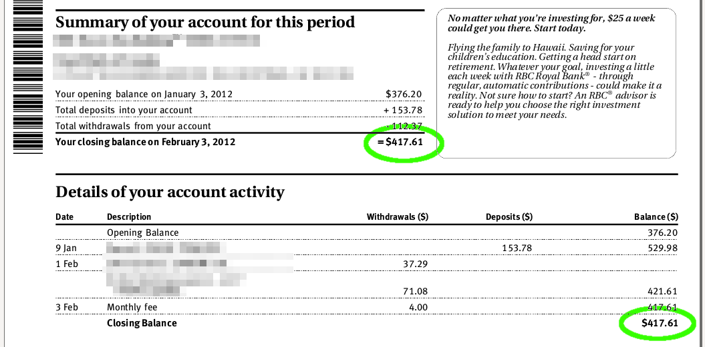

> 非官方中文译文 · 术语保留英文；代码、account、option、币种原样。
> 原文：https://beancount.github.io/docs/balance_assertions_in_beancount/

# Beancount 中的 Balance Assertions

Martin Blais，2014 年 7 月

[http://furius.ca/beancount/doc/proposal-balance](http://furius.ca/beancount/doc/proposal-balance)

*本文档总结了所有命令行记账系统中 balance assertion 的不同语义类型，并为 Beancount 中的总额和文件顺序 running assertion 提出了新的语法。*

> [动机](#motivation)
>
> [部分断言与完整断言](#partial-vs.-complete-assertions)
>
> [文件断言与日期断言](#file-vs.-date-assertions)
>
> [顺序与歧义](#ordering-ambiguity)
>
> [日内断言](#intra-day-assertions)
>
> [日初与日末](#beginning-vs.-end-of-day)
>
> [状态](#status)
>
> [提案](#proposal)
>
> [文件断言](#file-assertions)
>
> [完整断言](#complete-assertions)

## 动机

Beancount 和 Ledger 都实现了 *balance assertion*。它们为系统提供了检查点，可用于验证数据录入的完整性[^1]。

传统会计原则规定，用户永远不能更改过去——更正过去的错误需要通过插入新条目来撤销先前的错误[^2]——但我们命令行会计社区对此持异议：我们希望保留重建过去的能力，更重要的是，能够在原始数据录入处更正过去的错误。是的，我们是业余爱好者，但我们决心通过挑战现有概念来简化记账流程，并认为只要不破坏已知的 balance，这种做法是完全合理的。这些已知的 balance 正是我们通过 balance assertion 提供的。

从另一个角度来看，这些 balance assertion 仅仅是各种账户报表上报告的最终金额，如下图所示。

根据[此讨论串](https://groups.google.com/forum/#!topic/ledger-cli/vwkrPh74NFI)，我们确认在 Ledger (3.0) 和 Beancount (2.0b) 的当前版本中，对 balance assertion 存在不同的解释。

## 部分断言与完整断言

Beancount 中的 balance assertion 目前看起来像这样：

    2012-02-04 balance Assets:CA:Bank:Checking    417.61 CAD

该 directive 的含义是：“请断言 account ‘Assets:CA:Bank:Checking’ 在 2012 年 2 月 3 日结束时恰好包含 417.61 单位的 CAD”（因此日期标记为 4 日，因为在 Beancount 中 balance assertion 是在日期的开始处指定的）。它并未提及该 account 库存中的其他商品。例如，如果该 account 包含“USD”单位，则这些单位不会被检查。我们将这种解释称为**部分 balance assertion**或**单一商品断言**。

另一种断言是详尽的：“请断言 account ‘Assets:CA:Bank:Checking’ 在 2012 年 2 月 3 日结束时仅包含 417.61 单位的 CAD。”我们称之为**完整 balance assertion**。为了使这种第二种类型的断言生效，它必须支持指定库存的完整内容。目前尚不支持此功能。

此外请注意，我们并未断言库存的 cost basis，仅断言单位数量。

## 文件断言与日期断言

对于断言中的运行余额，存在两种不同的解释和实现方式：

-   Beancount 首先对所有 directive 进行排序，并在该 directive 日期的*开始*时刻验证余额。在之前的示例中，这意味着“*在 2012-02-04 的任何 transaction 应用之前的余额*”。我们将这种称为 **date assertions** 或 **date-based assertions**。

-   Ledger 在解析阶段维护每个 account 库存的运行余额，并在*文件中断言所在的位置*执行检查。我们将这种称为 **file assertions** 或 **file-order**，或 **file-based assertions**。这种断言没有关联的日期（这在 Ledger 中略显误导，因为断言的指定方式使其看起来像是附加在 transaction 的 posting 上，从而暗示它们发生在 transaction 日期，但实际上并非如此，它们严格地应用于文件位置）。

### 顺序与歧义

这两种断言类型之间的一个重要区别在于，file-based assertions 不是顺序无关的。例如，考虑以下输入文件：

    ;; Credit card account
    2014/05/01 opening
      Liabilities:CreditCard    $-1000.00
      Expenses:Opening-Balances

    2014/05/12 dinner
      Liabilities:CreditCard    $-74.20
      Expenses:Restaurant

    ;; Checking account
    2014/06/05 salary
      Assets:Checking            $4082.87
      Income:Salary

    2014/06/05 cc payment
      Assets:Checking            $-1074.20 = $3008.67
      Liabilities:CreditCard     = $0

如果你将信用卡付款移动到信用卡账户部分，同一组 transaction 将会失败：

    ;; Credit card account
    2014/05/01 opening
      Liabilities:CreditCard    $-1000.00
      Expenses:Opening-Balances

    2014/05/12 dinner
      Liabilities:CreditCard    $-74.20
      Expenses:Restaurant

    2014/06/05 cc payment
      Assets:Checking            $-1074.20 = $3008.67
      Liabilities:CreditCard     = $0

    ;; Checking account
    2014/06/05 salary
      Assets:Checking            $4082.87
      Income:Salary

这个微妙的问题可能让初学者难以理解。将 file assertion 移动到其自身无日期的 directive 中，可能是更能体现其语义的语法，看起来可能像这样：

    balance Assets:Checking = $3008.67

缺少日期表明该检查不是在特定时间点应用的。

### 日内断言

另一方面，date-based assertions 由于其顺序无关性，排除了日内断言，即在同一 account 的同一天的两个 posting *之间*发生的 balance assertion。

Beancount 目前不支持日内断言。

尽管存在这一不足，但这并没有造成太大问题，因为通常可以通过添加或减少一天来调整必要的日期，或者在不可能时直接跳过断言（跳过断言不是大问题，因为它们是可选的，其目的仅仅是提供确定性。只要有一个出现在被跳过断言之后的日期的断言，这就不是大问题）。

然而，为 date-based assertions 找到日内断言的解决方案将是很好的。一个有趣的想法是扩展语义，在平衡检查之前和之后直接发生的所有 transaction 集合中，按照文件顺序应用余额，这些 transaction 必须与平衡检查发生在同一日期。例如，这将平衡：

    2013-05-05 balance Assets:Checking    100 USD

    2013-05-20 * "Interest payment"
      Assets:Checking           12.01 USD
      Income:Interest

    2013-05-20 balance Assets:Checking    112.01 USD

    2013-05-20 * "Check deposit"
      Assets:Checking           731.73 USD
      Assets:Receivable

一旦某个 directive 出现在不同的日期，这种“魔法”就会失效。

另一个想法是始终将 balance assertions 按文件顺序作为第二个排序键（在日期之后）进行排序，并据此应用它们。不过我不确定这是否容易理解。

### 日初与日末

最后，为了完整性，值得一提的是，date assertions 必须具有关于它们在一天中*何时*应用的明确定义的语义。在 Beancount 中，它们目前应用于日初。

提供一种在日末应用的 date-based assertions 的替代版本可能很有价值，例如 “balance\_end”。Beancount v1 曾经有过这个（“check\_end”），但在 v2 重写中被移除了，因为不清楚它是否真的需要。balance assertions 具有单一含义的简洁性也是很好的。

## 状态

[Ledger](http://ledger-cli.org) 3.0 目前仅支持针对 transaction 的部分文件顺序 balance assertion。

[Beancount](http://furius.ca/beancount/) 2.0 目前仅支持在一天开始时的部分基于日期的 balance assertion。

## 提案

我提议对 Beancount 的 balance assertion 进行以下改进。

### 文件断言

文件断言应通过插件提供。其形式如下：

    2012-02-03 file_balance Assets:CA:Bank:Checking    417.61 CAD

理想情况下，为了明确它们严格遵循文件顺序，它们不应包含日期，形式如下：

    file_balance Assets:CA:Bank:Checking    417.61 CAD

但这破坏了所有其他 directive 语法的规律性。它还会使原本非常规律且简单的解析器变得更加复杂……*所有*其他 directive 都以日期和一个单词开头，而其他所有行基本上都被忽略。这将是一种偏离。最后，保留一个日期仍然很有用，以便将这些 directive 插入到渲染后的日志中的某个位置。因此，我正在考虑为其保留日期。如果你决定使用这些特殊的断言，你应该知道它们的含义。

我也不喜欢将断言附加到 transaction 上的想法；transaction 语法已经足够复杂，它应该保持简单。这应该是一个很少有人使用的独立 directive。

为了实现这一点，插件只需根据文件位置（使用条目的 `fileloc` 属性）对所有 directive 进行重新排序，忽略日期，并在应用检查时从上到下重新计算 running balances。这可以完全通过后处理来完成，就像基于日期的断言一样，而不会干扰任何其他处理。

此外，在插件中实现此功能的另一个优势是，不使用该 directive 的人无需承担计算这些库存的成本。

### 完整断言

完整断言应通过当前的 balance assertion directive 在 Beancount 中得到支持。它们并不非常重要，但可能有用。

可能的语法想法：

    2012-02-03 balance* Assets:CA:Bank:Checking        417.61 CAD, 162 USD

    2012-02-03 balance Assets:CA:Bank:Checking       = 417.61 CAD, 162 USD

    2012-02-03 balance full Assets:CA:Bank:Checking    417.61 CAD, 162 USD

    2012-02-03 balance 
      Assets:CA:Bank:Checking    417.61 CAD
      Assets:CA:Bank:Checking       162 USD

我仍未决定哪种最好。目前看来这似乎是一个口味问题。

## 用户评论

Red S - 2015 年 12 月 16 日

多商品的部分断言可能也很有用。例如，"<date> balance <account> 0 USD,CAD,AAPL"。在这种情况下，如果账户拥有五种商品，我们可能会明确指定前两种的非零余额，然后使用上述符号指定其余的零余额。您怎么看？

Martin Blais - 2015 年 12 月 17 日

> 两点评论：
>
> \- 单个数字 + 商品列表的语法与当前语法中的其他任何内容都不同。包含它感觉有点格格不入且不一致。
>
> \- 我认为这可以用多行轻松复现。
>
> 我需要对此进行更多思考，以彻底理清这个问题。

谢谢，

Red S - 2015 年 12 月 17 日

> 确实，理论上可以用多行复现，但正如我昨天在导入一个旧账户时发现的，即使只有大约 15 种商品，这也很快就会变得繁琐。
>
> 关于语法也是真的，尽管接受商品列表的 open directive 的语法很接近。

Martin Blais - 2015 年 12 月 17 日

确实，我之前没考虑到那一点。

关于在文件中保留 balance assertion 的日期：

Anonymous - 2014 年 7 月 13 日

> 我对此持异议：具体语法对于我们要使用/设计的工具类型来说太重要了，不能具有误导性。如果必须有一个日期，它应该被使用且有意义。如果我们试图表达的内容在语义层面上不需要日期，那么其具体语法就不应该包含日期。
>
> 如果要求日期的唯一原因是其他所有 directive 都有日期，那么我们应该推广我们对 directive 概念的理解，从“以日期开始的东西”变为“具有可选起始日期的东西”。
>
> — Zack

Martin Blais - 2014 年 7 月 13 日

观点已收到。仍然不确定。我愿意在这里做出例外的原因是，那将是唯一一种不需要日期的 directive。另一方面，如果我在解析时处理这些 directive——由于 interpolation 即将发生的变更，我无法这样做——没有日期就清楚地表明它不是一个 directive，而是一个特殊的解析器命令，如 option 和 pushtag/poptag。

Martin Blais - 2014 年 7 月 13 日

支持为文件断言添加日期的另一个原因是，它们随后可以显示在条目日志中。您可能没有使用过 Beancount 并注意到我在日志中渲染 balance 条目。如果文件断言没有日期，我就没有地方放置它们。我想我可以使用前一个在文件顺序中对该账户有 posting 的 transaction 的日期，但这对我来说似乎相当隐晦。或者我可以决定根本不渲染它们。

[^1]: 据我们所知，输入明确预期金额的概念是命令行会计系统所独有的。其他系统通过冻结过去的变更来进行“对账”。

[^2]: 这有几个原因。首先，在计算机出现之前，会计是使用账簿进行的，手动重新计算累计余额将涉及对账簿进行多次烦人的更正。这一定非常不方便，而在当前时间插入更正条目要容易得多。其次，如果您的会计余额用于报税，追溯更改某些余额会使在审计情况下回溯检查报告金额的详细信息变得困难。这个问题也适用于我们的上下文，但是是否允许过去的更正是一个取决于上下文和特定账户的选择，我们将其留给用户决定是否应该允许。

---

> **版权与许可**：原文 © Martin Blais / beancount/docs contributors，MIT License。中文翻译为非官方 derivative work，仅供个人学习；详见 [NOTICE.md](../NOTICE.md)。
