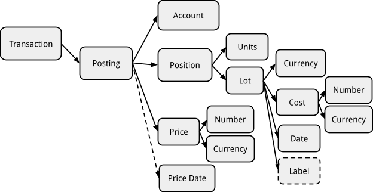

> 非官方中文译文 · 术语保留英文；代码、account、option、币种原样。
> 原文：https://beancount.github.io/docs/beancount_query_language/

# Beancount 查询语言

Martin Blais，2015 年 1 月

[http://furius.ca/beancount/doc/query](http://furius.ca/beancount/doc/query)

## 简介

Beancount 的目的是允许用户创建准确且无错误的财务 transaction 表示，通常这些 transaction 发生在用户或机构关联的一组 account 中，然后从这些 transaction 列表中提取各种 report。Beancount 提供了一些工具来从 transaction 语料库中提取 report：自定义 report（使用 Beancount `bean-report` 工具）、Web 界面（使用 `bean-web` 工具）以及用户编写自己的脚本以输出任何所需内容的功能。

财务 transaction 库始终从文本文件输入中读取，但一旦解析并加载到内存中，从 Beancount 中提取信息就可以像操作其他数据库一样进行，也就是说，可以使用查询语言在相对规整的 transaction 列表上进行编译和执行，而不是使用自定义代码从数据结构中生成输出。

在实践中，你可以将 posting 列表展平到外部 SQL 数据库，并使用该数据库自身的工具进行查询，但这种方法的结果相当令人失望，主要原因是缺乏对 inventory 的操作，而 inventory 是 Beancount 中平衡规则的基础。通过提供一个利用复式记账 transaction 结构的略微专业化的查询引擎，我们可以轻松生成特定于会计目的的自定义 report。

本文档描述了我们专门的类 SQL 查询客户端。它假设你至少对 [SQL](http://en.wikipedia.org/wiki/SQL) 语法有基本的了解。如果没有，你可能想先阅读一些关于它的 [内容](http://www.amazon.com/Practical-SQL-Handbook-Using-Variants/dp/0201703092/) [资料](http://www.w3schools.com/sql/)。

## 动机

那么人们可能会问：为什么要创建另一个 SQL 客户端？为什么不将数据输出到 SQLite 数据库，然后让用户使用现有的 SQL 客户端呢？

实际上，我们已经尝试过（参见将 Beancount 账本转换为 SQLite 数据库的 [bean-sql](https://github.com/beancount/beancount/tree/v2/beancount/scripts/sql.py) 脚本），但效果并不理想。编写查询非常痛苦，而对以 cost 持有的 lot 执行操作也很困难。通过利用我们内存数据结构的一些特性，我们可以做得更好。因此，Beancount 自带了一个名为“[bean-query](https://github.com/beancount/beanquery)”的类 SQL 查询客户端。

该客户端实现了以下对 Beancount 至关重要的“扩展”功能：

-   它允许同时在两个层级上进行过滤：你可以过滤整个 transaction，这有助于保持会计等式的完整性；然后，通常出于展示目的，你还可以在 posting 层级上进行过滤。

-   该客户端支持 Beancount 中实现的库存 booking 语义。它还支持对库存对象进行聚合函数操作以及渲染函数（例如，使用 COST() 来渲染库存的 cost，而不是其内容）。

-   该客户端允许你将多个 lot 展平为独立的 posting，从而生成持有列表，每个条目都带有其相关的 cost basis。

-   Transaction 可以以有助于生成资产负债表和损益表的方式进行汇总。例如，我们的 SQL 变体明确支持一种“close”操作，其效果类似于年度结账，该操作会插入 transaction 以将损益表账户清零至权益，并移除过去的历史记录。

另请参阅 [这篇帖子](https://groups.google.com/d/msg/beancount/ZYsPCXt_fQo/NdCdgjbhEgAJ) 以获取类似的解答。

## 警告与注意事项

在 2014 年底，查询语言实现了 [原始设计文档](http://furius.ca/beancount/doc/proposal-query) 中约 70% 的期望功能。要覆盖完整的功能集还需要更多工作，但当前版本已支持 Ledger 所涵盖的大多数用例，我推测也适用于 Beancount 用户。在继续推进之前，希望就当前版本获得更多反馈；在将更多时间投入查询语言之前，我希望先着手改进 Beancount 的一些更基础方面（即 inventory booking）。当前版本已经可用，但稍后将基于用户反馈和长期使用经验进行第二次修订。

因此，查询语言的首个版本已合并到默认的 stable 分支中。本文档介绍了 Beancount 查询语言的这一首次迭代。

## 执行查询

我们提供的自定义查询客户端名为 `bean-query`。在您的账本文件上运行它，方式如下：

    $ bean-query myfile.beancount
    Input file: "My Ledger’s Title"
    Ready with 13996 directives (21112 postings in 8833 transactions).
    beancount> _

这将以交互模式启动查询工具，您可以在加载到内存的数据集上输入多条命令。`bean-query` 会解析输入文件，输出一些关于您账本的基本统计信息，并提供一个命令提示符供您输入查询命令。您可以在此处输入 “`help`” 来查看可用命令列表。

如果您的账本中存在任何错误，它们会在提示符之前打印出来。若要抑制错误打印，请使用 “no-errors” 选项运行该工具：

    $ bean-query -q myfile.beancount

### 批处理模式查询

如果您希望直接从命令行运行查询，而不使用交互式提示符，可以在文件名后直接提供查询语句：

    $ bean-query myfile.beancount 'balances from year = 2014'
                         account                       balance
    ----------------------------------------------------------------------
    … <balances follow> … 

### 支持所有交互式命令。

### Shell 变量

交互式 shell 有几个 “`set`” 变量，您可以自定义它们以更改 shell 的某些行为。这些类似于环境变量。输入 “`set`” 命令可查看可用变量列表及其当前值。

这些变量包括：

-   format (string)：输出格式。目前仅支持 “text”。

-   boxed (boolean)：是否应在输出表格周围绘制边框。

-   spaced (boolean)：是否应在每行结果之间插入一个空行。这仅在包含多个 lot 的 posting 可能需要多行渲染时才相关，插入空行有助于将它们区分为独立项。

-   pager (string)：当输出大于屏幕时，用于将多页输出管道传输的 pager 程序名称。初始值从 PAGER 环境变量复制而来。

-   expand (boolean)：如果为 true，则展开渲染为多行列表的列。

## transaction 与 posting 

transaction 和 posting 的结构可以通过以下简化图示来说明：

## 

账本的内容被解析为一系列 directive，其中大多数是包含两个或更多 “Posting” 对象的 “Transaction” 对象。Posting 始终仅链接到单个 transaction（它们绝不在多个 transaction 之间共享）。每个 posting 都引用其父级 transaction，但拥有唯一的 account 名称、金额以及关联的 lot（可能带有 cost）、price 和其他一些属性。父级 transaction 本身也包含一些有用的属性，例如日期、收款人名称、narration 字符串、flag、links、tags 等。

如果我们忽略除 transactions 之外的其他 directive 列表，可以将数据集视为所有 postings 与其父级 transaction 连接而成的单张表。我们主要希望在这张 postings 连接表上执行过滤和聚合操作。

然而，由于复式记账的约束，即附加于某个 transaction 的 postings 金额之和为零，在 transaction 级别执行过滤操作也非常有用。因为任何孤立的 transaction 对全局余额的总影响为零，所以任何 transaction 子集也将遵循会计等式（Assets + Liabilities + Equity + Income + Expenses = 0），并且基于 transaction 子集生成的资产负债表和损益表提供了有意义的视图，例如“在巴哈马旅行期间发生的所有资产变动和费用”，这可以通过一个 tag 来选择。

因此，我们修改了 SQL SELECT 语法，以提供两级过滤语法：由于我们只有一张数据表，我们将 FROM 中的表名替换为应用于 transactions 的过滤表达式，而 WHERE 子句则应用于从生成的 postings 列表中获取的数据：

    SELECT <target1>, <target2>, …
    FROM <entry-filter-expression>
    WHERE <posting-filter-expression>;

这两个过滤表达式都是可选的。如果未提供过滤表达式，将枚举所有 postings。请注意，由于 transactions 始终按日期顺序过滤，结果默认将按此顺序进行处理和返回。

### posting 数据列 

目标列表指的是 posting 或其父级 transaction 的属性。相同的“列”列表也可在 *&lt;posting-filter-expression&gt;* 中使用，以便根据 posting 属性进行过滤。例如，你可以编写如下查询：

    SELECT date, narration, account, position 
    WHERE account ~ “.*:Vacation” AND year >= 2014;

在此处，“date”、“year” 和 “narration” 列指的是父级 transaction 的属性，而 “account” 和 “position” 列指的是 posting 本身的属性。

你可以使用熟悉的 AS 运算符显式命名目标：

    SELECT last(date) as last_date, cost(sum(position)) as cost;

要查看可用的 posting 列及其函数的完整列表，最好通过在你的实际客户端中使用 “`help targets`“ 或 “`help where`” 进行查询，这会打印出每个可用数据列的列表和数据类型。你还可以参考以下 Posting 对象结构的图表，以了解列与数据结构属性之间的对应关系。

### entry 数据列 

在 `FROM` 子句的 *&lt;entry-filter-expression&gt;* 中，可以使用另一组列名。这些列引用 Transaction 对象的属性。该子句旨在过滤完整的 transaction（即要么包含其所有 posting，要么完全排除）。可用的属性包括日期、transaction 标志、可选的 payee、narration、tags 和 links 集合。使用 “`help from`” 命令可以查找该子句中可用的完整列和函数列表。

Beancount 输入文件由许多不同类型的条目组成，不仅仅是 transaction。其中一些其他类型的条目（例如 Open、Close、Balance 等）也可能提供可以从 `FROM` 子句访问的属性。目前这一功能还处于萌芽阶段。（目前尚不清楚这些属性未来将如何使用，但我相信我们最终会发现一些有趣的应用场景。`FROM` 子句通过列 “`type`” 提供对数据条目类型的访问。我们仍在探索如何更务实地利用 SQL 语言来处理其他类型的 directive。）

**“id” 列**

存在一个特殊的列，用于唯一标识每个 transaction：“`id`”。它是从 transaction 自动计算得出的唯一哈希值，并且在多次运行之间应保持稳定。

    SELECT DISTINCT id;

此哈希值派生自 transaction 对象本身的内容（如果你更改了 transaction 的某些内容，例如编辑了 narration，id 将会改变）。

你可以打印和选择使用此列。它可以用于调试，例如：

    PRINT FROM id = '8e7c47250d040ae2b85de580dd4f5c2a';

**“balance” 列**

一种常见的期望输出是按时间顺序的条目日志（在 Ledger 中也被称为 “register”）：

    SELECT date, account, position WHERE account ~ "Chase:Slate";

对于这种类型的 report，同时渲染所选 posting 行的累计 balance 列会非常方便。访问前一行不是标准 SQL 功能，因此我们进行了一些创新，提供了一个名为 “`balance`” 的特殊列，它基于之前选定的行自动计算：

    SELECT date, account, position, balance WHERE account ~ "Chase:Slate";

这提供了渲染典型账户对账单的能力，例如银行邮寄给你的对账单。输出可能如下所示：

    $ bean-query $T "select date, account, position, balance where account ~ 'Expenses:Food:Restaurant';"
       date            account          position   balance  
    ---------- ------------------------ --------- ----------
    2012-01-02 Expenses:Food:Restaurant 31.02 USD  31.02 USD
    2012-01-04 Expenses:Food:Restaurant 25.33 USD  56.35 USD
    2012-01-08 Expenses:Food:Restaurant 67.88 USD 124.23 USD
    2012-01-09 Expenses:Food:Restaurant 35.28 USD 159.51 USD
    2012-01-14 Expenses:Food:Restaurant 25.84 USD 185.35 USD
    2012-01-17 Expenses:Food:Restaurant 36.73 USD 222.08 USD
    2012-01-21 Expenses:Food:Restaurant 28.11 USD 250.19 USD
    2012-01-22 Expenses:Food:Restaurant 21.12 USD 271.31 USD

### 通配符目标

使用通配符作为目标列表（“\*”）可以选择一组良好的默认列：

    SELECT * FROM year = 2014;

要查看实际选择的列列表，可以使用 EXPLAIN 前缀：

    EXPLAIN SELECT * FROM year = 2014;

## 数据类型

从 posting 或 transaction 中提取的数据属性具有特定的类型。大多数数据类型是底层 Python 实现语言提供的常规类型，例如：

-   字符串（Python str）

-   日期（datetime.date 实例）。日期以 `YYYY-MM-DD` 格式输入：`SELECT * WHERE date < 2024-05-20`..

-   整数（Python int）

-   布尔值（Python bool 对象），如 `TRUE`、`FALSE`

-   数值（decimal.Decimal 对象）

-   字符串集合（Python str 对象的 set）

-   空对象（`NULL`）

### 持仓与库存

然而，我们之所以存在这个类 SQL 客户端，一个主要原因是它能够对持仓库存执行聚合操作。持仓库存是 Beancount 的核心数据结构，实现了其平衡语义。在内部，Beancount 定义了 [Position](https://github.com/beancount/beancount/tree/master/beancount/core/position.py) 和 [Inventory](https://github.com/beancount/beancount/tree/master/beancount/core/inventory.py) 对象，并能够在 Inventory 实例中将它们聚合在一起。对于每个 Posting，“position” 列会提取一个 Position 类型的对象，当对这些对象求和时，会产生一个 Inventory 实例。

Shell 能够适当地显示这些对象。更具体地说，Inventory 对象可以包含多个不同的 lot 持仓，其中每一个都会单独渲染在一行上。

### 持仓与库存的数量

Position 类型的对象默认以完整细节渲染，不仅包括其数量和货币，还包括其 lot 的详细信息。Inventory 由 lot 列表组成，因此也以类似方式渲染，作为持仓列表（每行一个），默认情况下每个持仓都带有完整细节。这通常细节过多。

Shell 提供了函数，允许用户将持仓汇总为各种派生数量之一。派生数量的类型包括：

-   “`raw`”：以完整细节渲染持仓，包括 cost 和 lot 日期

-   “`units`”：仅渲染持仓的数量和货币

-   “`cost`”：渲染持仓的总 cost，即单位数量 x 单位 cost

-   “`weight`”：渲染用于平衡 transaction 的 posting 的金额。cost 和 weight 之间的主要区别在于带有 price 转换的 posting。

-   “`value`”：渲染按最后渲染条目的 market value 计算的金额。

具有相同名称的函数可用于操作 position 或 inventory 对象。例如，可以像这样生成每个 account 的最终余额表：

    SELECT account, units(sum(position)), cost(sum(position)) GROUP BY 1;

请参阅下表，了解每种类型 posting 的明确示例及其转换和渲染方式。

<table><thead><tr class="header"><th><strong>posting</strong></th><th><strong>raw (full detail)</strong></th><th><strong>units</strong></th><th><strong>cost</strong></th><th><strong>weight</strong></th><th><strong>market</strong></th></tr></thead><tbody><tr class="odd"><td><strong>Simple</strong></td><td>50.00 USD</td><td>50.00 USD</td><td>50.00 USD</td><td>50.00 USD</td><td>50.00 USD</td></tr><tr class="even"><td><strong>With Price Conversion</strong></td><td>50.00 USD @ 1.35 CAD</td><td>50.00 USD</td><td>50.00 USD</td><td>67.50 CAD</td><td>50.00 USD</td></tr><tr class="odd"><td><strong>Held at Cost</strong></td><td>50 VEA {1.35 CAD}</td><td>50 VEA</td><td>67.50 CAD</td><td>67.50 CAD</td><td>67.50 CAD</td></tr><tr class="even"><td><strong>Held at Cost with Price</strong></td><td>50 VEA {1.35 CAD} @ 1.45 CAD</td><td>50 VEA</td><td>67.50 CAD</td><td>67.50 CAD</td><td>72.50 CAD</td></tr></tbody></table>

## 运算符 

提供了常见的比较和逻辑运算符，用于操作可用的数据列：

-   = (相等), != (不相等)

-   < (小于), <= (小于或等于)

-   > (大于), >= (大于或等于)

-   AND (逻辑与)

-   OR (逻辑或)

-   NOT (逻辑非)

-   IN (集合成员)

我们还提供了一个用于字符串对象的正则表达式搜索运算符：

-   ~ (搜索正则表达式)

目前，匹配组会被忽略。

你可以使用字符串、数字和整数常量与这些运算符一起使用，并使用括号来明确指定优先级。

下面是一个使用其中几个运算符的查询示例：

    SELECT date, payee 
    WHERE account ~ 'Expenses:Food:Restaurant' 
      AND 'trip-new-york' IN tags
      AND NOT payee = 'Uncle Boons'

与 SQL 不同，bean-query 没有为 `NULL` 实现 [三值逻辑](https://www.postgresql.org/docs/9.6/static/functions-logical.html)。这意味着例如表达式 `NULL = NULL` 会返回 `TRUE` 而不是 `NULL`，这简化了事情，但可能会让资深 SQL 用户感到意外。

## 简单函数

Shell 提供了一组简单函数，它们作用于单个数据列并返回一个新值。这些函数针对特定类型进行操作。Shell 实现了基本的类型验证，并应能在类型不兼容时发出警告。

以下是一些示例函数：

-   COST(Inventory), COST(Position)：返回一个 Amount，即该 position 或 inventory 的 cost。

<!-- -->

-   UNITS(Inventory), UNITS(Position)：返回该 position 或 inventory 的 units。

-   DAY(date), MONTH(date), YEAR(date)：返回一个整数，即 posting 或 entry 日期的日、月或年。

-   LENGTH(list)：计算列表或集合的长度，例如针对 tags。

-   PARENT(account-string)：返回父 account 的名称。

这些只是示例；完整列表请参阅“`help targets`”、“`help where`”、“`help from`”。

请注意，向此列表添加新函数是[极其容易的](https://github.com/beancount/beancount/tree/master/beancount/query/query_env.py)。截至 2014 年 12 月，我们刚刚开始广泛使用 shell，并预计会根据需要添加新函数。如果你需要某个函数，请在此处添加评论或提交一个 ticket，我们将考虑将其添加到列表中（我们理解当前的列表是有限的）。我打算在添加新函数方面保持宽松态度；只要它们具有通用性，我认为这不应该是个问题。否则，我可能能够提供一个机制，允许用户将新函数注册为 Python 插件的一部分，这些插件可以存在于 Beancount 代码库之外。

## 聚合函数

某些函数作用于多于一行的数据。这些函数会对它们所操作的数据列中的多个值进行聚合和汇总。此类函数的典型用法是对库存中的持仓进行求和：

    SELECT account, sum(position) WHERE account ~ 'Income' GROUP BY account;

如果查询目标包含至少一个聚合函数，该查询即成为聚合查询（详见相关章节）。请注意，您不能在 `FROM` 或 `WHERE` 子句中使用聚合函数。

聚合函数的示例包括：

-   COUNT(...)：计算选中的 posting 数量（一个整数）。

-   FIRST(...)、LAST(...)：返回所见到的第一个或最后一个值。

-   MIN(...)、MAX(...)：计算所见到的最小值或最大值。

-   SUM(...)：对每组值进行求和。这适用于金额、持仓、库存、数字等。

与简单函数一样，这只是一个起始列表。我们将根据需要添加更多函数。使用“`help targets`”可访问所有可用的聚合函数列表。

注意：您无法使用 `WHERE` 子句对聚合函数的结果进行过滤；这需要实现提供 `HAVING` 子句，而目前尚未实现 HAVING 过滤。

## 简单查询与聚合查询

查询分为两种类型：

-   **简单查询**，为 WHERE 子句中 restricts 匹配的每个 posting 生成一行结果。

-   **聚合查询**，为 WHERE 子句中 restricts 匹配的每个 posting *组* 生成一行结果。

如果查询的目标列表中包含至少一个聚合函数，则该查询被视为“聚合”查询。为了确定聚合键，必须使用 GROUP BY 子句标记所有非聚合列，例如：

    SELECT payee, account, COST(SUM(position)), LAST(date) 
    GROUP BY payee, account;

你也可以使用目标的顺序位置来声明分组键，例如：

    SELECT payee, account, COST(SUM(position)), LAST(date) 
    GROUP BY 1, 2;

此外，如果你为目标命名，也可以使用显式的目标名称：

    SELECT payee, account as acc, COST(SUM(position)), LAST(date) 
    GROUP BY 1, acc;

如果你具备 SQL 的基础知识，这些内容应该会让你感到熟悉。

最后，由于我们实现的是 SQL 的一个有限版本，且简单列必须始终被指定，省略 GROUP BY 子句最终也应该有效，并且我们应该隐式地按这些列进行分组，作为一种便利。

### distinct 

存在一个后过滤阶段，支持对结果行进行去重。你可以在 `SELECT` 之后使用 `DISTINCT` 标志来触发此唯一性过滤器，这在 SQL 中很常见，例如：

    SELECT DISTINCT account;

## 控制结果

### 排序

与 GROUP BY 子句类似，ORDER BY 子句用于控制结果行的最终排序：

    SELECT …
    GROUP BY account, payee
    ORDER BY payee, date;

该子句是可选的。如果未指定，则使用所选 posting 的默认迭代顺序来输出结果（即按日期排序的 transaction 顺序，然后是它们的 posting）。

与 SQL 一样，您可以通过添加 `DESC` 后缀来反转排序顺序（默认等同于指定 `ASC`）：

    SELECT …
    GROUP BY account, payee
    ORDER BY payee, date DESC;

### 限制

我们的查询语言还支持 LIMIT 子句，以中断输出行的生成：

    SELECT … LIMIT 100;

这将输出前 100 行结果，然后停止。虽然这是 SQL 语言中常见的子句，但在复式记账的语境下，它的实用性不高：我们处理的数据集通常相对较小。尽管如此，为了完整性，我们仍然提供了它。

### 格式

对于 `SELECT`、`JOURNAL` 和 `BALANCES` 查询，默认的输出格式是文本表格。我们支持 CSV 输出。（*我们可以轻松添加对 XLS 或 Google Sheets 输出的支持。*）

然而，对于 `PRINT` 查询，输出格式是 Beancount 输入文本格式。

## 语句运算符

Shell 提供了一些旨在方便生成资产负债表和利润表的运算符。用于定义这些操作的特定方法应在随 Beancount 提供的“[复式记账入门](the-double-entry-counting-method.md)”文档中进行了详细描述，并且主要位于源代码中的 [summarize](https://github.com/beancount/beancount/tree/master/beancount/ops/summarize.py) 模块中。

这些特殊运算符在 Shell 中各种查询命令形式可用的 `FROM` 子句上提供。它们进一步在 transaction 级别（而非 posting 级别）转换由 `FROM` 表达式选定的条目集合。

请注意，这些并非来自标准 SQL；它们仅是由该 Shell 语言提供的扩展。

### 开启期间

在特定日期开启一个练习期间，会用汇总条目替换该日期之前的所有条目。这些汇总条目会将预期余额记录到权益类的“期初余额”账户中，并通过将其余额转移到权益类的“以前年度损益”账户，隐式地将收入和费用清零（实现细节参见 beancount.ops.summarize.open()）。

调用方式如下：

    SELECT … FROM <expression> OPEN ON <date> …

例如：

    SELECT * FROM has_account("Invest") OPEN ON 2014-01-01;

如果需要，可以像这样仅查看插入的汇总条目：

    PRINT FROM flag = "S" AND account ~ "Invest" OPEN ON 2014-01-01;

### 关闭期间

关闭一个练习期间主要涉及截断所有位于给定日期*之后*的条目，并确保货币转换得到正确修正（有关实现细节，请参阅 beancount.ops.summarize.close()）。

其调用方式如下：

    SELECT … FROM <expression> CLOSE [ON <date>] …

例如：

    SELECT * FROM has_account("Invest") CLOSE ON 2015-04-01;

请注意，关闭日期应为您希望包含的最后一笔 transaction 日期之后的一天（这符合我们在 Beancount 中各处使用的约定，即起始日期包含在内，而结束日期不包含在内）。

关闭日期是可选的。如果未指定日期，则使用最后一条条目日期之后的一天。

关闭期间会保持 Income 和 Expenses 账户原样，即不会将其余额清零至 Equity。这是因为关闭操作也用于生成损益表的最终余额。如下一节所述，“清零”操作仅适用于资产负债表。

### 结转损益

为了生成资产负债表，我们需要将 Income 和 Expenses 的最终余额转移到一个 Equity “current earnings” 账户（有时也称为 “retained earnings” 或 “net income”；你可以使用输入文件中的选项来选择要使用的具体账户名称）。损益表账户的 resulting balances 应为零（有关实现细节，请参阅 `beancount.ops.summarize.clear()`）。

你可以这样进行结转：

    SELECT … FROM <expression> CLEAR …

例如：

    SELECT * FROM has_account("Invest") CLOSE ON 2015-04-01 CLEAR;

这是一条适合生成账户列表以构建资产负债表的语句。“`Equity:Earnings:Current`”（默认情况下）将包含前一个期间累积的 net income。输出中不应出现 Income 或 Expenses 账户的余额。

### 示例语句

语句运算符当然可以组合使用。例如，如果你想输出 2013 年的损益表数据，可以发出以下语句：

    SELECT account, sum(position) 
    FROM OPEN ON 2013-01-01 CLOSE ON 2014-01-01
    WHERE account ~ "Income|Expenses"
    GROUP BY 1
    ORDER BY 1;

这将生成 Income 和 Expenses 账户的余额列表。

要生成资产负债表，你需要添加 CLEAR 选项并选择其他账户：

    SELECT account, sum(position) 
    FROM OPEN ON 2013-01-01 CLOSE ON 2014-01-01 CLEAR
    WHERE not account ~ "Income|Expenses"
    GROUP BY 1
    ORDER BY 1;

请注意，如果你将 CLEAR 运算符添加到损益表账户的语句中，由于在期末插入的将余额移至 Equity net income 账户的 transaction，所有余额都将显示为零。

值得注意的是，上述示例并未对 transaction 进行进一步过滤。如果你正在选择 transaction 的子集，你可能希望保持账户未打开、未关闭且未清除，因为仅将部分 transaction 应用于 Assets 和 Liabilities 账户的期初余额，不会为这些账户产生正确的余额。更有用的做法是让所有账户保持打开状态，并将资产负债表账户的余额解释为所选 transaction 子集中这些账户的*变化*。例如，如果你选择了一次旅行中的所有 transaction（使用标签），你将获得一个标记为包含在此旅行中的 Expenses（以及可能的 Income）变化列表，而 Assets 和 Liabilities 账户将显示这些 Expenses 的资金来源。

请参阅“复式记账法入门”文档以获取此内容的图示表示。（当然，这也许值得专门写一篇文档，我可能会在某个时候编写一篇。）

### 示例：获取成本基础

*“……目前有没有一种简单的方法来确定我在特定日期某个账户的 cost basis（除了手动将每笔贡献的 UNITS * COST 相加，这有点麻烦）？我正在尝试估算潜在股票销售的税务影响。” \[来自 Matthew Harris 的问题\]*

关于股份变动的详细 report：

    SELECT account, currency, position, COST(position) 
    WHERE year <= 2015 
      AND account ~ "Assets:US:Schwab"
      AND currency != "USD"

或者使用此查询获取 cost basis 的总和：

    SELECT sum(cost(position)) 
    WHERE year <= 2015 
      AND account ~ "Assets:US:Schwab" 
      AND currency != "USD"

## 高级快捷方式

对于会计应用程序而言，有两类非常常见的查询：日记账（journals）和余额（balances）报告。虽然我们可以使用 `bean-report` 工具生成此类报告的显式实现，但我们也能够使用 `SELECT` 语句合成此类报告的良好近似值。本节介绍了一些额外的选择命令，它们可以直接转换为 `SELECT` 语句，然后使用相同的查询代码运行。这些旨在作为便捷的快捷方式。

### 选择日记账

一种常见的查询类型是生成条目的线性日记账（Ledger 将其称为“register”）。这大致对应于账户对账单，但使用我们的语言，可以为任何 posting 子集生成这样的对账单。

你可以使用以下语法生成日记账：

    JOURNAL <account-regexp> [AT <function>] [FROM …]

正则表达式 *account-regexp* 用于选择要为哪些账户子集生成日记账。可选的 “AT *&lt;function&gt;*” 子句用于指定渲染金额的聚合函数（通常是 `UNITS` 或 `COST`）。`FROM` 子句遵循与 `SELECT` 语句相同的规则，并且是可选的。

以下是一个生成日记账的查询示例：

    JOURNAL "Invest" AT COST FROM HAS_ACCOUNT("Assets:US");

### 选择余额

另一种最常见的报告类型是特定日期下各个账户余额的表格。这可以被视为一个 `SELECT` 查询，按 account 分组聚合头寸。

你可以使用以下语法生成余额报告：

    BALANCES [AT <function>] [FROM …]

可选的 “AT *&lt;function&gt;*” 子句用于指定渲染余额的聚合函数（通常是 `UNITS` 或 `COST`）。`FROM` 子句遵循与 `SELECT` 语句相同的规则，并且是可选的。

要在特定日期生成你的余额，请使用上述描述的 “`FROM… CLOSE ON`” 形式来关闭你的条目集合。

请注意，在会计背景下看到的典型资产负债表和损益表是此类查询报告的余额表的子集。损益表仅报告在一段时间内出现的 transaction，而资产负债表总结其报告日期之前的 transaction，并将该期间累积的收入和费用清除到一个权益账户中。然后进行一些次要的重新格式化。有关更多详细信息，请参阅关于复式记账的介绍文档，以及上面讨论 “open”、“close” 和 “clear” 操作的章节。

我们还将提供一个独立的文本处理工具，它可以接受余额报告并将其重新格式化为类似于你在资产负债表和损益表中看到的两列格式。

### 打印

生成 Beancount 格式的输出可能很有用，例如，以便将 transaction 子集保存到文件中。Shell 通过 `PRINT` 命令提供此功能：

    PRINT [FROM …]

FROM 子句遵循本文档其他地方描述的通常语义。然后，过滤后的 Beancount 条目流将以 Beancount 语法打印到输出中。

特别是，仅运行 “`PRINT`” 命令就会输出 Beancount 文件的解析和加载内容。如果需要，你可以使用它进行故障排除，或者展开你正在开发的插件生成的 transaction。

## 调试与 explain 

如果你在编译和运行某个特定语句时遇到困难，可以在任何查询语句前加上 `EXPLAIN` 修饰符，例如：

    EXPLAIN SELECT …

这不会执行该语句，而是打印出中间的 AST 和编译后的表示形式，以及计算出的语句列表。这在向邮件列表报告 bug 时可能很有用。

此外，这还会显示 `JOURNAL` 和 `BALANCES` 语句的翻译形式。

## 未来特性

以下列出的特性原本计划在首次发布中包含，但我决定先发布一个不包含这些特性的初始版本。我将在后续修订中添加它们。

### 展平库存

如果在查询后提供 `FLATTEN` 选项，它会指示查询引擎将包含多个 lot 的库存展平为每个 lot 单独的一行。例如，如果你的库存余额包含以下内容：

    3 AAPL {102.34 USD}
    4 AAPL {104.53 USD}
    5 AAPL {106.23 USD}

使用以下查询：

    SELECT account, sum(position) GROUP BY account;

它应该返回单行结果，渲染为三行。然而，添加该选项后：

    SELECT account, sum(position) GROUP BY account FLATTEN;

这应该返回三行独立的结果，包含所有选定的属性，就好像存在相应数量的 posting 一样。

### 子查询

目前尚不支持从另一个 `SELECT` 的结果中进行选择，但查询代码的内部结构已为此做好了准备。

## 更多信息

本文档试图对我们查询语言所支持的功能提供一个良好的高层概述。然而，如果您发现需要更多信息，可以查看[原始提案](http://furius.ca/beancount/doc/proposal-query)，或查阅[beanquery](https://github.com/beancount/beanquery) 仓库中的源代码。特别是，[解析器测试](https://github.com/beancount/beanquery/blob/master/beanquery/parser_test.py) 将有助于了解语法的细节，而 [查询环境测试](https://github.com/beancount/beanquery/blob/master/beanquery/query_env_test.py) 则会揭示所支持的数据列和函数。请随意在源代码中探索，并在邮件列表上提问。

## 附录

### 未来功能

*本节记录了将在未来版本中实现的功能构想。*

#### 按列旋转（Pivot By）

最终将可以使用一个特殊的 `PIVOT BY` 子句，将输出从一维的结果列表转换为二维表格。例如，以下查询：

    SELECT
      account,
      YEAR(date) AS year,
      SUM(COST(position)) AS balance
    WHERE
       account ~ 'Expenses:Food' AND
       currency = 'USD' AND
       year >= 2012
    GROUP BY 1,2
    ORDER BY 1,2;

可能会生成如下结果表：

            account          year   balance
    ------------------------ ---- -----------
    Expenses:Food:Alcohol    2012   57.91 USD
    Expenses:Food:Alcohol    2013   33.45 USD
    Expenses:Food:Coffee     2012   42.07 USD
    Expenses:Food:Coffee     2013  124.69 USD
    Expenses:Food:Coffee     2014   38.74 USD
    Expenses:Food:Groceries  2012 2172.97 USD
    Expenses:Food:Groceries  2013 2161.90 USD
    Expenses:Food:Groceries  2014 2072.36 USD
    Expenses:Food:Restaurant 2012 4310.60 USD
    Expenses:Food:Restaurant 2013 5053.61 USD
    Expenses:Food:Restaurant 2014 4209.06 USD

如果在查询中添加 PIVOT 子句，如下所示：

    …
    PIVOT BY account, year;

你将得到如下表格：

          account/year              2012        2013        2014                                                                                                                                                         
    ------------------------ ----------- ----------- -----------
    Expenses:Food:Alcohol      57.91 USD   33.45 USD
    Expenses:Food:Coffee       42.07 USD  124.69 USD   38.74 USD
    Expenses:Food:Groceries  2172.97 USD 2161.90 USD 2072.36 USD
    Expenses:Food:Restaurant 4310.60 USD 5053.61 USD 4209.06 USD

如果你的表格超过三列，未旋转的列将会水平展开，如下所示：

    SELECT
      account,
      YEAR(date),
      SUM(COST(position)) AS balance,
      LAST(date) AS updated
    WHERE
       account ~ 'Expenses:Food' AND
       currency = 'USD' AND
       year >= 2012
    GROUP BY 1,2
    ORDER BY 1, 2;

你将得到如下表格：

            account          year   balance    updated
    ------------------------ ---- ----------- ----------
    Expenses:Food:Alcohol    2012   57.91 USD 2012-07-17
    Expenses:Food:Alcohol    2013   33.45 USD 2013-12-13
    Expenses:Food:Coffee     2012   42.07 USD 2012-07-19
    Expenses:Food:Coffee     2013  124.69 USD 2013-12-16
    Expenses:Food:Coffee     2014   38.74 USD 2014-09-21
    Expenses:Food:Groceries  2012 2172.97 USD 2012-12-30
    Expenses:Food:Groceries  2013 2161.90 USD 2013-12-31
    Expenses:Food:Groceries  2014 2072.36 USD 2014-11-20
    Expenses:Food:Restaurant 2012 4310.60 USD 2012-12-30
    Expenses:Food:Restaurant 2013 5053.61 USD 2013-12-29
    Expenses:Food:Restaurant 2014 4209.06 USD 2014-11-28

进行旋转后，将生成如下表格：

    account/balance,updated  2012/balanc 2012/updat 2013/balanc 2013/updat 2014/balanc 2014/updat
    ------------------------ ----------- ---------- ----------- ---------- ----------- ----------
    Expenses:Food:Alcohol      57.91 USD 2012-07-17   33.45 USD 2013-12-13
    Expenses:Food:Coffee       42.07 USD 2012-07-19  124.69 USD 2013-12-16   38.74 USD 2014-09-21
    Expenses:Food:Groceries  2172.97 USD 2012-12-30 2161.90 USD 2013-12-31 2072.36 USD 2014-11-20
    Expenses:Food:Restaurant 4310.60 USD 2012-12-30 5053.61 USD 2013-12-29 4209.06 USD 2014-11-28

---

> **版权与许可**：原文 © Martin Blais / beancount/docs contributors，MIT License。中文翻译为非官方 derivative work，仅供个人学习；详见 [NOTICE.md](../NOTICE.md)。
