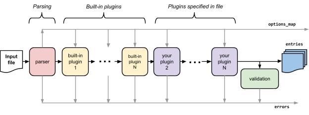

> 非官方中文译文 · 术语保留英文；代码、account、option、币种原样。
> 原文：https://beancount.github.io/docs/beancount_scripting_plugins/

# Beancount 脚本与插件

[Martin Blais](http://plus.google.com/+MartinBlais)，2014 年 7 月

[http://furius.ca/beancount/doc/scripting](http://furius.ca/beancount/doc/scripting)

> [简介](#introduction)
>
> [加载管道](#load-pipeline)
>
> [编写插件](#writing-plug-ins)
>
> [编写脚本](#writing-scripts)
>
> [从文件加载](#loading-from-file)
>
> [从字符串加载](#loading-from-string)
>
> [打印错误](#printing-errors)
>
> [打印条目与往返转换](#printing-entries-round-tripping)
>
> [进一步探索](#executing-plugins)

## 简介

本文档提供了使用账本内容编写脚本的示例和指南。它还介绍了如何编写自己的“插件”，这些插件只是可以配置为以编程方式转换 transaction 或合成 transaction 的 Python 函数。这是扩展 Beancount 功能和编写自定义 report 的两种主要方法。你只需使用 Python 即可完成这些操作。

## load 流程（pipeline） 

你需要了解一些 Beancount 处理其输入文件的方式。在内部，加载输入文件的唯一入口点是 `beancount.loader.load_file()` 函数，它接受一个输入文件并执行一系列转换步骤，如下图所示：

加载的阶段如下：

1.  **Parser（解析器）。** 将输入文件通过解析器处理。此阶段的输出为：

    1.  entries：一个元组列表（定义在 beancount.core.data 中），对应于文件中出现的每个 directive，并按日期和行号排序。此外，与其他 directive 出现在同一日期的 Transaction directive 始终保证排在它们之后。这为处理这些条目做好了准备。这个条目列表将在后续各个阶段中被转换和细化。

    2.  options_map：一个包含输入文件中选项值的 Python dict。详见 beancount.parser.options。一旦创建，此后将不再被修改。

    3.  errors：如果发生错误，则为一个错误对象列表。在每个阶段，新生成的错误都会被收集起来。

2.  **Process plugins（处理插件）。** 对于每个插件，加载插件模块并调用其函数，传入上一阶段的条目列表和 options\_map，并用插件返回的列表替换当前列表。这实际上允许插件过滤条目。  
    要运行的插件列表由一组实现 Beancount 某些内置功能的默认插件模块组成，随后是用户从输入文件中的 “plugin” 选项提供的列表。

3.  **Validation（验证）。** 将生成的条目通过验证阶段，以确保由插件合成或修改的 directive 符合代码库所依赖的一些不变量。这主要用于生成错误。

由此 pipeline 生成的条目列表属于 [beancount.core.data](https://github.com/beancount/beancount/tree/master/beancount/core/data.py) 中定义的各种类型，在典型的输入文件中，大多数条目都是 *Transaction* 类型。Beancount 自身的过滤和 report 程序直接处理这些条目，你也可以这样做。这些条目是简单的只读对象（Python [namedtuples](https://docs.python.org/3/library/collections.html#collections.namedtuple)），没有显式修改其内容的方法。Beancount 内部的所有处理都是以函数式风格进行的，处理被假定为不可变的条目列表[^1]。

要运行的用户插件列表是加载阶段的一部分，因为这允许监控文件变化的程序重新加载文件并重新应用相同的插件列表。这也允许输入文件的作者以这种方式选择性地启用各种可选功能。

## 编写插件

如上一节所述，加载 Beancount 文件本质上会生成一个 directive 列表。许多语法扩展可以通过在插件处理阶段将 directive 列表转换为新的列表来实现。以下是一些你可能希望对某些 directive 执行的转换示例：

-   自动添加一些 posting

-   使用共同的标签关联一些 transaction

-   合成新的 transaction

-   移除或替换某些 transaction 集合

-   修改各个字段

只要你的插件生成的条目满足某些约束条件（所有 posting 平衡，所有数据类型符合预期），你可以做的事情是没有限制的。

插件通过 [option 语法](beancount-language-syntax.md) 添加到输入文件中，例如如下所示：

    plugin "accounting.wash_sales"

通过此 directive，加载器将尝试导入 `accounting.wash_sales` Python 模块（代码必须是 Python-3.3 或更高版本），查找一个特殊的 `__plugins__` 属性（该属性应为一个要运行的函数序列），然后运行这些函数。

关于运行插件，请参阅下面的“执行插件”部分。

作为一个示例，你会将如下代码放在一个“`accounting/wash_sales.py`”文件中：

    __plugins__ = ['wash_sales']

    def wash_sales(entries, options_map):
        errors = []
        for entry in entries:
            print(type(entry))
        return entries, errors

这是一个最小示例，它不修改条目，而是将它们打印到控制台。在实际应用中，为了做有用的事情，你会修改列表中的某些条目并输出它们。

然后，你在输入文件上调用 Beancount 提供的常规工具。各种过滤器和 report 将基于你的插件输出的条目列表进行操作。有关如何操作条目的详细信息和示例，请参阅 [beancount.core](https://github.com/beancount/beancount/tree/master/beancount/core/) 中的源代码。

### 插件配置

某些插件需要配置。为了向插件提供特定于你文件的数据，你可以提供一个配置字符串：

    plugin "accounting.wash_sales" "days=31"

插件函数随后将接收一个额外的参数，即配置字符串。如何解释该字符串由插件本身定义。

## 编写脚本

如果你需要生成一些无法通过内置过滤和 report 功能实现的自定义分析或可视化，你可以直接编写一个脚本来显式加载 directive。这让你能够控制程序的流程，并执行任何你想要的操作。

### 从文件加载

你可以直接调用 `beancount.loader.load_file()` 加载函数。以下是一个最小化的脚本示例：

    #!/usr/bin/env python3
    from beancount import loader

    filename = "/path/to/my/input.beancount"
    entries, errors, options = loader.load_file(filename)
    … 

此时，你可以按自己的意愿处理 entries，打印它们、生成 HTML、调用 Python 库等。（我建议你遵循最佳编程实践，在脚本中使用 docstring 和 main 函数；上面的脚本旨在保持最小化）。同样，请参阅 [beancount.core](https://github.com/beancount/beancount/tree/master/beancount/core/) 中的源代码，以了解如何操作 entries 的详细信息和示例。

### 从字符串加载

你也可以直接解析字符串。使用 `beancount.loader.load_string()`：

    #!/usr/bin/env python3
    from beancount import loader

    entries, errors, options = loader.load_string("""

       2014-02-02 open Assets:TestAccount   USD
       … 

    """)

如果你希望缩进 Beancount directive 并自动去除缩进，标准库中的 [textwrap.dedent](https://docs.python.org/3/library/textwrap.html#textwrap.dedent) 函数会很有用。要查看许多示例，请参阅 Beancount 源代码中的各种测试。

### 打印错误

默认情况下，加载器在加载时不会打印任何错误；我们倾向于让加载过程默认不产生任何副作用。你可以提供一个可选参数来打印错误，该参数是一个用于写入错误字符串的函数：

    #!/usr/bin/env python3
    import sys
    from beancount import loader

    filename = "/path/to/my/input.beancount"
    entries, errors, options = loader.load_file(filename, 
                                                log_errors=sys.stderr)
    … 

或者，如果你更喜欢显式地自行处理，可以调用 `beancount.parser.printer.print_errors()` 辅助函数：

    #!/usr/bin/env python3
    from beancount import loader
    from beancount.parser import printer

    filename = "/path/to/my/input.beancount"
    entries, errors, options = loader.load_file(filename)
    printer.print_errors(errors)
    … 

### 打印 Entries 与往返处理

直接打印 [namedtuple](https://docs.python.org/3/library/collections.html#collections.namedtuple) entries 会输出一些可读但格式相对较差的内容。最好使用 `beancount.parser.printer.print_entry()` 实用函数以可读的方式打印 entry：

    #!/usr/bin/env python3
    from beancount import loader
    from beancount.parser import printer

    filename = "/path/to/my/input.beancount"
    entries, errors, options = loader.load_file(filename)
    for entry in entries:
        printer.print_entry(entry)

特别是，Beancount 保证 printer 的输出始终是可解析的，并且读回时应产生相同的数据结构。（如果不是这种情况，应被视为 bug。）

请参阅 `beancount.parser.printer` 模块的源代码以获取更多实用函数。

## 执行插件

要让插件模块被找到，只需确保它存在于你的 `PYTHONPATH` 环境变量中（你需要确保相关的 `__init__.py` 文件存在以便导入）。它可以位于你自己的代码中：你无需修改 Beancount 本身。

还有一个选项，可以添加到你的 beancount 文件中：

    option "insert_pythonpath" "True"

这会将包含 beancount 文件的文件夹添加到 `PYTHONPATH` 中。结果是，你可以将插件与 beancount 文件放在同一位置，并在使用该文件时执行它们。

下面是一个简短的示例，使用我们上面编写的 wash\_sales.py 插件。你的 beancount 文件将包含以下行：

    option "insert_pythonpath" "True"

    plugin "wash_sales"

Python 文件 wash\_sales.py 将与 .beancount 文件存储在同一文件夹中。

## 进一步探索

要了解如何操作 entries，你应该参考源代码，并且可能需要深入学习以下模块：

-   [beancount.core.data](https://github.com/beancount/beancount/tree/master/beancount/core/data.py)

-   [beancount.core.account](https://github.com/beancount/beancount/tree/master/beancount/core/account.py)

-   [beancount.core.number](https://github.com/beancount/beancount/tree/master/beancount/core/number.py)

-   [beancount.core.amount](https://github.com/beancount/beancount/tree/master/beancount/core/amount.py)

-   [beancount.core.position](https://github.com/beancount/beancount/tree/master/beancount/core/position.py)

-   [beancount.core.inventory](https://github.com/beancount/beancount/tree/master/beancount/core/inventory.py)

更多详情请参阅[设计文档](beancount-design-doc.md)。祝使用愉快！

[^1]: [严格来说，Python 并不阻止对 namedtuple 中本身可变（如列表和集合）的属性进行修改，但在实践中，按照惯例，一旦 entry 被创建，我们绝不会以任何方式修改它。避免副作用并采用函数式风格在任何语言中都能带来好处。](http://validator.w3.org/check?uri=referer)

---

> **版权与许可**：原文 © Martin Blais / beancount/docs contributors，MIT License。中文翻译为非官方 derivative work，仅供个人学习；详见 [NOTICE.md](../NOTICE.md)。
