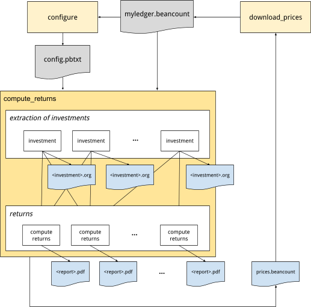
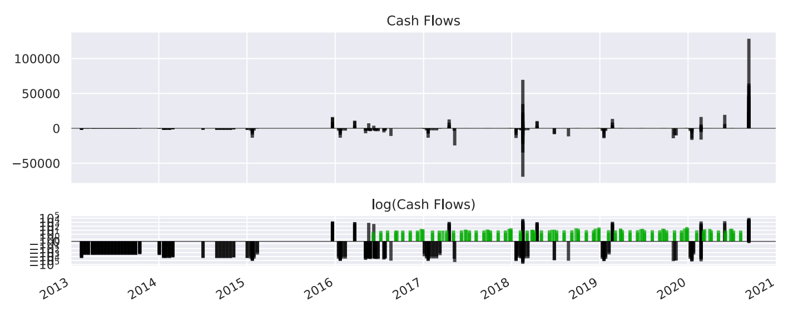
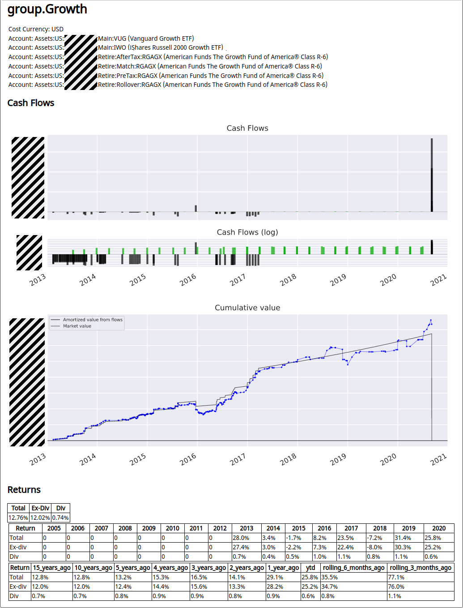

> 非官方中文译文 · 术语保留英文；代码、account、option、币种原样。
> 原文：https://beancount.github.io/docs/calculating_portolio_returns/

# 计算 Portfolio Returns

> **面向 intermediate → advanced 读者**  
> 原文：Martin Blais，2020 年 9 月  
> 来源：[Calculating Portfolio Returns](https://beancount.github.io/docs/calculating_portolio_returns/)  
> 翻译原则：中文为主；`transaction`、`posting`、`directive`、`account`、`balance assertion`、`tolerance`、`precision`、`interpolation`、`cost`、`price`、`lot`、`booking`、`pad` 等术语保留英文。`cash flow`、`investment`、`report`、`signature`、`handler`、`root finding`、`IRR`、`market value`、`cost basis` 等实现相关术语也保留英文，以免在代码和报表之间来回翻译时失真。

> **版本提示**：本文写于 2020 年，代码路径指向 Beancount v2 时代的 `experiments/returns`。现在这套代码已经独立为 [beangrow](https://github.com/beancount/beangrow)。阅读时请以 beangrow 当前仓库为准；文中的 `compute_returns.py`、`configure.py`、`download_prices.py` 仍有助于理解方法，但具体参数和路径可能已经变化。

## 译者导读

这篇不是“如何记账”的教程，而是一篇**实现记录**：如何从 Beancount ledger 中提取 cash flows，再用 IRR/root finding 计算真实的 portfolio returns。

核心方法可以压缩成四步：

1. 为每个 `(instrument, account)` 组合定义一个 investment；
2. 从 ledger 中提取与该 investment 相关的 transactions；
3. 把 transactions 归类成 signature，再转换成 `(Date, Amount, IsDividend)` 形式的 cash flows；
4. 用 cash flows 解 IRR，并按区间截断，得到 lifetime、calendar、cumulative returns。

真正困难的部分不是 IRR，而是**数据提取**：account 命名是否一致、transaction templates 是否稳定、price 是否足够新、dividends 是否被正确标记。作者花了大部分篇幅讲这些“脏活”，这也是本文对高级读者最有价值的地方。

> **译者注 · IRR 不是 TWR**  
> 文中用的是 IRR（money-weighted return），它受现金流时点影响。若你要和基金、指数做严格比较，通常还需要 TWR（time-weighted return）。两者回答的问题不同：IRR 回答“我的钱实际赚了多少”，TWR 回答“策略本身表现如何”。不要混用。

---

*本文说明如何从 Beancount ledger 计算 portfolio returns。*

## 动机

你可能会意外地发现，折扣券商通常不会基于你的实际 cash flows，给出准确、完整的 investment returns 计算。它们往往报告的是另外一些 performance 指标：

- **Change in value.** 最简单的是账户在期初和期末（或年初/年末）的价值快照。问题在于，它没有把现金的注入或取出、以及持仓变化反映进去。例如，年初账户有 $50,000，8 月又投入 $30,000，12 月底报告差额 $37,000，这并没有什么用（你得在脑子里扣除年内新增投入的现金；而且如果你想拆开比较账户内不同 instrument 的 returns 呢？）。

- **Underlying performance.** 它们可能单独报告底层资产本身的增长，而不考虑你的具体持仓。如果你只（或主要）在下半年才投入，那么“HDV 过去一年涨了 8.2%”对你没什么用。我想知道的是：在我具体的持仓变化和时点下，我的投资到底增长了多少。换句话说，*我* 做得怎么样？

- **No dividends.** 另一个问题是，performance 通常只报告价格变化带来的资本增值。理想情况下，你会希望把 performance 拆成资本增值、dividends，以及各自对总 returns 的贡献，这样才能比较股票和债券的 returns。有时 summary 里的 Yield 字段能提供一些信息，但对于不均匀的分布，它无法告诉我在任意区间内实际拿到了多少 dividend returns。

- **Commissions and management expenses.** 有些券商会按月按账户价值收取管理费。我想知道扣除这些费用后的 portfolio return 是多少。

**我想要基于我实际 cash flows 和持仓变化、准确反映时点的 returns 报告。**

如果我把投资信息维护在 Beancount ledger 里，理论上它包含了我计算真实 returns 所需的全部数据：我的储蓄（cash infusions）的具体时点，以及我在各个时点持有哪些 positions。只是它并不是计算所需的最简格式——Beancount transactions 比你可能希望的更灵活，需要从中提取出一组更简单的 cash flows。**本文解释我最终如何从自己的 Ledger 做到这一点**，以及如何基于一些简单规则推广到你的账本。大部分文字都花在提取正确数据的繁琐细节上。

源码在 [beangrow](https://github.com/beancount/beangrow)。

此外，基于同样的 cash flows，应该可以对其他投资情景做公平、诚实的比较。例如，你应该能生成这样的数据：“我在 ZZZ 的投资回报为 8.2%，其中 1.1% 来自 dividends；如果我投资的是 60/40 的广泛股票/债券组合，回报会是 7.2%。”换句话说，我想把 performance 与若干常见替代方案做*相对*评估。

（最后说明：如果你只需要当前 positions 的快照，[export script](https://github.com/beancount/beancount/blob/v2/beancount/projects/export.py) 已经能处理。）

### 历史

2014 年，我做过一次[简短尝试](https://github.com/beancount/beancount/blob/2.3.1/experiments/returns/returns.py)，想从 ledger 中拆解出这些信息。当时我很快陷入细节：有些提取出的 time series 结果看起来不合理（有些离群值）。我太快钻进了细节。有时候更好的做法是先把整个任务做完，再回头处理细节。我当时没有记录足够的 debug 信息，也对输出没有足够信心去使用它。那次工作最终没有完成，脚本被移到 experiments，我也就耸耸肩：“以后再说。”

2020 年 8 月，我重新坐下来做这件事，这次目标没那么宏大：先得到一个好的近似，并产生大量 debug 输出；把提取过程简化为只抽取 cash flows，并让所有 accounts 都能跑完，即使这意味着要对输入文件做一些调整。结果证明这是对的：我完成了任务，本文记录了我的过程、方法、假设、怪癖和一些结果。

## 方法概览

我将使用的方法，是为每个 investment 提取 cash flow 信息。这里的 **investment** 指的是某种 **financial instrument**，例如 Vanguard Total Stock Market ETF 的 VTI 股份，**投资于某个特定 account**，例如某个 Vanguard 401k。cash flow 列表是一组带日期的正/负货币金额，表示投入该 investment 或从中取出的资金。因此，每个 account 有一组 cash flows，而每个 account 只记录一个 financial instrument。

报告时，我会把这些 per-account series 按逻辑单位 **reports** 分组，例如把同一 instrument 在不同 accounts/券商的记录合并，或把代表同一底层资产的不同 instruments 的 cash flows 合并；甚至按“策略”分组。基本上，通过合并多个 accounts 的 cash flows，我就有了一种通用方式，可以对任意 account 子集分组并计算 returns。

有了 cash flows 后，我会运行一个简单的 **root finding** routine，计算这些 flows 需要以多高的平均年增长率增长，才能达到最终 market value。这给出整体 returns。它类似于计算 [Internal Rate of Return](https://en.wikipedia.org/wiki/Internal_rate_of_return)（IRR）。我会对整条 time series 计算，也会对子区间计算，例如 calendar returns（每年或每季度）或 trailing periods 的 cumulative returns。由于 cash flows 标记了是否为 dividends，我可以把 returns 拆成价格增值和 dividends 两部分。每个 group 都会生成带图的报告。

下图展示了 `configure`、`compute_returns` 和 `download_prices` 三个脚本如何协作：



下面会进一步说明。

## 配置

首先需要创建一个 [configuration](https://github.com/beancount/beancount/blob/v2/experiments/returns/config.proto)，定义 investments 列表及其 groups，并为这些 groups 生成 reports。configuration 是文本格式的 [protocol buffer](https://developers.google.com/protocol-buffers) message。

- **Investment.** 一个 investment 对应某个 account 中的某个 instrument。它还涉及其他不直接涉及该 account 的 transactions。我们需要提供几组 account 名称：

  - **Asset account.** 持有该 investment commodities 的 account 名称。
  - **Matching accounts.** 额外 account 列表；只要 transaction 有 posting 到这些 accounts，就会被选中。
  - **Cash accounts.** investment 外部的 accounts，用于标记流入/流出 investment 的现金。

- **Report.** 虽然可以按单个 investment 计算 returns，但更通用、更有用的是按 investments group 计算。一个 report 就是一个 investment 名称列表。每个 report 会生成一个 PDF 文件。

下面是一个包含 6 个 investments 和 3 个 reports 的例子：

```text
investments {
  # Accounts at BTrade.
  investment {
    currency: "GLD"
    asset_account: "Assets:US:BTrade:GLD"
    cash_accounts: "Assets:US:BTrade:Cash"
  }
  investment {
    currency: "AMZN"
    asset_account: "Assets:US:BTrade:AMZN"
    cash_accounts: "Assets:US:BTrade:Cash"
  }
  investment {
    currency: "QQQ"
    asset_account: "Assets:US:BTrade:QQQ"
    dividend_accounts: "Income:US:BTrade:QQQ:Dividend"
    cash_accounts: "Assets:US:BTrade:Cash"
  }

  # Accounts at IBKR.
  investment {
    currency: "IAU"
    asset_account: "Assets:US:IBKR:IAU"
    cash_accounts: "Assets:US:IBKR:Cash"
  }
  investment {
    currency: "SLV"
    asset_account: "Assets:US:IBKR:SLV"
    cash_accounts: "Assets:US:IBKR:Cash"
  }

  # Accounts at Schwab.
  investment {
    currency: "GOOG"
    asset_account: "Assets:US:Schwab:GOOG"
    cash_accounts: "Assets:US:Schwab:Cash"
    cash_accounts: "Assets:AccountsReceivable"
    cash_accounts: "Assets:US:GoogleInc:GSURefund"
  }
}

groups {
  group {
    name: "strategy.gold"
    investment: "Assets:US:BTrade:GLD"
    investment: "Assets:US:IBKR:IAU"
  }
  group {
    name: "strategy.tech"
    investment: "Assets:US:BTrade:QQQ"
    investment: "Assets:US:BTrade:FB"
    investment: "Assets:US:Schwab:GOOG"
  }
  group {
    name: "all"
    investment: "Assets:US:*"
    currency: "USD"
  }
  group {
    name: "accounts.BTrade"
    investment: "Assets:US:BTrade:*"
    currency: "USD"
  }
}
```

不同 reports 可以包含同一个 investment。configuration 中对 accounts 和 investment 名称的引用支持简单的 UNIX-style globbing patterns。运行时它们会展开为完整 account 名称，并存储在输出中。

[configure.py](https://github.com/beancount/beancount/blob/v2/experiments/returns/configure.py) 脚本可以从现有 Beancount ledger 自动推断一个可用的基础 configuration。每个唯一 instrument 都会生成 report；export script 认可的 metadata 字段（`assetcls`、`strategy`）也会生成 reports。我建议你先在自己的 ledger 上运行它，然后手工定制 configuration。

### 寻找 Accounts

这个脚本需要找出可报告的 investments 列表。按照惯例，我会为每种 commodity 保留一对专用 leaf accounts：一个持有实际 positions（assets），一个接收 dividends。例如，对于券商 BTrade 中持有的 VTI：

```beancount
2012-03-01 open Assets:US:BTrade:VTI              VTI
2012-03-01 open Income:US:BTrade:VTI:Dividend     USD
```

这有两个好处：(a) 很容易找出包含 investments 的 accounts（任何 leaf account 名称也是 ledger 中出现的 commodity 的 account）；(b) 通过找出所有 posting 到该 account 的 transactions，可以很好地隔离与该 investment 相关的全部活动。**我建议你在自己的 chart of accounts 中遵循同样的惯例。** 结果是一个 account 列表，例如 `Assets:US:BTrade:VTI`，针对每个 `(instrument, institution)` 组合。

我进一步筛选出过去 15 年仍然 open 的 accounts（我用 Beancount 的 `Close` directive 在账户结束时关闭它们）。就我而言，那时候没有多少储蓄，没必要为了那么久远的零碎记录做归一化工作。

## 提取 Cash Flow 数据

本节描述我从 ledger 提取相关数据所采取的步骤。

### 提取相关 Transactions

对于每个识别出的 asset account，我们要从 ledger 的 transactions 中提取影响该 account 的 transaction 列表。我们遍历整个 ledger 的 transactions，保留至少有一个 posting 到该 investment 的 asset account、dividend income accounts，或配置中定义的其他 match accounts 的 transactions。

例如，现金 dividend 支付的 transaction 不会有 asset posting；典型的 dividend payment 只包含 dividend income posting 和 cash posting（存款）：

```beancount
2019-11-27 * "Dividend"
  Income:US:BTrade:VTI:Dividend   -123.45 USD
  Assets:US:BTrade:Cash            123.45 USD
```

因此，必须在 configuration 中包含 dividend account，才能纳入这些 transactions，因为它们通常不涉及 asset account。

### Account 分类

下一步是把 transactions 泛化为 *templates*：记录每个 investment 提取出的 transactions 涉及的全部 accounts，并根据它们在 transaction 中的角色分配到通用类别。例如，查看我的 VTI 交易，会遇到这些 accounts：

```text
Assets:US:BTrade:Cash
Assets:US:BTrade:VTI
Expenses:Financial:Commissions
Income:US:BTrade:VTI:Dividend
```

我把每个 account 映射到若干通用类别之一（现在可能可以简化）：

```text
ASSET      # The account holding the commodity.
CASH       # Cash accounts, employer matches, contributions.
DIVIDEND   # Dividend income account.
EXPENSES   # Commissions, fees and other expenses.
INCOME     # Non-dividend income, P/L, gains, or other.
OTHERASSET # Other assets than the primary asset for this investment.
OTHER      # Any other account.
```

像这样：

```text
'Assets:US:BTrade:Cash': CASH
'Assets:US:BTrade:VTI': ASSET
'Expenses:Financial:Commissions': EXPENSES
'Income:US:BTrade:VTI:Dividend': DIVIDEND
```

这样，我就可以跨 instruments 比较相似 transactions，并用同一套代码提取信息。例如，涉及 dividend account 和 cash account 的 transaction 就是现金 dividend 支付，我可以写一个通用 handler 来提取 cash flows。分类最初是用一组 ad-hoc 规则做原型，现在由 configuration 提供分类。

注意：在这个过程中，我注意到自己 account 命名有很多不一致。例如，有时用 `:Dividend`，有时用 `:Dividends`。我检查了 ledger，做了一些修改，让 account 命名一致，并反复迭代，直到所有 accounts 都被正确分类。你可能也需要 review 一些数据录入。

### 用 Signature 处理 Transactions

使用上一节的 account-category mappings，我可以为每笔 transaction 推导出一个唯一的 **signature**。例如：

```beancount
2020-03-12 * "(DOI) ORDINARY DIVIDEND"
  Income:US:BTrade:VTI:Dividend  -1312.31 USD
  Assets:US:BTrade:Cash           1312.31 USD
```

的 signature 是：

```text
CASH_DIVIDEND
```

希望它总是 dividend payment。Beancount 语法相当灵活，并不强制 transactions 遵循这种模板，所以项目开始时我并不清楚，在 12 年 ad-hoc 数据录入的 ledger 中会发现哪些模式……我不确定这种分类和 signatures 是否足以正确处理 cash flow 转换。因此我让脚本生成两套 debug 文件：

1. **Investment details.** 每个 investment 一个文件，列出提取出的所有 transactions，并标注每个 posting 推断出的分类，以及遇到的所有 accounts 的 categorization map。我人工检查这些文件，确保 configuration 中的 account/patterns 提取了完整且正确的 transaction 集合。

2. **Signature transactions.** 每个唯一 signature 一个文件，列出跨所有 investments 匹配该 signature 的完整 transactions 列表。通过检查这些文件，我确认同一 signature 的所有 transactions 确实扮演相同角色，因此每个 signature 一个 handler 就足够。

此时，我得到一个有限的 unique signatures 列表，每个都有清晰唯一的角色：

```text
ASSET_CASH                 : Purchase or sale
ASSET_CASH_EXPENSES        : Purchase or sale with commission
ASSET_CASH_INCOME          : Purchase or sale with profit
ASSET_CASH_INCOME_EXPENSES : Purchase or sale with commission and profit
ASSET_EXPENSES             : Fee paid from liquidation
ASSET_INCOME               : Cost basis adjustment (with P/L)
ASSET_INCOME_EXPENSES      : Fee from liquidation (with P/L)
ASSET                      : Stock splits
ASSET_DIVIDEND             : Dividend reinvested
CASH_DIVIDEND              : Dividend payment
CASH_INCOME_DIVIDEND       : Dividend payment and gains distribution
ASSET_OTHERASSET           : Exchange of stock/symbol
…
```

注意，具体列表取决于你 ledger 的内容；你应该检查生成的文件是否正确。

然后我为每个 signature 写了特定 handler，生成对应的 cash flows，并单独推理每种情况。这样我就能为每个 investment 正确生成完整的 cash flow 列表。

> **注意**：实践中我还遇到 3、4 种比较特殊的 signature；通过修 ledger，我修正了它们，或把它们拆成等价但更简单的 transactions。特别是一个 importer 把同一天发生的多笔交易合并在一起，我回头修了 importer，并手工修正了那些 transactions。`ASSET_OTHERASSET` 这个 signature 尤其是股票互换（Google -> GOOG, GOOGL）。这样做会暴露你记账技巧中的一些 idiosyncrasies。保持一致、使用更少的 templates 是有帮助的。
>
> 一个有价值的方向是配一个 plugin，把可能的 templates 限制在少数几种，从而约束数据录入，使其能很好地配合这套 returns 生产代码。

### 泛化 Cash Flow 的生成

检查完每个 signature handler 后，我尝试把它们泛化为一个统一的 handler，适用于所有 transactions。结果发现，至少对我现有 ledger 的 transactions 来说，这是可行的。

本质上，记录流入/流出 cash accounts 或其他 assets 就足够了。例如：

```beancount
2013-09-18 * "Buy shares of HOOL"
  Assets:US:BTrade:Cash            -818.55 USD
    flow: CASH
  Assets:US:BTrade:HOOL                  8 HOOL {101.20 USD}
    flow: ASSET
  Expenses:Financial:Commissions      8.95 USD
    flow: EXPENSES
```

`CASH` posting 是一笔足够的 incoming cash flow，所以我们记录 `-818.55 USD`。在现金 dividend 支付中：

```beancount
2013-12-17 * "Cash Dividend payment"
  Assets:US:BTrade:Cash              38.50 USD
    flow: CASH
  Income:US:BTrade:HOOL:Dividends   -38.50 USD
    flow: DIVIDEND
```

同样，`38.50` 是一笔足够的 outgoing cash flow，所以我们记录 `+38.50 USD`。另一方面，reinvested asset dividend（某些共同基金会有）不会产生任何 cash flow；它只是留在 investment 内，增加总价值：

```beancount
2013-12-30 * "Reinvested dividend"
  Assets:US:BTrade:HOOL              0.356 {103.41} USD
        flow: ASSET
  Income:US:BTrade:HOOL:Dividends   -36.81 USD
        flow: DIVIDEND
```

这条规则似乎足以正确处理我 ledger 的全部内容。

最终，我实现了两种方法：用通用规则生成 cash flow 列表，同时调用显式 handlers，并交叉检查提取出的 cash flows 是否完全一致，以确保正确。这由 `compute_returns.py` 的一个 flag 开启（`--check-explicit-flows`）。这会迫使我确保已经分析了所有可能的 transaction templates。

> **注意**：如果你在使用脚本时发现自己的 ledger 中有无法通过一组 cash accounts 处理的情况，请在 mailing-list 上告诉我。

### cash flow

上一节的 handlers 为每笔 transaction 生成一个 cash flow 列表；对 account 来说，合起来本质上是一个列表：

```text
(Date, Amount, IsDividend)
```

现在这是一个更简单的模型。每个 account 现在有一条排序好的、带日期的 cash flow series。注意 `Amount` 包含它的 cost currency（我有 USD 和 CAD），`IsDividend` 是一个 flag，标识该 cash flow 是否为 dividend payment（用于计算不含 dividends 的 returns）。这些 cash flow series 可以很容易地在 accounts 之间合并，并通过在区间起点/终点插入对应 market value 的 initial/final cash flows 来截断。渲染出来可能像这样（由于 scale 的关系，log 渲染能显示细节；dividends 用绿色）：



注意，由于很多 transactions 不产生 cash flows，单靠一个 investment 的 cash flow 列表不足以计算该 investment 随时间的价值。截断某个时间区间时，investment 的 market value 是用 transaction 列表推导出来的。

最后，每个报告 group 的 cash flows 可以通过拼接轻松合并。

## 计算 Returns

### 计算平均增长率

对于每条 cash flow series，先把 cash flows 合并。我使用 [scipy.optimize.fsolve](https://docs.scipy.org/doc/scipy/reference/generated/scipy.optimize.fsolve.html) 计算满足 net present value 的 rate：

*cf<sub>i</sub>*/(1 + *r*)<sup>*t<sub>i</sub>*</sup> = 0

其中 *cf<sub>i</sub>* 是带符号的 cash flow 金额，*t<sub>i</sub>* 是每笔 cash flow 距今天的时间（年）。我们求解 *r*。要计算不含 dividends 的 returns，只需排除 dividend 产生的 cash flows。差额告诉我们，returns 中有多少完全来自 dividend income。

重要的是：如果对应 positions 仍在投资中，你必须在最新日期插入一笔最终负 cash flow，金额为 market value，使其归零。你本质上是在模拟卖出。如果会有显著的 transaction costs，也可以模拟（例如，如果你是在为房子做这件事）。

美妙之处在于：**整个过程中没有使用底层价格**，除了把当前 position 按 market value 标记。我们没有读取任何外部 returns 指标。这些 returns 完全由 **cash going in and coming out** 计算。它们是 *actual* realized returns。它们不会说谎。

**Intervals.** 要计算 calendar returns，例如 2016、2017、2018、2019、2020 年的 returns，我会把 cash flows 截断到区间内，例如 2018-01-01 到 2018-12-31；如果区间开始时已有 position，就在 series 开头插入一笔负 cash flow，金额等于该日期的 market value。区间末尾同理，插入一笔正 cash flow，如前所述。

理想情况下，我想看不同的 interval 集合：

- **Lifetime of investment.** 整个 positions 生命周期的 total returns，归结为一个数字。

- **Calendar.** 过去 10 或 15 年的年度或季度 returns，观察 returns 随时间的变化。

- **Cumulative.** 过去 10 或 15 年的 cumulative returns，按 calendar periods 对齐，判断情况是在改善还是恶化，以及我的 strategies 在近期（例如过去 3 年）表现如何。

- **High frequency cumulative.** 过去 12 个月的 cumulative returns，按月或按周对齐，评估短期决策的影响。

这些可以用表格渲染，investments 之间也可以这样比较。

### 补齐缺失的 Price Points

计算不同区间的 returns，需要在区间起止日期把 positions 按 market value 标记。Beancount 设计上是 hermetic 的，即不外部抓取价格，只使用 ledger 中的内容；它的 price database lookup 会自动给出请求日期之前最近可用的 price point 及其记录日期。取决于你的记录纪律，有些价格可能过时，带来不准确。尤其重要的是，期末换算金额（用于估算当前 positions 价值）可能很大，会显著影响甚至 lifetime returns 数字。

因此，ledger 的 price database 中需要有相对新鲜的价格点。现在的问题是：**给定随时间变化的 positions 和一组 interval dates，需要哪些 price entries 才能产生准确结果？**

因为这高度依赖 returns script 的具体输入，为了解决这个问题，我简单地在 price database 外包了一层 facade，在生成 reports 的过程中收集所有请求换算的 `(instrument, date)` pairs，然后按某个 age threshold 过滤（例如价格不能旧于 3 天）。这些本质上就是文件中缺失的 price points。

脚本结束时，我把这些输出到一个包含 `Price` directives 的文件；另一个程序（`download_prices.py`）可以读取该文件并抓取历史价格。它会产生更新后的 rates，你可以一次性粘贴到 ledger 文件，然后重新计算更准确的 returns。从 Yahoo! Finance 拉数据对我 90% 的 positions 有效，但一些较老的 instruments 已经太旧、退市或不可得（例如一些退休基金），所以我只能浏览并手工录入一些 price points（大概 30 个……没什么大不了的）。

**Rolling windows.** 一个重要点是：以后把 reporting intervals 对齐到某个 calendar-based interval（例如按月）会更容易，这样不必每次生成 returns 都重新生成价格数据。按月对齐对我的时间跨度来说大概足够。

**Stock Splits.** Beancount 不会显式调整拆股后的价格，所以如果你的价格源记录的是拆股前价格，应该返回拆股前的价格。你可以用 Fava 检查 price time series 是否有错误。

> **译者注 · 最大的误差源**  
> 这套方法对 price freshness 非常敏感。lifetime returns 看起来“精确”，但如果期末 market value 用的是几个月前的 price，数字可能明显偏离。实践上，先把 price database 的新鲜度做好，再谈 returns 的精度。

### 货币换算

另一个重要细节是，每个 investment 有自己的 quote currency。我以前住在加拿大，一些较早的 investments 以 CAD 计价。于是问题来了：我应该用本地货币（CAD）计算 returns，还是用参考货币（USD）？

方便的是，Beancount 的 `Inventory` 对象有函数可以轻松完成所需换算。由于提取出的 cash flows 用 Beancount 的 `Amount` 对象存储，我的提取数据集中已经正确保留了 quote currencies。在任何一个 group 中，如果所有 instruments 的 quote currency 相同，我就用该货币报告 returns；如果 group 混合了多种 quote currencies，我就进一步全部换算成 USD（因此得到 USD returns）。

## 报告

### 对 Accounts 分组

Returns 是按 configuration 中定义的每个 report 内的每组 accounts 联合计算的。以下是一些合理的 grouping 示例：

- **Same instrument in different accounts.** 同一股票在不同 accounts 买入，联合报告该股票的 returns 是合理的。

- **Same underlying.** 有些 instruments 代表同一股票，例如 GOOG 和 GOOGL（不同 share class，同一公司）。IAU 和 GLD（黄金）是不同的 ETFs，但价值都来自实物黄金储备（存放在伦敦银行金库）。

- **Same asset class.** 同一资产类别的 instruments，例如 “metals” 包括 IAU、GLD、SLV、COPX 等；“REITs” 包括 VNQ、VGSLX 等；或 “all stocks” vs “all bonds”。

- **By Strategy.** 在我的 portfolio investment 方法中，我采用 multi-headed approach：定义具体的 broad strategies，然后选择一组 instruments 来实现它。

  - 例如，我有一个 “tech sector” strategy，包含 FAANG 公司。
  - 或 “growth stock” strategy，可能包含 VUG、IWO、RGAGX 等不同 indexes。我可以跨券商报告这些 strategies 的表现。
  - 或按地域，“developed APAC”，包括 EWY、EWT、EWS、EWA。

- **By Broker.** 我可以按券商或券商 account 报告 returns。这尤其可以按税务处理方式分离已实现利润（例如 401k 是 tax-deferred）。

- **Asset type.** 比较所有 index funds 和所有 managed funds（例如 mutual funds）。

注意，不同 reports 可以包含相同 investments。Groupings 不是互斥的。你根据自身情况定义最有意义的组合。作为参考，我用了 20 多个 reporting groups。

### 运行代码

只需调用：

```bash
./experiments/returns/compute_returns.py <file.beancount> <config.pbtxt> <output-dir>
```

生成所有 reports 和 debug 文件，其中 `<config.pbtxt>` 是 “Configuration” 一节所示的格式。它有点慢——性能还有改进空间——但如果你在最后一个参数后提供 report 名称列表，就只会处理那些 investments 和 reports，迭代会更快。用 `--help` 查看 flags，configuration 输入文档见 `config.proto`。

### 渲染结果

对于每个 reporting group，我目前会生成：

- 一张 **cash flows over time** 图，以及一张更小的 *log*(cash flows) 图。dividend payments 通常被本金的 cash flows 淹没，所以 log 图能让我看清 timing。它主要用于概览随时间的活动和 debug。

- 一张 cumulative value 图，包含两条曲线：

  - **Cumulative cash flows**，附带一条与我回归出的 returns 匹配的增长曲线。结果应该是一条在 cash flows 之间平缓上升的线（对应 total returns 增长），最后下降到零。
  - **Market value over time**：portfolio 按市值计价的曲线。这让我能通过观察资产价值随价格的变化，理解 calendar returns。

- 一张 **total returns** 表，包含不含 dividends 的 returns，以及仅来自 dividends 的 returns。

- 一张每年的 **calendar returns** 表，也按 total、ex-dividends、dividends-only 拆分。（以后可能会渲染成图。）

- 一张 trailing **cumulative returns** 表。

这些会随着我继续开发而细化和扩展 [2020 年 9 月]。

### 示例

下面是一个 example report，针对一组以 “growth” 为重点、分散在不同券商的 accounts。每个 reporting group 我都会生成一张。（为隐私灰掉了一些部分。）



### 解释时的坑

有几点需要注意：

**所有 rates 都是 *annualized*。** 这让数字之间容易比较，但也意味着短期持有的 positions 会产生不适合长期外推的数字。特别是几个月前才建立的新 positions，可能经历高增长或大幅下跌，外推到整年可能显示惊人的百分比。看近期新增 positions 时尤其要记住这一点。

**Taxes 没有计入。** 应税账户和 tax-deferred 账户的 returns 应该区别评估；如果税差很大，不能直接比较。记住，大多数国家的 gains 只在 realization（卖出）时征税，所以实际上长期持有的 investments 行为或多或少像 tax-deferred。不要卖太多。这是持有广泛分散 ETFs 的一大优势（而且通常未被量化，因为人们的注意力还过度集中在 registered accounts（例如 401k）的好处上）。

**Cost basis.** 注意，我们的计算中完全没有使用或计入 cost basis，所以不要把它和 market value 混淆。Cost basis 只对税务相关影响有用。

## 其他 Instrument 类型

注意，这种计算 returns 的方式并不限于股票和债券。用同样的方法，我们可以纳入其他类型的 instruments：

### P2P 借贷

在对冲基金进场捡低垂果实之前，我用过 LendingClub；后来让我投资的那些 bonds 全部到期。用同样的方法计算这些 investments 的 returns 很容易。最初，我有纪律地根据每月 PDF statement 记录这个 investment，使用这样的 transactions：

```beancount
2016-10-31 * "2016-10-31.Monthly_Statement.pdf"
  Assets:US:LendingClub:FundsLent     -451.52 LENCLUB {1 USD}
  Assets:US:LendingClub:Cash           451.52 USD
  Income:US:LendingClub:LoanInterest   -21.68 USD
  Income:US:LendingClub:Recoveries      -5.92 USD
  Expenses:Financial:Fees                1.08 USD ;; Recovery fees
  Expenses:Financial:Fees                4.71 USD ;; Service fees
  Expenses:Financial:Fees                0.45 USD ;; Collection fees
  Assets:US:LendingClub:Cash
  Assets:US:LendingClub:FundsLent      -23.05 LENCLUB {1 USD}
  Income:US:LendingClub:ChargedOff      23.05 USD
```

后来，在 principal bonds 到期后，transactions 变成这样：

```beancount
2018-11-30 * "2018-11-30.Monthly_Statement.pdf"
  Income:US:LendingClub:Recoveries  -2.73 USD
  Expenses:Financial:Fees            0.49 USD ;; Recovery fees
  Assets:US:LendingClub:Cash
```

计算 returns 只需要这个 investment configuration：

```text
investment {
  currency: "LENCLUB"
  asset_account: "Assets:US:LendingClub:FundsLent"
  match_accounts: "Income:US:LendingClub:Recoveries"
  cash_accounts: "Assets:US:LendingClub:Cash"
}
```

注意，`match_accounts` 配置是必要的，用来捕捉后期只有 recoveries、没有 asset account posting 的零碎 transactions。值得一提的是，这个 investment 我算出了 6.75% 的 return。嗯。

### 房地产

可以从房子的所有 transactions 中提取 cash flows，因此可以计算投入房子的所有资金的 returns，就好像纯粹是为了投资。

通常买房是出于其他原因——给孩子稳定、能自己改造、定期还本的强制储蓄，以及常常只是“有个家”的感觉——但在绝大多数情况下，房屋所有权更像成本中心，把钱投到别处 returns 会更好（见 [这本书](https://www.amazon.in/Wealthy-Renter-Choose-Housing-That-ebook/dp/B01B2DK68E)，对利弊有很好的揭露）。就我个人而言，我有比修马桶、担心冬天窗户漏水更重要的事，所以又回去租房了；但我经历过一次，很值得，既是学习经历，也体验了“拥有自己地方”的“快乐”。通过这套 exercise，可以算出拥有房子实际花了你多少钱，以及把同样的 cash flows 投入市场可能赚多少。

这稍微复杂一些，因为：

- 你必须自律地把“如果租房就不会有的”费用分离到房屋专用 accounts。
- 你需要计入因为住在房子里而不用支付的等效租金。
- 如果你仍拥有房子，必须通过插入一笔 transaction 来模拟可观的 agent fee 和其他 closing costs。
- 很多地方卖房有巨大的 tax break（有时是全部资本增值），这*真的*需要计入。计算并不总是简单，尤其如果你在持有期内出租过一部分，那时可能只能扣除部分 capital gains。
- 对一些人来说，能低成本、轻松搬家的 *optionality* 有很大价值（例如接受全国另一边的新工作），这种个人价值很难估算。

这需要我做更多分类工作，最好作为单独项目记录，虽然使用同一套代码。我确实做了一个简单 configuration，并从中提取出大约 5% 的数字，但我觉得还需要一点工作才能宣布胜利。后续再说。

### 期权

我有时用长期 OTM PUT positions 对冲部分 portfolio 下行风险。近期我也会卖出 OTM PUTs 和 CALLs 来融资。本文描述的股票方法同样适用于 options，也就是从 cash 中提取 cash flows。

主要区别是：

- **Currency names.** Instrument 名称是每个 contract 特有的——包含 expiration date 和 strike price——所以我不会把 options 存到 leaf account 名称包含 instrument 名称的 account。我只用通用 leaf account 名称，例如 `Options` 或 `Hedging`，在建立/退出 positions 时选择它。

- **Prices for options.** Options 价格不容易通过程序抓取。我不得不用私有 API。也许更重要的是，theta 衰减、vol 变化和接近 strike 时的非线性，意味着我确实需要 ledger 中有相当新的价格估计，才能计算 unrealized gains/losses 的 returns。我觉得影响足够强，最终会想要一些代码，在生成 reports 前总是更新价格。

## 后续工作

本节描述我希望对 returns 代码做的未来改进（我很可能会实现），以及相应的挑战。

注意：2020 年 9 月写这篇文章时，我正在积极开发这套代码，接下来几个月的周末可能还会继续。本文可能稍微过时，下面一些 proposal 可能已经实现。最新情况请参考源码。

### 相对规模随时间变化

另一个可以轻松加入 reports 的有用数据，是 market values over time 的 stack plot，以及每个 report group 中各个 investment 的相对比例。这对监控 group 中特定 instruments 的增长、辅助 rebalancing 很有用。

### 与基准比较

运行自己 portfolio 的一个重要成功晴雨表，是与一个等价的、定期 rebalance 的广泛股票/债券简单 portfolio 比较。毕竟，如果我的 returns 在正常环境下跑不赢它，那就可以说我没必要搞更复杂的 allocation。

假设我获取 capital 的能力相同（确实相同，因为这个项目看的是来自收入的储蓄），我可以简单地把自己的 cash flows 替换成流入这个模拟 portfolio 的 cash flows，也就是用同样的 timing 模拟买入其他资产。我必须排除 dividend payments，因为它们是特定 instruments 特有的；同时，从 benchmark portfolio 中相似规模的 positions 生成模拟 dividends。

应该可以在不修改 ledger 的情况下做到。一个问题是，我需要 benchmark 在我历史 cash flow 日期上的一组准确价格。就像脚本已经处理 aging price points 那样，这可以轻松存到文件里供抓取。

也许更复杂的是，Beancount 目前不支持 per-share dividend distributions 数据库。可以在不引入新语法的情况下，通过 `Price` directives 上附加并识别 metadata 来加入，例如：

```beancount
2020-09-01 price LQD   136.16 USD
  distribution: 0.295 USD
```

总体而言，实现起来不会太难。

### 计入未投资现金

我在投资自己 portfolio 时面临的一个问题，是缺乏纪律及时投入可用现金，尤其是在时局不确定、决策困难的时候。为了计入这对 performance 的拖累，我应该纳入一个 “investment”，纯粹反映随时间未投入现金的总额。

由于这个数字变化很大，一个好近似是每月采样可投资现金总额，并根据差额合成 cash flows。如果这条 cash flow series 被纳入 portfolio，它会通过稀释适当拖累 returns。

### 税后价值

目前我用 [export script](https://github.com/beancount/beancount/blob/master/beancount/projects/export.py) 把所有 holdings 导出到 Google Sheets，然后按长期/短期 positions、pre-tax、after-tax、Roth、taxable 等 buckets 拆分。从这 8 个 aggregates 中，我扣除估算税额，报告一个单一的 “estimated after-tax net worth” 和相应 tax liability。这是粗略估计。

Returns report 则详细得多，我不仅可以模拟 liquidation 时的税款，还可以模拟每年末（来自 dividends 和 sales）的税款。我持有每个 position 的 lot dates，所以可以自动判断 short-term vs long-term lots。

### 通胀调整

Returns charts 和 calendar returns 中报告的 market value 金额没有考虑 inflation。长时间来看，这会对 returns 产生重要影响。

用年度 CPI 估计（或其他 inflation 估计；你甚至可以根据 ledger 中的 expenses 自己编一个）对 returns 随时间折现会很有用，这样我们可以看 *real* growth 曲线，而不只是 nominal growth。

### 卖出佣金

Configuration 可以很容易改进，让用户指定卖出 investments 的预期 commissions，绝对值或相对（%）金额。这用于以更现实的 liquidation values 标记 positions。对金额小或 commissions 大的 investments（例如通过普通券商，或房地产）会有影响。

### 风险估计与 beta

一个更高级的话题，是根据具体 portfolio composition 估算 variance，从而计算并报告某种风险度量，例如 [Sharpe Ratio](https://en.wikipedia.org/wiki/Sharpe_ratio)。这需要足够多、等间隔的 price points。度量随时间的变化也会很有趣，还可以计算当前 portfolio 对整体市场的 specific sensitivity（beta）。

## 结论

我原本以为可以从 Beancount 数据中生成清晰的 returns 图景；做完之后，我对自己 ledger 能产生的细节和清晰度比预期更满意。这远远超出了单纯绘制 net worth over time；它确实运行得很好，我可以用它公平地比较不同 investments 的 performance。我希望至少有一些 Beancount 用户能在自己的 ledgers 上运行它，也期待听到那些设置好的人的反馈。

也许最重要的是，我对自己 portfolio returns 的结果非常惊讶。我属于那种如果被问到 returns 会耸耸肩、猜一个不起眼的数字的人，比如“嗯，6% 左右吧，不太满意。”做这项工作的最初动力，正是因为我回答不了这个问题。结果发现，过去 15 年，我的平均年回报接近 12%，过去 5 年是 14%。我还没有做 benchmark 比较，当然这些数字应该和市场并排看，才能公平评估。尽管如此，这套 exercise 让我对未来有了新的信心和希望；我也希望它能为其他 Beancount 用户自己的 investments 带来同样启蒙性的清晰度。

---

## 译者附：落地检查清单

如果你要把这套方法用到自己的 ledger，按这个顺序排查，能省很多时间：

1. **Account 命名先统一**：每种 instrument 一个 asset account，一个 dividend account；避免 `:Dividend` / `:Dividends` 混用。
2. **先跑 `configure.py`**：让它推断 investment 列表，再手工修正 groups；不要一上来就写完整配置。
3. **看 investment details 文件**：确认每笔相关 transaction 都被提取，且 posting 分类正确。
4. **看 signature 文件**：同一 signature 必须只对应一种经济含义；遇到 exotic transaction，先修 ledger，不要急着写 handler。
5. **先做 lifetime returns**：确认整体数字合理，再做 calendar / cumulative。
6. **检查 price freshness**：期末 market value 的 price 不能太旧；先补价格，再看 returns。
7. **区分 IRR 与 TWR**：IRR 是 money-weighted；要和 benchmark 比策略，最好同时算 TWR。
8. **不要用 cost basis 代替 market value**：cost basis 只影响税务，不参与 returns。
9. **短期年化要谨慎**：几个月的新 positions 年化后可能非常夸张。
10. **先跑小报告**：用 report 名称列表缩小范围，迭代配置，再跑全量。

---

> **版权与许可**：原文 © Martin Blais / beancount/docs contributors，MIT License。中文翻译为非官方 derivative work，仅供个人学习；详见 [NOTICE.md](../NOTICE.md)。
