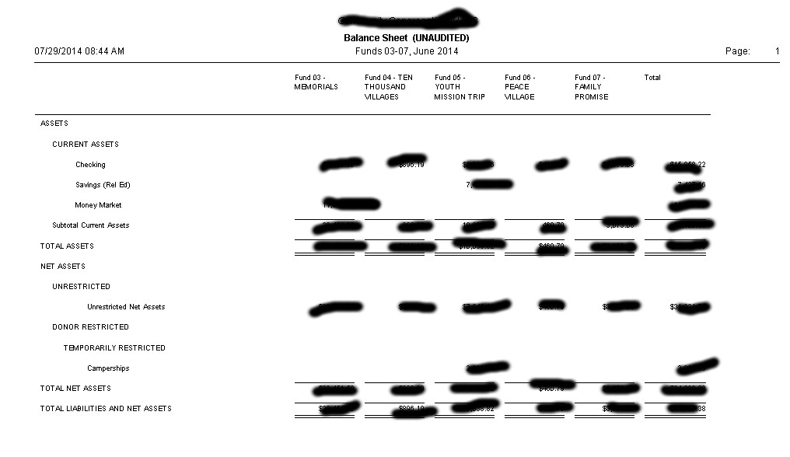

> 非官方中文译文 · 术语保留英文；代码、account、option、币种原样。
> 原文：https://beancount.github.io/docs/fund_accounting_with_beancount/

# 使用 Beancount 进行基金会计

[Martin Blais](http://plus.google.com/+MartinBlais), Carl Hauser, 2014 年 8 月

[http://furius.ca/beancount/doc/proposal-funds](http://furius.ca/beancount/doc/proposal-funds)

*关于如何在 Beancount 中实施基金会计的讨论，涵盖各种方法、解决方案及可能的扩展。*

## 动机

许多用户正尝试使用命令行记账系统来解决基金会计问题。部分原因在于，这类会计活动通常发生在预算有限的非营利组织中，这些组织更倾向于使用免费软件；另一部分原因在于，所需的灵活性和定制化程度似乎与命令行记账系统非常契合。

## 什么是基金会计？

例如，参见[此讨论串](https://groups.google.com/d/msg/ledger-cli/N8Slh2t45K0/nu1ZACCueQYJ)：

> *“我计算的另一种宗教义务实际上是什一税（我们称之为 Huqúqu'lláh，其计算方式不同，但那是另一个话题）。为了计算应付的什一税，我将每笔存款的 19% 累积到一个虚拟账户中，然后从该账户中扣除每笔必要支出的 19%。*
>
> *年底剩余总额即为我应付的什一税。这个什一税账户不是一个真实账户，因为它不存在于任何金融机构中；但作为个人义务，它是足够真实的。通过使用虚拟账户，我可以跟踪这项“旁路”负债，并在到期时从资产账户中支付它。如果我使用 --real 进行报告，我将只看到我为这项负债支付了多少；如果我不使用 --real 进行报告，我会看到当前欠多少 Huqúqu'lláh。”*
>
> *— John Wiegley*

以下是另一位用户作为评论提供的另一种描述：

> *\[...\] 基本上，这个想法是将你的财务生活分成称为“基金”的独立部分。每个基金都有自己的科目表（在一定程度上），并且每个基金都遵循 Assets+Liabilities+Equities == 0。这在非营利组织中经常需要，因为用于特定目的的资金必须单独核算。唯一不分离的领域是，实际的资产账户（例如银行账户）和实际的负债账户（信用卡）可能代表多个基金持有或欠付资金，因此你不能使用完全独立的账本文件。在我们教堂，我们使用一个名为 PowerChurchPlus 的程序来处理这个问题，效果非常好。我妻子现在是一个社区音乐组织的财务主管，面临着同样的问题，但规模如此之小，以至于商业程序的成本并不值得。*
>
> *我在 ledger-cli 列表上看到了关于使用 C++ ledger 进行非营利会计的帖子，它看起来需要太多的纪律才能正确且一致地使用标签。基金的概念更容易解释和使用（并且余额账户不变量自然得到强制）。因此，我查看了 Beancount 代码，看看我是否可以将其改编以支持基金会计。我认为答案是“是的，而且相对容易”。此外，我认为这个想法对个人也有用途：出现了几个场景。首先，我居住在一个社区财产州。我和我妻子都可能各自继承财产，这些财产将属于我们个人，但我们也有社区财产。这些可以分别作为独立的基金处理，我们可以单独报告它们，也可以一起报告以了解我们的整体财务状况。同样，为每个人使用单独的基金来核算退休金也是合理的。*
>
> *— Carl Hauser*

摘自 PowerChurchPlus 11.5 手册（PowerChurch, Inc. 2013）：

> *“在会计中，基金一词有非常具体的含义。会计基金是一个自平衡的科目表。\[...\] 在会计中，我们需要将基金视为你教堂的一个部门或子组。每个会计基金都有自己的资产、负债、权益、收入、转账和费用账户。*
>
> *那么，你什么时候会使用额外的基金？如果你教堂的某个领域需要产生自己的报告，你就需要使用额外的基金。例如，如果你的教堂运营一个幼儿园或游戏学校，你可能希望设置一个额外的基金，以将其财务与教堂的财务分开。根据你的需求，你可能希望为男子或女子团体设置一个单独的基金。你甚至可能设置一个新基金，以单独跟踪所有固定资产，与日常运营账户分开。”*

这是一个有趣且显然常见的问题。我们将在本节其余部分描述用例。

### 联合账户管理

我本人曾使用这种“基金会计”理念来管理我与前妻的联合账户。我们各自持有个人账户——我们都是职场人士——并根据需要向联合账户注资。本节描述了我当时的做法[^1]。

联合账户的会计记录保存在一个单独的文件中。创建了两个子账户来分别持有我们各自的“份额”：

    2010-01-01 open Assets:BofA:Joint         
    2010-01-01 open Assets:BofA:Joint:Martin  
    2010-01-01 open Assets:BofA:Joint:Judie   

向联合账户的转账直接记入两个子账户之一：

    2012-09-07 * "Online Xfer Transfer from CK 345"
      Assets:BofA:Joint:Judie          1000.00 USD
      Income:Contributions:Judie

当我们产生支出时，我们会通过两条腿（legs）减少资产账户，每条腿对应一个子账户。我们通常按 2:1 的比例记账以反映收入差异，或者我直接将许多 transaction 记在我自己名下（尽管精确记账并不意味着我们在那方面不慷慨）：

    2013-04-27 * "Urban Vets for Grumpy"
      Expenses:Medical:Cat           100.00 USD
      Assets:BofA:Joint:Martin          -50 USD
      Assets:BofA:Joint:Judie           -50 USD

    2013-05-30 * "Takahachi"  "Dinner"
      Expenses:Food:Restaurant        65.80 USD
      Assets:BofA:Joint:Judie        -25.00 USD
      Assets:BofA:Joint:Martin

省略两个金额中的一个很方便，因为我们在这方面并不非常精确。

### 处理多个基金

*（由 Carl Hauser 贡献）*

以下是上文提到的 PowerChurchPlus 系统所使用的模型（将其使用的账户编号替换为 Beancount 风格的名称）。“基金”名称被*前缀*添加到账户名称之前。

    Operations:Assets:Bank:...
    Endowment:Assets:Bank:...
    Operations:Liabilities:CreditCard:...
    Endowment:Liabilities:CreditCard:...
    Operations:Income:Pledges:2014
    Operations:Expenses:Salaries:...
    Operations:Expenses:BuildingImprovement:...
    Endowment:Income:Investments:...
    Endowment:Expenses:BuildingImprovement:...
    …

要求任何 transaction 在其使用的每个基金中都必须保持平衡。例如，我们的 Endowment 基金经常用于支付那些超出当前捐赠收入能力范围的事物。

    2014-07-25 * "Bill’s Audio" "Sound system upgrade"
       Endowment:Assets:Bank1:Checking        800.00 USD
       Operations:Assets:Bank1:Checking       200.00 USD
       Endowment:Expenses:BuildingImprovement:Sound -800.00 USD
       Operations:Expenses:BuildingImprovement:Sound -200.00 USD

这代表了一张支付给 Bill’s Audio 的单一支票，该支票由 Endowment 和 Operations 两个基金的资产支付，而这些资产都存放在单一的外部资产账户 `Assets:Bank1:Checking.` 中。

**注 1：** 可以允许空的基金名称，并省略随后的“:”，实际上，对于不想使用这些功能的人来说，这可以成为默认设置。（即，如果你不使用这些功能，则没有任何变化。）名称为空字符串的基金，当然与其他所有基金都是不同的。

**注 2：** `balance` 和 `pad` directive 对于参与多个基金的账户来说并不是很有用。使用它们需要知道该账户在不同基金之间的分配情况，而来自外部持有者（例如银行）的账户对账单不会包含这些信息。允许类似以下内容可能有用：

    2014-07-31 balance *:Assets:Bank1:Checking     579.39 USD

作为检查事物是否正确的验证，但使用 `pad` 条目自动纠正似乎是不可能的。

可以在任何基金*或任何基金组合*上运行资产负债表 report，并且它会保持平衡。你可以轻松地跟踪为每个不同目的所持有的资产。基金之间的转账被记录为一个基金的支出和资产减少，以及另一个基金的收入和资产增加。用于转账的收入和支出账户可以是通用的（`Operations:Income:Transfer`），或者你可以使用为特定类型的收入或支出设置的账户（`Endowment:Expense:BuildingImprovement:Sound`）作为转账 transaction 的一边。

这里的账户名称语法只是其可能工作方式的一种，并依赖于 Beancount 对五个特定命名的顶级 account 的使用。第一个顶级账户左侧的任何内容都可以被视为基金名称，或者可以在基金部分和账户名称部分之间使用不同的分隔符。同样，我只展示了单层基金名称，但它们也可以是分层的。我不确定这有多大价值，但请注意，如果 transaction 在叶级基金中保持平衡，那么它们在层级中较高的基金中也会保持平衡，这可能有一些用处。

对于 John W. 的 *Huqúqu'lláh* 示例，可以设置一个基金，其负债是“道德义务”而非法律义务（这似乎是对简单地在普通负债账户中跟踪什一税的反对意见）。当收入进来时（例如，直接存入真实银行的支票账户），将其中的 19% 记入“道德义务”基金的支票账户，并配以相应的负债。当发生必要的支出时，从“道德义务”基金的支票账户中取回 19%，并减少负债。没有虚拟 posting 或 transaction -- 一切都必须平衡。如果我们例如要有一个 `HisRetirement` 基金和一个 `HerRetirement` 基金，这将很好地工作 -- 出于遗产规划目的，分开持有是有用的 -- 但更常见的是，我们想了解我们的合并退休情况，这可以定义为一个*虚拟*基金 `OurRetirement`，等于 `HisRetirement` 和 `HerRetirement` 的总和。请注意，这只在创建 report 时才有意义：除了在每个*真实*基金中进行正常的、平衡的 transaction 的双式记账外，无需做任何其他事情。当我说两个基金的“总和”时，我的意思是：在剥离基金名称后，取所包含账户名称的并集，然后对共同账户的余额求和，并保留其他账户的余额。

*(Balance Sheet)* 在报告方面，需要能够按基金（fund）查看余额，以及汇总一组基金的余额。我还使用一种报告，它显示基金的一个子集，每个基金占一列，对应的账户名称水平排列，右侧有一列作为“合计”。当所有基金都包含在这种报告中时，你就能完整地了解自己拥有什么、欠什么，以及为不同目的预留或受到不同限制的资金。以下是教会部分基金资产负债表的一个小样本。术语略有不同：Beancount 所称的 Equity 在这里称为 Net Assets。而且，由于在 PowerChurchPlus 中使用大量基金并不方便，NetAssets 实际上是为不同目的分类的——我认为这正是我们在此探讨的理念真正发光的地方：如果创建和组合基金用于报告变得非常容易，那么 PCP 中用于在基金内部分配资产的一些机制就变得不再必要。 

*(Income Statement)* 对于收入和支出报告，通常我一次只关心一个基金的支出，但如果需要，将两个基金加在一起也完全合理。

对我来说，这种基金会计方法很有吸引力，因为它依赖并保留了复式记账的基本原则：当 transaction 的总和为 0 时，资产负债表等式始终成立。由此，我们自动获得了合并*任意一组基金*的能力（在录入 transaction 或组织账户的深层结构时，我们无需做任何特殊处理），并且至少能使其在算术上成立，同时我们不依赖与重命名或标记相关的任何“魔法”。我不认为将“基金”的概念推入账户层级之下能如此轻松或整洁地实现：基金属于*高于*五个根账户（Assets, Liabilities, Equity, Income and Expenses）的位置，而不是低于它们。

## 实现思路

***目前是一些随机的想法。这部分还需要进一步的工作。***

-   如果需要多个冗余的 posting，可以使用 **plugin](beancount-scripting-plugins.md) 来自动化生成这些 posting**。例如，如果使用类似于 [镜像记账](http://furius.ca/beancount/doc/mirror) 的技术来“将相同的金额发送到多个 account”，至少用户不应该需要手动执行此操作，因为这既繁琐又容易出错。

-   在解析过程中可以使用一个**重命名 account** 的过程，以便将多个文件合并为一个。（允许用户安装此类映射是我一直有但从未实现的想法，尽管可以通过 plugin filter 来实现。）

-   我们可以依赖这样一个事实：**子 account 的 transaction 可以在父 account 中合并并求和**（尽管目前报告功能在这方面有所滞后。最终会实现这一功能）。

-   基于之前关于为基金（Funds）做类似 tag 栈的备注。如果当前的 tag 架构被扩展以允许 tag 具有值，例如 `#fund=Operations,` 或 `#fund=Endowment`。我们称之为 value-tags。你还需要允许 posting 拥有 tag。value-tags 的语义是：它们在任何 posting 中只能出现一次，posting 上显式的 tag 会覆盖从 transaction 继承的 value-tag，transaction 上显式的 tag 会覆盖 tag 栈中的值，并且 tag 栈中只有最后一个 value-tag（具有特定 key）会被应用到 transaction 上。这使得基金在某种程度上不如之前提出的将其放在 account 名称前面的方案那样“一等公民”，但避免了之前提到的轻微解析困难。这表明，在基金内部开设 account 可能不是必需的，而之前的语法暗示这是必需的。每个基金在 transaction 中的严格平衡规则仍然可以作为 plugin 实现。并且，针对某个基金（或基金总和）的报告看起来像这样：

    -   选择任何 posting 匹配目标基金（或基金）的 transaction

    -   收集（并在必要时以显而易见的方式求和）与正在报告的基金（或基金）相关的 posting（A）

    -   收集（并以显而易见的方式求和）所选 transaction 中不与目标基金相关的 posting（B）

    -   格式化报告，将 (A) 作为目标基金或基金的信息，将 (B) 作为 OTHER。需要 OTHER 以确保报告平衡，但可以选择省略。

<!-- -->

从实现角度来看，这似乎与当前现状更加正交，对现有代码的更改要求更少。它添加了一个新功能——value tags，然后可以由 plugin 和新报告使用它来执行我们想要的基金会计操作。

## 示例

*(Carl)* 下面是一个示例，展示了我可能如何处理与工资单相关的事项，其中涉及递延薪酬（403(b) -- 与 401(k) 极为相似）以及弹性支出账户（与之前已在 ledger-cli 群组中讨论过的 HSA 有些相似）。

*(L. Maganti via Johannes H)* 此示例展示了如何为夫妻两人设置两个基金（fund），使用共享的源数据，并为丈夫、妻子和家庭提供独立的视图。

-   [https://lalitm.com/post/one-number-i-trust](https://lalitm.com/post/one-number-i-trust)

-   [https://github.com/LalitMaganti/beancount-blog-examples/tree/main/chapter-6](https://github.com/LalitMaganti/beancount-blog-examples/tree/main/chapter-6)

### 不使用 Funds

（Carl）首先，在不使用 Funds 的情况下（这可以通过 bean-check 检查）：

以下是我在没有 Funds 的情况下，如何设置包含健康保险、FSA 和 403b 缴款的工资单。其中一个问题是，尽管它认识到健康保险缴款是薪资的减少，而 403b 和 FSA 的缴款也应当如此，但它仍然直接将 Gross Income 分配到 403b 和 FSA 账户中。这使得追踪这两项缴款以及应税收入变得更加困难。

经过深入思考，我们可以解决这个问题——我们会创建 Income 和 Expense 类型的账户来表示这些缴款，但在我的观点中，它们最终看起来会有点滑稽，因为它们完全属于账户系统内部。

请参阅下一个示例，了解使用 Funds 时的样子。如果你伸出舌头、揉揉肚子并倒立起来，你会发现基于 Funds 的解决方案在 transaction 的复杂性方面与上一段中我们得出的方案是等价的——所需的行数同样多。其优势主要在于心理层面——更容易看出如何做到既一致又实用。

    option “title” “Paystub - no funds”

    2014-07-15 open Assets:Bank:Checking
    2014-07-15 open Assets:CreditUnion:Saving
    2014-07-15 open Assets:FedIncTaxDeposits
    2014-07-15 open Assets:Deferred:R-403b
    2014-07-15 open Expenses:OASI
    2014-07-15 open Expenses:Medicare
    2014-07-15 open Expenses:MedicalAid
    2014-07-15 open Expenses:SalReduction:HealthInsurance
    2014-07-15 open Income:Gross:Emp1
    2014-07-15 open Income:EmplContrib:Emp1:Retirement
    2014-01-01 open Assets:FSA

    ; 这种设置 FSA 的方式看起来相当不错。它承认了
    ; 该规则：当年指定的金额立即可用
    ; （在 Asset 账户中），并且我们有义务在
    ; 全年期间进行缴款以资助它（Liability 账户）。
    2014-01-01 open Liabilities:FSA
    2014-01-01 ! "Set up FSA for 2014"
      Assets:FSA                                                 	2000 USD
      Liabilities:FSA                                           	-2000 USD

    2014-07-15 ! "Emp1 Paystub"
      Income:Gross:Emp1                                         	-6000 USD
      Assets:Bank:Checking                                       	3000 USD
      Assets:CreditUnion:Saving                                  	1000 USD
      Assets:FedIncTaxDeposits                                    	750 USD
      Expenses:OASI                                               	375 USD
      Expenses:Medicare                                           	100 USD
      Expenses:MedicalAid                                          	10 USD
      Assets:Deferred:R-403b                                      	600 USD
      Liabilities:FSA                                              	75 USD
      Expenses:SalReduction:HealthInsurance                        	90 USD
      Income:EmplContrib:Emp1:Retirement                         	-600 USD
      Assets:Deferred:R-403b

    2014-01-01 open Expenses:Medical
    2014-07-20 ! "Direct expense from FSA"
      Expenses:Medical                                             	25 USD
      Assets:FSA

    2014-07-20 ! "Medical expense from checking"
      Expenses:Medical                                             	25 USD
      Assets:Bank:Checking

    2014-07-20 ! "Medical expense reimbursed from FSA"
      Assets:Bank:Checking                                         	25 USD
      Assets:FSA

### 使用 Funds

（Carl）接下来是使用 Funds 的示例（由于使用了提议中的功能，因此无法通过 bean-check 进行检查）：

以下是我如何使用 Funds 来设置包含健康保险、FSA 和 403b 缴款的工资单。我可以很直接地安排事务，使得 FSA 和 403b 的缴款在所得税目的下被识别为工资扣减。并且我可以轻松查看我向 403b 缴了多少，以及我的雇主缴了多少。

请参阅上一个示例，了解不使用 Funds 时的样子，那种方式不够准确。

这**没有**做的是追踪最终欠付的 403b 资金的税款。我认为这取决于一个人是选择现金基础还是权责发生制会计的决定。如果是现金基础，这些税款不是当前负债，不能以此方式报告。如果是权责发生制，它们是当前负债，需要在收入入账时记录为负债。

对于现金基础的账簿，我们希望有能力报告仿佛税款已欠付的状态，但这是报告问题而非入账问题。我们需要确保拥有足够的可识别信息来自动化创建这些报告。我相信，采用基于 Fund 的会计视角可以轻松实现这一点。

一个未解决的问题：如果你的基础（basis）在联邦和州目的下不同，甚至在联邦和多个不同州之间不同，该怎么办？天哪！

我使用的约定是 Fund 名称位于根 account 名称之前。请注意，通过适当的“倒立”（standing on one's head）以及透视规则，你可以将 Fund 名称放在任何位置。将其放在前面强调了它标识了一组必须平衡的账户，并且使 transaction 处理器能够轻松保证这一属性。前面没有 Fund 名称的账户属于名称为空字符串的 Fund。

    option "title" "Paystub - no Funds"

    2014-07-15 open Assets:Bank:Checking
    2014-07-15 open Assets:CreditUnion:Saving
    2014-07-15 open Assets:FedIncTaxDeposits
    2014-07-15 open Expenses:OASI
    2014-07-15 open Expenses:Medicare
    2014-07-15 open Expenses:MedicalAid
    2014-07-15 open Expenses:SalReduction:HealthInsurance
    2014-07-15 open Expenses:SalReduction:FSA
    2014-07-15 open Expenses:SalReduction:R-403b
    2014-07-15 open Income:Gross:Emp1
    2014-07-15 open Income:EmplContrib:Emp1:Retirement
    2014-01-01 open FSA:Assets                    	; FSA fund accounts
    2014-01-01 open FSA:Income:Contributions
    2014-01-01 open FSA:Expenses:Medical
    2014-01-01 open FSA:Expenses:ReimburseMedical
    2014-01-01 open FSA:Liabilities
    2014-07-15 open Retirement403b:Assets:CREF    	; Retirement fund accounts
    2014-07-15 open Retirement403b:Income:EmployeeContrib
    2014-07-15 open Retirement403b:Income:EmployerContrib
    2014-07-15 open Retirement403b:Income:EarningsGainsAndLosses

    ; This implements the same idea as above for the FSA, of balancing
    ; Assets and Liabilities at the opening, but now does it using a 
    ; separate Fund.
    2014-01-01 ! "Set up FSA for 2014"
      FSA:Assets                                                 	2000 USD
      FSA:Liabilities                                           	-2000 USD

    2014-07-15 ! "Emp1 Paystub"
      Income:Gross:Emp1                                         	-6000 USD
      Assets:Bank:Checking                                       	3000 USD
      Assets:CreditUnion:Saving                                  	1000 USD
      Assets:FedIncTaxDeposits                                    	750 USD
      Expenses:OASI                                               	375 USD
      Expenses:Medicare                                           	100 USD
      Expenses:MedicalAid                                          	10 USD
      Expenses:SalReduction:R-403b                                	600 USD
      Retirement403b:Income:EmployeeContrib                       	-600 USD
      Retirement403b:Assets:CREF                                  	600 USD
      Expenses:SalReduction:FSA                                    	75 USD
      FSA:Income:Contributions                                    	-75 USD
      FSA:Liabilities                                             
      Expenses:SalReduction:HealthInsurance                       
      Retirement403b:Income:EmployerContrib                       	-600 USD
      Retirement403b:Assets:CREF

    2014-01-01 open Expenses:Medical
    2014-07-20 ! "Direct expense from FSA"
      FSA:Expenses:Medical                                          25 USD
      FSA:Assets

    2014-07-20 ! "Medical expense from checking"
      Expenses:Medical                                             	25 USD
      Assets:Bank:Checking

2014-07-20 ! "Medical expense reimbursed from FSA"
      Assets:Bank:Checking                                         	25 USD
      Income:ReimburseMedical
      FSA:Assets                                                   -25 USD
      FSA:Expenses:ReimburseMedical

## 转账账户提案

*作者：Carl Hauser*

这是对上述 Transfers 讨论的后续补充。我意识到，如果明确“transfer”的性质并赋予其独立含义（所有 transfer 必须平衡），就有可能捕捉到我偶尔会犯的数据录入错误。

在使用 Fund 方法时，我遇到的一个问题是，在基金之间转账时很容易出错，例如上面最后一笔 transaction 中所示的情况。将 Transfer 账户的概念形式化有助于解决这一问题。最常见的错误是，导致两个账户中的资产朝同一方向变动——要么都增加，要么都减少，就像下面这笔有错误的 transaction 版本所示：

    2014-07-20 ! "Medical expense reimbursed from FSA - with mistake"
     Assets:Bank:Checking                            25 USD
     Income:ReimburseMedical
     FSA:Assets                                      25 USD
     FSA:Expenses:ReimburseMedical

这笔交易虽然平衡，但并非我们的本意。假设我们引入 Transfer 账户的概念。它们在层级结构与 Income 和 Expenses 处于同一位置，并且和它们一样是非资产负债表账户。但它们实际上仅在与涉及多个基金的 transaction 中发挥作用。对于包含 Transfer 账户的 transaction，有一条额外规则：transfer 的总和也必须为零（“额外”是指，关于每个基金内部 transaction 必须平衡的规则依然存在）。因此，为了使用这一机制，我们需要稍作不同的设置：

    2014-07-15 open FSA:Transfer:Incoming:Contribution
    2014-07-15 open FSA:Transfer:Outgoing:ReimburseMedical
    2014-07-15 open Transfer:Outgoing:FSAContribution
    2014-07-15 open Transfer:Incoming:ReimburseMedical

现在，错误的 transaction 会被标记出来，因为 transfer 的总和为 `-50 USD`，而非零。

    2014-07-20 ! "Medical expense reimbursed from FSA - with mistake"
      Assets:Bank:Checking                                    25 USD
      Transfer:Incoming:ReimburseMedical
      FSA:Assets                                              25 USD
      FSA:Transfer:Outgoing:ReimburseMedical

使用 Transfer 账户来处理 FSA 和退休账户金额的工资单 transaction 可能如下所示（当然，在进行了适当的 `open` 之后）：

    2014-07-15 ! "Emp1 Paystub - using transfer accounts"
      Income:Gross:Emp1                                      -6000 USD
      Assets:Bank:Checking                                    3000 USD
      Assets:CreditUnion:Saving                               1000 USD
      Assets:FedIncTaxDeposits                                 750 USD
      Expenses:OASI                                            375 USD
      Expenses:Medicare                                        100 USD
      Expenses:MedicalAid                                       10 USD
      Transfer:Outgoing:Retirement403b:SalReduction          600 USD
      Retirement403b:Transfer:Incoming:EmployeeContrib
      Retirement403b:Assets:CREF                               600 USD
      Transfer:Outgoing:FSA:SalReduction                        75 USD
      FSA:Transfer:Incoming:Contributions
      FSA:Liabilities                                                   
      Expenses:SalReduction:HealthInsurance                              
      Retirement403b:Income:EmployerContrib                   -600 USD
      Retirement403b:Assets:CREF

有些人可能认为这过于复杂。在不改变 Transfer 账户的概念或规则的前提下，你可以将 booking 简化为每个基金仅使用一个账户，即 `Fund:Transfer`，虽然这会降低 report 的 precision，但不会失去检查 transfer transaction 正确性的能力。

## 账户别名

Simon Michael 提到，这与 HLedger 中的 [账户别名](http://hledger.org/how-to-use-account-aliases) 相关：

> “我认为这与希望同时以独立和合并的方式查看实体财务状况的情况有关。账户别名可以作为近似实现这一目标的一种方法，参见[http://hledger.org/how-to-use-account-aliases](http://hledger.org/how-to-use-account-aliases)。”

## 评论 / 集成

Martin Blais - 2014年7月29日

这里一个显而易见的想法是通过自动重命名账户，将多个输入文件合并为一个。你可以保留多个文件，每个基金一个，并编写一个脚本将它们合并在一起，添加必要的前缀。

Carl Hauser - 2014年7月29日

是的。那会很好。但这无法覆盖所有情况，因为你需要能够处理涉及多个基金的 transaction。另一个想法是复用 tag 上下文的概念，创建一个 Fund 上下文，将基金名称附加到尚未拥有 Fund 的 posting 上。（不过在这种情况下，需要小心处理空的基金名称）。

Martin Blais - 2014年7月30日

请注意，你目前可以直接使用 #fund-Operations 和 #fund-Endowment，即使没有键值对。这可以作为临时方案。

Carl Hauser - 2014年7月30日

但我认为你需要允许在 posting 上使用 tags。同样，一个 plugin 可以根据我给出的规则传播 tags，并确保最终每个 posting 上只有一个 fund tag。

Martin Blais - 2014年7月30日

从我的角度来看，account 名称的一个组成部分与 posting 上的 tag 并没有太大区别。事实上，前者更好：特定的 account 永远不应该接收两个不同的 fund=X 值。

Carl Hauser - 2014年7月30日

我同意这是一个关于实现的相对次要的决定——所需的含义已经足够清晰，无论是使用 fund 名称组成部分还是赋予语义的 tags，都应该由哪种方式对实现最有意义来决定。尤其是在这个早期阶段。

Kane York - 2018年11月12日

这里的命名模式暗示了额外的规则执行——如果命名为 (Main:)Transfer:FSA:Outgoing:Contribution 会怎样？也就是说，"Transfer" 之后的第一个组成部分必须是目标基金名称？

Kane York - 2018年11月12日

然后，可以添加一个额外的推断规则，其中任何 A:Transfer:B / B:Transfer:A 对都可以让其中一条腿省略金额（从另一金额推断），只要在该 transaction 中 A 和 B 之间只有这样一个对。

关于 report：

Martin Blais - 2014年7月29日

自定义 report 很容易构建，但如果我们能足够好地泛化，这可以内置。你能提供一个该 report 看起来像什么的例子吗？（如果方便的话，可以使用截图，你可以模糊数字。）

Martin Blais - 2014年7月30日

很好。这将非常容易实现。感谢截图。

Martin Blais - 2014年7月30日

我想听听你如何处理底层“真实”账户（例如支票账户）的 register 渲染。那会是什么样子？你是否希望渲染到基金账户的传出 transfer？或者你是否希望能够选择渲染包含或不包含这些 transfer，例如，仅复制实际银行的活动，以便与账户对账单进行核对？这看起来是什么样子？

Carl Hauser - 2014年7月30日

> 在 PCP 中，对账是针对真实账户的 posting 列表进行的（通过查看使用该真实账户的所有基金中的 transaction 来收集）。当然，作为一个基于 GUI 的程序，他们有一个单独的交互屏幕来执行此操作。
>
> 对于 transfer transaction，它们只是在基金之间移动资金，而不将资金移入或移出真实账户，因此在真实账户上的净额为 0，我认为它们被排除在对账之外。如果没有排除，你就必须手动匹配它们。但无论如何，有时你都必须进行这种手动匹配，因为支票 transaction 和该支票的作废 transaction 会分开显示，并且不会反映在对账单上。我认为无论哪种方式都不是大问题。

关于 transfer：

Martin Blais - 2014年7月29日

到目前为止，我在一种情况下使用过这些“transfer 账户”，只是为了方便，但我在想，为什么不在单个 transaction 中直接在两个 asset 账户之间进行 transfer 呢？

Carl Hauser - 2014年7月29日

你需要在每个基金中平衡 transaction——因此每个基金中需要两条腿，而 transfer/income/expense 账户做到了这一点。这一切都在一个 transaction 中完成。

Martin Blais - 2014年7月29日

啊，我想我明白你的意思了。你真正想说的是，当你查看单个基金的账簿时，你不想看到任何其他基金的账户，即使是“全局”的账户。有道理。

Carl Hauser - 2014年7月29日

> 回复：“你不想看到其他基金的任何账户，即使是‘全局’账户。这说得通。”
>
> 这比你偏好看到什么更为根本。如果你不坚持要求一笔 transaction 在其使用的每个基金中都必须平衡，事情就会出错（我花了数年！来修复教会账簿中的问题，那里的 transaction 在总体上是借贷平衡的，但在各个单独的基金内部却是不平衡的）。
>
> 请考虑以下情况：
>
> 2014/07/25 \* "Transfer from endowment to operating" "Endowment income is
>
> available for operations"
>
> Operations:Assets:Bank 200.00 USD
>
> Endowment:Assets:Bank -200.00 USD
>
> 这在总体上是平衡的，但在任一账户中都不平衡。如果我们现在对 Operations Fund 进行试算平衡，它将无法平衡，我们必须去查明原因。在年底结账并用留存收益等调整权益时，也会注意到这种错误。

Martin Blais - 2014年7月29日

> 哈哈，是的，我明白了。
>
> 我的意思稍微微妙一点：如果你为 Operations Fund 绘制资产负债表，Beancount 必然会显示 Endowment Fund 的变化（并且 Endowment:Assets:Bank 账户会出现在该资产负债表上），因此它将是平衡的。
>
> 正是出于你提到的原因，我计划不支持在 postings 级别过滤 transaction，也就是说，所有过滤器只能选择 transaction 的子集，每个 transaction 都包含其所有的 legs。由于所有 transaction 都是平衡的，资产负债表也将是平衡的。过滤应该仅意味着“过滤要 report 哪些 transaction”。
>
> 至于显示，如果你选择通过账户子集来缩小 report 的范围，这可能不会平衡，但当这种情况发生时，它应该是显而易见的。
>
> 我希望这说得通，并且不会让人觉得受限。

Carl Hauser - 2014年7月29日

是的，这说得通，而且对于我的用例来说不会是一个限制。如果需要，可以通过插件来强制执行我的“每个基金内平衡”规则。

[^1]: 如果你对我们的现代生活方式感到文化上的挑战，也许你可以想象室友的情况，尽管我不喜欢这种联想给我带来的还原论观点。

---

> **版权与许可**：原文 © Martin Blais / beancount/docs contributors，MIT License。中文翻译为非官方 derivative work，仅供个人学习；详见 [NOTICE.md](../NOTICE.md)。
