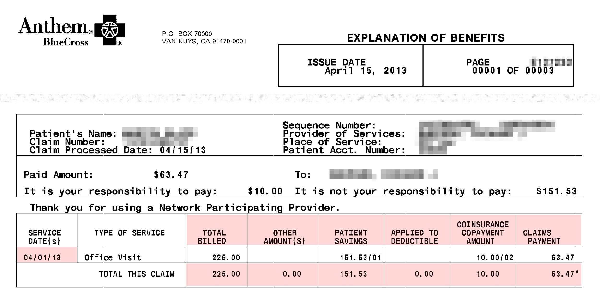
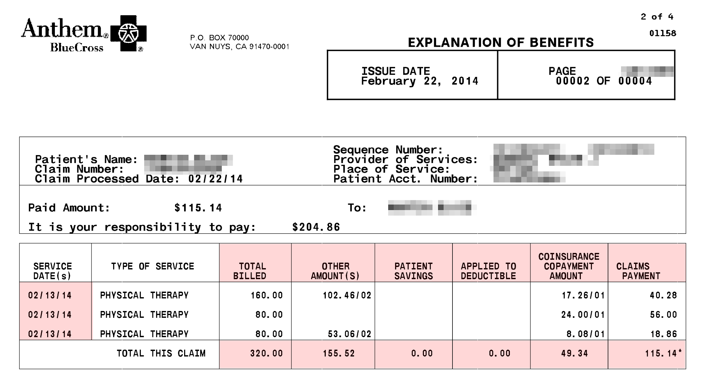

> 非官方中文译文 · 术语保留英文；代码、account、option、币种原样。
> 原文：https://beancount.github.io/docs/health_care_expenses/

# 医疗保健费用

[Martin Blais](mailto:blais@furius.ca)，2014 年 7 月

*本文档尚不完整，正在编写中，尚未发布。*

由于保险计划施加的各种上限，医疗保健费用的记账方式与普通费用略有不同。在本节中，我们将假设一个类似于美国现有的私有化医疗保健体系的背景，但同样的原则也可能适用于其他国家（如果有的话，情况会更简单）。

### 无保险计划时的记账 - 朴素方法

那么，医疗保健费用有什么特别之处呢？你可能会认为它们应该与其他费用一样处理。例如，我们可以定义几个这样的类别：

    1973-04-27 open Expenses:Health:Medical
    1973-04-27 open Expenses:Health:Dental
    1973-04-27 open Expenses:Health:Vision
    1973-04-27 open Expenses:Health:Drugs
    1973-04-27 open Expenses:Health:Acupuncture
    1973-04-27 open Expenses:Health:Massage-Therapy
    1973-04-27 open Expenses:Health:Physical-Therapy

然后，当你在这些类别中产生支出时，只需将资金流出记录到相应的账户即可：

    2014-01-08 * "CityPT" "Copay for PT session w/ Rob on 12/28"
      Liabilities:US:BofA:Credit-Card     -25 USD
      Expenses:Health:Physical-Therapy     25 USD

事实上，如果你所有的医疗保健费用都是自付的，这种方法完全可行。如果这是你的情况，那么这就是你应该做的。它很直接明了。

问题在于，在现实中，绝大多数人并不自己支付医疗保健费用。你大部分与健康相关的费用是由你的保险支付的。这并不意味着没有成本：根据你的保险计划，保险通常只支付实际费用的一部分，具体取决于服务类型。特别是，根据你的保险计划，在任何一个日历年中，你需要支付 100% 的医疗保健费用，直到达到一个固定金额（通常是几百美元）。这被称为 *deductible*（自付额）。在此之前，你支付服务费用的一定比例（即 *copayment*（共付额）），而在达到更高的限额（即 *out-of-pocket maximum*（自付上限））之后，你就不再需要支付任何费用；具有此类限额的计划保证你永远不会支付超过该金额的费用。

如果你只记录你为 deductible 支付的部分，那么反映在损益表上的费用规模将主要取决于你在 1 月 1 日之后*碰巧首先使用*了哪种类型的服务。它无法准确反映你使用的每项服务的实际成本。因此，这种方法并不太有用。

### 记录现金支付 - 错误的方式

因此，你可能会认为应该将这些相同的资金流出记录到反映其真实性质的类别中：

    1973-04-27 open Expenses:Health:Medical:Deductible
    1973-04-27 open Expenses:Health:Medical:Copayments
    1973-04-27 open Expenses:Health:Vision:Deductible
    1973-04-27 open Expenses:Health:Vision:Copayments
    1973-04-27 open Expenses:Health:Dental:Deductible
    1973-04-27 open Expenses:Health:Dental:Copayments

然后将支付记录到这些类别中：

    2014-01-08 * "CityPT" "Copay for PT session w/ Rob on 12/28"
      Liabilities:US:BofA:Credit-Card     -25 USD
      Expenses:Health:Medical:Copayments   25 USD

但这在很大程度上令人不满意，原因有几点：虽然这跟踪了总共支付了多少自付额（deductible）和共付额（copayments），但它没有反映使用了多少特定医疗服务提供者的服务。

更重要的是，这是不正确的，因为自付额和共付额限额适用于服务提供日期的每个日历年，而不是支付日期。换句话说，如果你在 2013 年 12 月 28 日接受了服务，但在次年 2014 年 1 月 8 日支付了费用，那么共付额的累计将计入错误的年份。为了正确执行此操作，你必须在*服务日期*累计自付额和共付额金额，该日期始终提供在你的保险公司提供的文件上（*Explanation of Benefits*，稍后对此进行更多介绍）。服务日期是你实际接受提供者服务的日期。

另一种解决方案是为每一年定义账户，类似于税务账户（参见 Taxes 章节）：

    2012-01-01 open Expenses:Health:Medical:Y2012:Deductible
    2012-01-01 open Expenses:Health:Medical:Y2012:Copayments
    2013-01-01 open Expenses:Health:Medical:Y2013:Deductible
    2013-01-01 open Expenses:Health:Medical:Y2013:Copayments
    2014-01-01 open Expenses:Health:Medical:Y2014:Deductible
    2014-01-91 open Expenses:Health:Medical:Y2014:Copayments
    2014-01-01 open Expenses:Health:Dental:Y2012:Deductible
    2014-01-91 open Expenses:Health:Dental:Y2012:Copayments
    … 

然后，当你记录你的费用时，你可以使用对应于接受服务年份的账户：

    2014-01-08 * "CityPT" "Copay for PT session w/ Rob on 12/28"
      Liabilities:US:BofA:Credit-Card          -25 USD
      Expenses:Health:Medical:Y2013:Copayments  25 USD

然而，这不是一个很好的解决方案，因为需要为每一年创建大量账户，而且它仍然无法告诉我们消耗了多少每项服务。我们显然需要一个更好的解决方案。

### 医疗保险支付是如何运作的

首先，让我们回顾一下保险支付是如何运作的，因为要正确记录这些费用，需要对理赔支付有基本的了解。

对于每一项服务，你的保险会覆盖其中的一部分，而你通常需要支付差额。其运作方式是：你的医生向保险公司发送账单，保险公司要么 (a) 直接向医生支付该服务中已覆盖部分的款项，要么 (b) 保险公司寄给你一张支票，你需要将其背书转让给医生（通常在你收到一些烦人的提醒之后）。有时，但并非总是，你的保险公司会向你发送一份关于医生索赔的报告。这份文件被称为*利益说明*（explanation of benefits）或“EOB”，它详细列出了保险支付的服务部分、你负责支付的部分以及其他金额。与你的保险公司没有直接关系的服务提供商需要这些详细信息。对于记账目的而言，这是一份有用的文件：请确保自己保留一份副本[^1]。

以下是一份 EOB 的示例，其中重要区域已高亮显示：

上述示例展示了以下金额：

-   **Claims/Billed（索赔/账单金额）。** 医生就该项服务向保险公司要求的金额。

-   **Patient Savings（患者节省金额）。** 由于与提供商（针对网络内提供商）预先达成的协议，服务费用减少的金额。

-   **Applied to Deductible（计入免赔额）。** 作为本年度免赔额的一部分，你需要自行承担该服务的金额。你需要支付这笔钱。

-   **Copayments（共付额）。** 保险未覆盖的服务部分。你必须支付这笔钱。

-   **Claims Payments（索赔支付）。** 保险公司实际向提供商开具支票支付的金额。

你的保险公司提供的 EOB 上使用的术语可能略有不同，但你应该能轻松找到对应的金额。

随后，医生的账单部门会就未覆盖的部分向你发送账单[^2]，你通过信用卡、支票或其他方式向他们支付款项。当账单或 EOB 送达你手中时，请将其视为一笔应付账款。

总而言之，与一笔索赔相关的日期有四个：

-   **Date of Service（服务日期）。** 即你访问医生诊所、接受服务的日期。这是记录免赔额和共付额时相关的日期。

-   **Date of Issue（签发日期）。** 保险公司处理该索赔的日期。你可以忽略此日期。

-   **Billing Date（账单日期）。** 提供商收到其索赔的付款并向你就剩余部分开具账单的日期。我们也不太关心这个日期。

-   **Date of Payment（支付日期）。** 你进行支付的日期。这会自动显示在你的信用卡或支票账户对账单上；如果你是用现金支付的，则需要手动输入此日期（就像你记录所有关心的现金 transaction 一样）。

当你引用任何索赔时，最重要的日期是*服务日期*。如果你将 EOB 扫描并归档到文档中，明智的做法是重命名文件，以便在文件名中包含此日期。

### 提供商网络

在美国，每位医疗专业人员（或“服务提供商”）都会根据保险公司的付款费率以及其在账单支付方面的配合程度，决定是否与每家保险公司维持既定的合作关系。如果维持了这种关系，他们就被保险公司视为“网络内提供商”（in-network provider）。否则，他们被视为“网络外提供商”（out-of-network provider），保险公司对服务费用的报销比例会低得多。这就是唯一的区别。保险公司网络内的提供商名单——以及他们在拒绝支付账单方面的严格程度——通常是那些有选择权的人在挑选保险计划时的主要考量因素。

但由于大多数雇主通过为员工支付医疗保健保险费用来在薪酬福利方面展开竞争，而且由于他们代表着一大群客户（即员工），通常能够比个人从保险公司那里谈判到更优惠的费率，因此绝大多数有工作的人最终会选择其雇主的保险计划，并尽量前往网络内提供商就诊。然而，这并不总是可行的：你的家庭医生可能会在一年中的某个时候决定不再接受你的保险作为网络内服务，而你可能更倾向于维持与医生的既有关系而不是更换医生，因此你最终不得不支付稍高的费用。归根结底，在典型的一年中，你通常会使用一些网络内和网络外专业人员的服务，并且必须对这两类成本进行核算。

### 按服务日期计提 - 正确的方法

理想情况下，我们希望获取以下金额的余额：

-   每项服务的成本金额，无论由谁支付

-   每个日历年中使用的免赔额和共付额金额

我们将执行的操作是录入两条分录：

1.  针对每张 EOB（解释性账单），在服务日期录入一条分录，从中获取应付账款。

2.  针对每笔付款，从 *Asset* 或 *Liability* account 中支出。

#### 网络内提供商

对于网络内提供商，典型的分录如下所示：

    2013-04-01 * "DR RAPPOPORT" "Office visit" ^anthem-claim-8765937424
      Expenses:Health:Medical:Claims            225.00 USD
      Expenses:Health:Medical:PatientSavings   -151.53 USD
      Liabilities:US:Accounts-Payable           -10.00 USD ; Copay
      Expenses:Health:Medical:ClaimsPayment     -63.47 USD

一旦你弄清楚要从这些 EOB 中提取哪些数字，录入其他分录就会变得简单，因为它们非常规律且外观一致。

请注意，网络内 EOB 会包含一个“Patient Savings”（患者节省）数字。这旨在反映由于你选择的保险计划而导致的较低支付金额。（实际上，这有点障眼法，因为医生开具的所有索赔金额都被夸大，以反映他们实际获得的支付金额，但我认为保险公司喜欢无论如何都向你展示这些数字。）

我喜欢立即将缺失的部分反映到“accounts payable”（应付账款）负债中，这告诉我已将其登记为即将发生的付款：

    1973-04-27 open Liabilities:US:Accounts-Payable

然后，当付款分录通过你的信用卡导入进来时，你可以消除这笔应付账款：

    2014-01-08 * "Rappoport Medical Office" ^anthem-claim-8765937424
      Liabilities:US:BofA:Credit-Card     -10.00 USD
      Liabilities:US:Accounts-Payable      10.00 USD

注意我如何使用“`^anthem-claim-8765937424`”将这两笔 transaction 相互“链接”，以便日后轻松查找和验证。

对于网络内医生，由于保险公司的付款通常是可以预测的，医生办公室有时会要求你在就诊当天支付共付额。只需将此作为现金分录记入同一负债 account 即可。

如果你经常看某位医生，你可以为他们创建专用的 Liabilities account：

    2009-09-17 open Liabilities:US:Accounts-Payable:DrRappoport

#### 网络外提供商

对于网络外提供商，EOB 略有不同：

我们注意到有一个“other amount”（其他金额）部分，这基本上就是提供商将核销的金额，而 Patient Savings 部分为空。

对应此 EOB 的典型分录如下所示：

    2014-02-13 * "ROB BOONAN" | "Physical Therapy" ^anthem-claim-17646398
      Expenses:Health:PhysicalTherapy:Claims           320.00 USD
      Expenses:Health:PhysicalTherapy:ClaimsPayment   -115.14 USD
      Expenses:Health:PhysicalTherapy:Uncovered       -155.52 USD                                                                                                                                                                                                                                                                  
      Liabilities:US:Accounts-Payable:CityPT           -49.34 USD

你通常会收到服务提供商付款的支票（在示例中，这是一张 115.14 美元的支票），并且必须自己寄给他们。你可以立即存入支票并用信用卡进行全额付款，或者寄出支票并只支付差额（这是大多数人的做法）：

    2014-01-08 * "City PhysioTherapy" ^anthem-claim-17646398
      Liabilities:US:BofA:Credit-Card            -49.34 USD
      Liabilities:US:Accounts-Payable:CityPT      49.34 USD

一个有趣的转折是，许多网络外提供商会接受保险公司为网络外服务支付的较低金额，并核销超额部分，或者只向你收取名义金额。例如，与我常去的物理治疗机构的“协议”是他们每次会话向我收取 25 美元。同样，索赔金额当然是夸大的，保险公司声称你必须支付的明显金额大部分需要被核销。这是你如何记录此类分录的 EOB：

    2014-02-13 * "ROB BOONAN" | "Physical Therapy" ^anthem-claim-17646398
      Expenses:Health:PhysicalTherapy:Claims           320.00 USD
      Expenses:Health:PhysicalTherapy:ClaimsPayment   -115.14 USD
      Liabilities:US:Accounts-Payable:CityPT           -25.00 USD
      Expenses:Health:PhysicalTherapy:WriteOffs

提供商的管理员不会在每次就诊时向我收费。她计提金额，并在决定处理其会计时，对总额进行收费，从而使 account 清零。这可能看起来像这样：

2014-02-26 * "Payment for 3 Physical Therapy treatments"
      Liabilities:US:BofA:CreditCard             -75.00 USD
      Liabilities:US:Accounts-Payable:CityPT

### 跟踪免赔额和共付限额

如前所述，您在医疗保健服务上的最终支付金额存在上限。这些上限按日历年计算，因此需要在服务日期当天应用。基于此原因，我们可以将相应的条目附加到 EOB 条目上，然后按年份筛选 transaction，以计算该年度的余额。

我喜欢密切关注这些限额，并确保它们被正确应用。根据我的保险计划，这些限额定义如下：

-   **Deductible（免赔额）。** “在一个日历年内，在您的健康保险开始支付承保服务之前，您自付的金额。”

-   **Out-of-pocket maximum（自付上限）。** “在一个日历年内，您为承保的医疗保健服务自付的最大金额。存在一些排除项，例如处方药和部分服务。”

-   **Co-payment（共付额）。** “您为某项服务自付的固定费用。该费用不随服务的实际 cost 而变化。”

然而，情况并不简单，因为对于网络内（in-network）和网络外（out-of-network）的提供商，免赔额和共付额都有各自不同的限额：

-   为网络内免赔额支付的金额计入您的网络外免赔额限额。

-   为网络内共付额支付的金额计入您的网络外共付额限额。

-   为免赔额支付的金额计入您的共付额限额。

我使用在另一份文档中描述的“镜像记账”技术来实现这一点。其核心思想是使用一种替代货币来统计这些金额。

***TODO: complete this***

### 保险保费

接下来，你需要追踪在保险保费上的支出。这些是你为获得保险单本身而支付的固定半月付款项——通常直接从你的工资中扣除。对于大多数在美国有工作的人来说，我的雇主提供几种健康保险计划并支付大部分费用，但总有一部分需要我自己支付：

    1973-04-27 open Expenses:Health:Insurance

固定保费会自动从我的工资条目中扣除，正如我的工资单上所示：

    2014-02-08 * "Acme Corp - Salary"
      …
      Expenses:Health:Insurance        42.45 USD
      …

在你的工资单上，请注意不要将此与“Medicare 税”混淆，后者是一种用于支付美国为老年人提供的部分社会化医疗成本的税。这仅仅是一种税，与你自己的医疗保健支出关系不大。

### 药品 

药品是单独核算的。

***TODO: complete this***

[^1]: 你并不总是通过邮件收到这些账单，但保险公司现在终于推出了网站，你可以在上面下载所有代表你提交的理赔记录（并对其进行核算），即使那些没有邮寄给你的记录也是如此。

[^2]: 这是一件极其令人烦恼的事情，因为每位医生都有不同的收费部门，这些部门通常陈旧过时，其在线支付选项几乎总是失效（你最终不得不拨打一个电话号码，说服一位脾气暴躁的管理人员用信用卡付款，因为他们仍然习惯于接收*支票*），并且所有合作为你提供医疗服务的不同服务提供商都会分别向你收费（并且拥有不同的收费部门）。例如，如果你接受手术，在接下来的 6 个月内，你可以预期会收到来自你的外科医生、他的助手、麻醉师、在你睡眠期间监测你脑活动的人员、进行血液检查的实验室、阅读 X 光片的人员等的不同账单。而且，这些账单可能在手术发生 6 个月之后才寄出，甚至一直拖到下一年。这完全是卡夫卡式的荒诞。你不得不认真思考，为什么保险公司不总是向服务提供商支付全额服务费，然后只向你收取一次自付额（deductibles）。那样会使流程简单得多，并降低管理医疗保健的高昂成本。

---

> **版权与许可**：原文 © Martin Blais / beancount/docs contributors，MIT License。中文翻译为非官方 derivative work，仅供个人学习；详见 [NOTICE.md](../NOTICE.md)。
