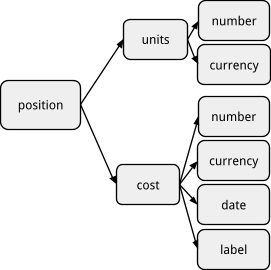

> 非官方中文译文 · 术语保留英文；代码、account、option、币种原样。
> 原文：https://beancount.github.io/docs/how_inventories_work/

# Beancount 的 Inventory（库存）是如何运作的

> **面向 intermediate → advanced 读者** · 已使用 Beancount 一段时间、准备开始跟踪投资与成本基础的读者。
>
> 原文：Martin Blais，2016 年 12 月
> 来源：[How Inventories Work](http://furius.ca/beancount/doc/booking)
> 翻译原则：中文为主；`transaction`、`posting`、`directive`、`account`、`balance assertion`、`tolerance`、`precision`、`interpolation`、`cost`、`price`、`lot`、`booking`、`pad` 等术语保留英文。`inventory`、`position`、`commodity`、`augmentation`、`reduction`、`cost basis` 等 Beancount 核心概念也保留英文，以便与代码和报表术语对齐。代码块、account 名、option 名、货币代码、链接、图片路径均保持原样。

> **版本提示**：本文写于 2016 年 12 月。文中多处标注 AVERAGE booking 与 trade 记录"尚未实现"；现代 Beancount（v2 起）已经实现了 `booking_method "AVERAGE"`，但 trade 的自动记录至今仍未完成。阅读时请以你实际使用的 Beancount 版本的 option reference 为准。

## 译者导读

这篇不是"如何写 transaction"的教程，而是解释 Beancount 最核心的内部机制：**inventory**。你记下的每一笔 posting，最终都要落到某个 account 的 inventory 里——Beancount 正是通过对 inventory 内容的聚合来计算余额、执行 balance assertion、跟踪 cost basis、并自动算出资本利得。理解了 inventory 与 booking，你就理解了 Beancount 为什么能"只记账、不手算投资回报"。

对高级用户，这一章真正值得带走的是：

1. **augmentation 与 reduction 是两套完全不同的语义。** 买入（正号、带 cost）是"增补"，会新建一个 lot，并把你给的 cost、label、date 记到 lot 上；卖出（负号）是"减持"，你写的 cost/label/date 只是**过滤条件**，用来在现有 lot 里挑出要砍哪一个，被砍 lot 的真实 cost basis 会被回填。写反了会直接报 ambiguous match 错误。
2. **booking method 决定"多个 lot 匹配时怎么选"，直接决定你的资本利得。** 默认 STRICT 遇到歧义就报错；FIFO/LIFO 按获得日期先后自动选 lot；AVERAGE 用平均成本（适合退休账户这类不计成本基础的场景）；NONE 干脆不合并、只保留总和。
3. **price 与 cost basis 是两回事。** 做 balance 时，有 cost basis 就用 cost basis、不用 price；price 只是注解，供 plugin（`implicit_prices` / `sellgains`）使用。这正是"资本利得能被自动算出来"的原因。
4. **这是 Beancount 与 Ledger 的分水岭。** Ledger 只有 NONE 一种 booking 方式；Beancount 提供 STRICT/FIFO/LIFO/AVERAGE/NONE，让你能精确控制每一股的成本归属——这是做税务报告时最需要的能力。

---

*本文说明我们如何累积 commodity，以及如何把卖出（reduction）与已累积的 inventory 内容相匹配。*

## 引言

除了能够跟踪并列出每个 account 上的 posting（这一操作会产生一个 *journal*，即条目流水）之外，Beancount 最常见、最有用的操作之一，就是对任意一组 posting 的 position 求和。这些聚合是 Beancount 工作原理的核心，它们实现于一个名为 "inventory"（库存）的对象中。本文解释这个聚合过程是如何工作的。如果你要跟踪投资，就有必要理解下面的内容。

## 匹配与 Booking Method

为了获得整体图景，让我们通过几个简单的例子走一遍各种 booking 特性。这样你可以一次性接触到所有主要概念。

### 简单 Posting —— 无 Cost

考虑对一个 account 的一组简单 posting，例如：

    2016-04-24 * "Deposit check"
      Assets:Bank:Checking      221.23 USD
      … 

    2016-04-29 * "ATM Withdrawal"
      Assets:Bank:Checking     -100.00 USD
      … 

    2016-04-29 * "Debit card payment"
      Assets:Bank:Checking      -45.67 USD
      … 

Checking account 的 inventory 初始为空。第一笔 transaction 之后，其内容为 221.23 USD。第二笔之后，为 121.23 USD。最后，第三笔 transaction 使余额变为 75.56 USD。这看起来非常自然；数字就是简单地相加。

这也许是显而易见的，但还要注意：数字允许改变符号（变为负数）。

### 多种 Commodity

一个 inventory 可以包含不止一种 commodity（商品，泛指货币、股票、基金份额等）。它等价于一个从 commodity 到某个单位数量的映射。例如：

    2016-07-24 * "Dinner before leaving NYC"
      Expenses:Restaurants     34.58 USD
      … 

    2016-07-26 * "Food with friends after landing"
      Expenses:Restaurants     62.11 CAD
      … 

这两笔 transaction 之后，Restaurants account 包含 34.58 USD 和 62.11 CAD。它的内容被称为混合 commodity。自然地，posting 只会应用到它们所影响的货币。例如，下面这笔 transaction

    2016-07-27 * "Brunch"
      Expenses:Restaurants     23.91 CAD
      … 

使该 account 的余额变为 34.58 USD 和 86.02 CAD。USD 的单位数量没有变化。

注意，account 可以包含任意数量的 commodity，这对于按 cost 持有的 commodity 也是如此，我们稍后会看到。虽然这是允许的，但我建议你定义足够的 account，让每个 account 只保留一种 commodity；这可以通过 "[onecommodity](http://github.com/beancount/beancount/tree/master/beancount/plugins/onecommodity.py)" plugin 来强制。

### Cost Basis（成本基础）

当我们考虑用 cost basis 跟踪投资时，事情变得稍微复杂一些。Beancount 允许你将 cost basis 和一个可选的 label 与某个已获得的特定 lot 关联起来。考虑对投资 account 的两笔买入：

    2015-04-01 * "Buy some shares of Hooli in April"
      Assets:Invest            25 HOOL {23.00 USD, "first-lot"}
      … 

    2015-05-01 * "Buy some more shares of Hooli in May"
      Assets:Invest            35 HOOL {27.00 USD}
      … 

所以现在，投资 account 的 inventory 包含

              units ccy   cost  cost-ccy lot-date    label
                 25 HOOL {23.00 USD,     2015-04-01, "first-lot"}
                 35 HOOL {27.00 USD,     2015-05-01, None}

这两个 lot 没有合并，它们在 inventory 中仍然是两个独立的 position。只有当 commodity 以及其*所有* cost 属性完全匹配时，inventory 才会合并 lot 并调整单位数。（实际上，两次 augmentation 具有相同 cost 和 date 属性是非常罕见的。）

注意 Beancount 如何自动将获得日期关联到每个 lot；如果你愿意，可以通过添加类似可选 label 的日期来覆盖它。这对于做 cost basis 调整很有用。

向 inventory 内容*添加*的 posting 被称为 **augmentation**（增持）。

### Reduction（减持）

但是我们如何从 inventory 中移除 commodity 呢？

你可以通过卖出其中一部分来削减现有的 lot。做法是向 account 提交一个 **reduction**，像这样：

    2015-05-15 * "Sell some shares"
      Assets:Invest           -12 HOOL {23.00 USD}
      … 

为明确起见，使这个 posting 成为 **reduction** 的，仅仅是符号（-）与该 commodity 的 account 余额（+25）相反这一事实。这个 posting 告诉 Beancount 找出所有 cost basis 为 23.00 USD 的 lot，并从中移除 12 个单位。得到的 inventory 将是

              units ccy   cost  cost-ccy lot-date    label
                 13 HOOL {23.00 USD,     2015-04-01, "first-lot"}
                 35 HOOL {27.00 USD,     2015-05-01, None}

注意第一个 posting 是如何被减少 12 个单位的。我们不需要指定 lot 的所有属性，只需指定 cost。我们也可以等效地使用 date 来指定要削减哪个 lot：

    2015-05-15 * "Sell some shares"
      Assets:Invest           -12 HOOL {2015-04-01}
      … 

或者用 label：

    2015-05-15 * "Sell some shares"
      Assets:Invest           -12 HOOL {"first-lot"}
      … 

或者它们的组合。任何属性组合都会与 inventory 内容匹配，以确定要削减哪个 lot。事实上，如果 inventory 恰好只有一个 lot，你可以这样削减它：

    2015-05-15 * "Sell some shares"
      Assets:Invest           -12 HOOL {}
      … 

### 歧义匹配（Ambiguous Matches）

但是如果有多个 lot 匹配这个 reduction 会怎样？例如，用之前的包含两个 lot 的 inventory，如果你这样写卖出：

    2015-05-15 * "Sell some shares"
      Assets:Invest           -12 HOOL {}
      … 

Beancount 将无法确定哪个 lot 需要被削减。我们遇到了一个 ambiguous match。

部分 ambiguous match 也是可能的。例如，如果你要从下面的 inventory 中削减：

              units ccy   cost  cost-ccy lot-date    label
                 25 HOOL {23.00 USD,     2015-04-01, None}
                 30 HOOL {25.00 USD,     2015-04-01, None}
                 35 HOOL {27.00 USD,     2015-05-01, None}

而你尝试这样削减：

    2015-05-15 * "Sell some shares"
      Assets:Invest           -12 HOOL {2015-04-01}
      … 

前两个 lot 被选为匹配项。

### STRICT booking

Beancount 如何处理 ambiguous match？默认情况下，它会产生一个 error。

更准确地说，发生的是 Beancount 调用 **booking method**，它根据设置来处理 ambiguous match。默认的 booking method 是 "**STRICT**"，它直接放弃并输出一个 error，告诉你需要细化输入以消除 inventory reduction 的歧义。

### FIFO 与 LIFO Booking

还有其他可用的 booking method。它们可以通过 option 配置，像这样：

    option "booking_method" "FIFO"

"**FIFO**" method 自动选择匹配 lot 中最旧的，直到满足 reduction 请求的规模。例如，给定我们之前的 inventory：

              units ccy   cost  cost-ccy lot-date    label
                 25 HOOL {23.00 USD,     2015-04-01, "first-lot"}
                 35 HOOL {27.00 USD,     2015-05-01, None}

尝试削减 28 股，像这样：

    2015-05-15 * "Sell some shares"
      Assets:Invest           -28 HOOL {}
      … 

会匹配两个 lot，将第一个完全减为零，并从第二个 lot 中移除剩余的 3 个单位，得到如下 inventory：

              units ccy   cost  cost-ccy lot-date    label
                 32 HOOL {27.00 USD,     2015-05-01, None}

"LIFO" method 工作方式类似，但首先消耗最新（最晚）的 lot，按时间倒序工作以移除数量。

### 按 Account 设置 Booking Method

你不必让所有 account 都遵循相同的 booking method；上一节的 option 设置的是所有 account 的默认 method。要为特定 account 覆盖 booking method，可以在该 account 的 Open directive 上使用一个可选的字符串 option，像这样：

    2014-01-01 open Assets:Invest    "FIFO"

这允许你以不同的 booking 解析方式处理不同的 account。

### 完全匹配（Total Matches）

strict booking 有一个例外：如果整个 inventory 恰好被削减了总的单位数，那么显然所有匹配的 lot 都要被选中，这被认为是无歧义的，即使在 "STRICT" booking 下也是如此。例如，在 "STRICT" booking 下，下面这个 reduction 会清空之前的 inventory 而不报错，因为匹配的有 25 + 35 股：

    2015-05-15 * "Sell all my shares"
      Assets:Invest           -60 HOOL {}
      … 

### AVERAGE booking

由政府激励计划创建的退休账户（如美国的 401k 计划或加拿大的 RRSP）通常包含税前资金。对于这类账户，券商通常忽略 cost basis 的计算，因为税收是在资金转出账户时才征收。这些账户通常被管理到完全投资的程度；因此，费用通常以投资组合的份额形式收取，按费用支付当天的价格计价。这使得跟踪各个 lot 的 cost basis 变得麻烦。

正确的做法是分别处理每种 commodity 的整套 lot 的单位数量和 cost basis。例如，下面两笔 transaction：

    2016-07-28 * "Buy some shares of retirement fund"
      Assets:Invest       45.0045 VBMPX {11.11 USD}
      … 

    2016-10-12 * "Buy some shares of retirement fund"
      Assets:Invest       54.5951 VBMPX {10.99 USD}
      … 

应该得到一个单一 lot，具有总单位数和平均 cost：

              units ccy    cost    cost-ccy lot-date    label
            99.5996 VBMPX {11.0442 USD,     2016-07-28, None}

在该账户中收取的费用可能看起来像这样：

    2016-12-30 * "Quarterly management fee"
      Assets:Invest       -1.4154 VBMPX {10.59 USD}
      Expenses:Fees

即使是负单位数，数量和 cost 也会被分别聚合：

              units ccy    cost    cost-ccy lot-date    label
            98.1842 VBMPX {11.0508 USD,     2016-07-28, None}

<table><tbody><tr class="odd"><td><em>这个 feature 目前尚未在 Beancount 中支持；它实现起来相当棘手，将作为未来某个 minor release 的主题。</em></td></tr></tbody></table>

> **译者注 · 版本**  
> 上面方框里"尚未支持"的说法是 2016 年的状态。现代 Beancount（v2 起）已经实现了 AVERAGE booking，可以用 `option "booking_method" "AVERAGE"` 或 `open` directive 上的 `"AVERAGE"` 启用。此处原文描述的平均成本合并逻辑，如今已可实际使用。

### NONE Booking（禁用 Booking）

不过，同时还有另一种处理非应税账户的方法：你可以简单地禁用 booking。有一个名为 "**NONE**" 的 booking method，它实现了一种非常宽松的策略，接受任何新 lot。新 lot 总是无条件地追加到 inventory。对上一节的 transaction 使用这个策略会得到这样的 inventory：

              units ccy    cost  cost-ccy lot-date    label
            45.0045 VBMPX {11.11 USD,     2016-07-28, None}
            54.5951 VBMPX {10.99 USD,     2016-10-12, None}
            -1.4154 VBMPX {10.59 USD,     2016-12-30, None}

观察得到的 inventory 是如何混合符号的；通常这是不允许的，但在这种退化的 booking method 下是被容忍的。注意，在这种 method 下，唯一有意义的数值是单位*总数*和 cost 的*总额*或*平均值*。各个 lot 并不真正是 lot，它们只代表对该 account 所做的所有 posting 的列表。

注意：如果你熟悉 Ledger，这是它支持的默认且唯一的 booking method。

## 小结

总之，以下是我们演示的内容。*Augmentation* 从来不会有问题；它们总是向现有 inventory 添加新的 position。另一方面，*reduction* 可能导致几种结果：

-   **单一匹配。** 只有一个 position 匹配 reduction；它被削减。

-   **完全匹配。** 请求的总单位数恰好等于被匹配 position 的总单位数。这些 position 被削减为零。

-   **无匹配。** 没有任何 position 匹配 reducing posting。会报出 error。

<!-- -->

-   **歧义匹配。** inventory 中不止一个 position 匹配 reducing posting；*此时调用 booking method 来处理*。

有几种 booking method 可用于处理最后一种情况：

-   **STRICT。** 报出 error。

-   **FIFO。** 从最旧（最早）的 lot 中取单位，直到 reduction 完成。

-   **LIFO。** 从最新（最晚）的 lot 中取单位，直到 reduction 完成。

-   **NONE。** 禁用 booking；reducing lot 被简单地加入 inventory。这会产生一个混合符号的 inventory，只有单位总数和 cost basis 总额是有意义的数值。

注意，下面这个**尚未**支持，但可能出现在未来版本中：

-   **AVERAGE。** 每次 reduction 之后，受影响 commodity 的所有单位被合并，并重新计算其新的平均 cost。

Beancount 为所有 account 提供一个默认 booking method，可以用 option 覆盖：

    option "booking_method" "FIFO"

booking method 的默认值是 "STRICT"。我建议你保持它不变，并只为特定 account 覆盖 booking method。

可以通过在 account 的 Open directive 上添加一个字符串来为每个 account 指定 method：

    2016-05-01 open Assets:Vanguard:RGAGX  "AVERAGE"

## Price 是如何被使用的

简短的回答是：price 根本不被使用，也不影响 booking 算法。不过，讨论它们在这个语境下做了什么是有意义的，因为用户总是对它们的解释感到困惑。

price 有两个使用场景：在 commodity 之间进行换算，以及给 reducing lot 打上其卖价的标签，以便记录并可选地平衡所得款项。

### Commodity 换算

换算用于将一种货币兑换成另一种。它们看起来像这样：

    2016-04-24 * "Deposit check"
      Assets:Bank:Checking      220.00 USD @ 1.3 CAD
      Income:Payment           -286.00 CAD

就把它 book 到 Checking account 的 inventory 而言，附带 price 的 posting 与没有 price 时处理方式完全相同：Checking account 只是收到一笔 220.00 单位 USD 的存款，并将与 commodity "USD" 的 position 匹配。price 仅用于验证 transaction 是否平衡，确保复式记账规则得到遵守（220.00 x 1.3 CAD + -286.00 CAD = 0.00）。除此之外，它在修改 inventory 内容时被忽略。在某种意义上，posting 被应用到 account inventory 之后，price 就被遗忘了，inventory 余额不保留任何关于这笔存款来自换算的记忆。

### Price 与 Cost Basis 的区别

有人可能会问，如果存在 cost basis 说明，price 是如何被使用的，像这样：

    2015-05-15 * "Sell some shares"
      Assets:Invest:HOOL           -12 HOOL {23.00 USD} @ 24.70 USD
      Assets:Invest:Cash        296.40 USD
      Income:Invest:Gains

答案常常让很多用户感到惊讶：如果存在 cost basis，balance 算法**不使用** price；用于平衡 posting 的数字是 cost basis。这是一个有用的特性，使我们能够自动计算资本利得。在前面的例子中，balance 算法会求和 -12 x 23.00 + 296.40 = -20.40 USD，这就是资本利得，(24.70 - 23.00) \* 12。它会补全最后一个 posting 并为其赋这个值。

一般来说，计算销售利润的方式是用所得款项（即现金存款）来权衡所卖 lot 的 cost basis，这足以确立利得差额。另外，如果一个 *augmenting* posting 恰好带有 price 注解，它同样不被使用。

price 是供你记录的注解。它保留在 Posting 对象上，如果你想以某种方式使用它，随时可以通过写一些 Python 代码实现。已经有两个 plugin 使用了这个注解：

-   [**beancount.plugins.implicit_prices**](http://github.com/beancount/beancount/tree/master/beancount/plugins/implicit_prices.py)：这个 plugin 取出 posting 上附带的 price，自动为每个 price 创建并插入 Price directive，以填充全局 price database。

-   [**beancount.plugins.sellgains**](http://github.com/beancount/beancount/tree/master/beancount/plugins/sellgains.py)：这个 plugin 实现了一个额外的 balance 检查：它用 price 计算预期所得款项，并与该 transaction 的*其他*所有 posting 权衡，*排除*任何 Income account 的 posting。在我们的例子中，它会检查 (-12 x 24.70 + 296.40) = 0。这提供了另一种验证输入正确性的手段。

有关这个主题的更多细节，请参见 [Trading with Beancount](trading-with-beancount.md) 文档。

## Trades（交易）

获得某项资产再将其卖回，这种组合就是我们所称的 "trade"。在 Beancount 中，我们只考虑带有 cost basis 的资产作为 trade 的对象。由于在 booking 过程中会把 reduction 与累积的 inventory 内容相匹配，因此 trade 应该在这里被识别和记录。

<table><tbody><tr class="odd"><td>
截至目前 [2016 年 12 月]，trade 记录尚未实现。

此前已经测试过一些原型，我相信在不久的将来会很容易加上。届时将在这里记录。敬请关注。
</td></tr></tbody></table>

trade 的实现方式将是：允许 booking 过程在 transaction 流中，向 augmenting 和 reducing posting 双方插入带唯一 UUID 的匹配 metadata。将提供函数和报表，能够轻松提取每个 reducing posting 的 posting 对，并以不同方式过滤它们。最终，你应该能够将所有 trade 的列表提取到一个表格中，包含获得价和卖出价，以及其他费用。

> **译者注 · 版本**  
> 截至本文撰写时 trade 自动记录仍未实现，上面的方框内容至今仍然成立。若你需要成对的买卖记录，目前仍需要自行用脚本或 plugin 从 posting 的 cost/label 信息中提取。

## 调试 Booking 问题

如果你在记录卖出时因为匹配过程遇到困难，有一些工具可以让你查看某个 account 在应用某笔 Transaction 前后的详细 inventory 内容。为此，你可以使用 bean-doctor 命令。你调用该程序时提供文件和你想要选择的 Transaction 附近的文件与行号，像这样：

    bean-doctor context <filename> <line-no>

得到的输出会显示所有受影响 account 在该 transaction 应用之前的 inventory 内容列表，包括完整呈现的 cost basis、获得日期和可选 label。注意，一些失败通常是通过丢弃无效 Transaction 的影响来处理的（但绝不会悄悄地处理）。

在 Emacs 或 VI 中，将光标放在 transaction 附近并调用相应命令是最容易的调用方式，因为它会自动插入行号。

## 附录

本文的其余部分深入更技术性的细节。你完全可以忽略这一部分，它不是理解 Beancount 工作方式所必需的阅读。只有当你对细节感兴趣时才需要费心。

### 数据表示

了解 position 在 inventory 对象中如何表示是很有用的。一个 *Position* 本质上是某种 commodity 的一定数量的单位，附带一些关于其获得情况的可选信息：

-   **Cost。** 其每单位获得成本（"cost basis"）。

-   **Date。** 这些单位被获得的日期。

-   **Label。** 某个用户指定的 label，可用于引用该 lot。

我们经常把这些 position 对象称为 "lot" 或 "leg"。示意性地，一个 position 对象看起来像这样：

*Position 对象的结构。*

有两种不同类型的 position，在接下来的小节中详细讨论：

-   **Simple positions。** 这些是没有 cost basis 的 position。"cost" 属性被设为 null 值（Python 中的 "`None`"）。

-   **Positions held at cost。** 这些是带有相关 cost basis 和获得细节的 position。

一个 *Inventory* 就是这些 position 的累积，表示为一个列表。我们有时谈论 *ante-inventory* 来指代 transaction 的 posting 应用之前的 inventory 内容，用 *ex-inventory* 指代应用之后的最终 inventory。

一个 *Posting* 是一个 position 的超集对象：除了单位和 cost 之外，它还有一个关联的 account 和一个可选的 price 属性。如果存在，price 与 units 的类型相同。它代表输入中 transaction 的一条 leg。Posting 蕴含 position，这些 position 被添加到 inventory 中。我们可以说一个 position 被 *posted* 到某个 account。

关于 Beancount 内部数据结构的更多细节，请参考 [Design Doc](beancount-design-doc.md)，它进一步展开了这个主题。

### 为什么 Booking 并不简单

reduction 过程的复杂性体现在：我们如何跟踪各个 lot 的 cost basis。为了演示这一点，让我们考虑一个简单的例子，我们将在下面不同的小节中复用它：

-   4 月 1 日以 $23/股买入 25 股。

-   5 月 1 日以 $27/股买入 35 股。

-   5 月 15 日卖出 30 股；当时价格为 $26/股。

我们现在忽略佣金，它们不会引入额外的复杂性。在 Beancount 中，这个场景会这样记录：

    2015-04-01 * "Buy some shares of Hooli in April"
      Assets:Invest:HOOL            25 HOOL {23.00 USD}
      Assets:Invest:Cash       -575.00 USD

    2015-05-01 * "Buy some more shares of Hooli in May"
      Assets:Invest:HOOL            35 HOOL {27.00 USD}
      Assets:Invest:Cash       -945.00 USD

    2015-05-15 * "Sell 30 shares"
      Assets:Invest:HOOL           -30 HOOL {...} @ 26.00 USD
      Assets:Invest:Cash        780.00 USD
      Income:Invest:HOOL:Gains

现在，整个问题围绕着*哪些*股份被选中卖出。我把这个输入渲染成了红色省略号（"…"）。用户在那个位置填写的任何内容都将用于确定我们想使用哪个 lot。

我们选择卖出哪个（些）lot，将决定利得的金额，因为那是这些股份 cost basis 的函数。这就是它重要的原因。

### Augmentation 与 Reduction

最重要的观察是，有两种不同的 lot 说明，它们在输入中看起来非常相似，但处理方式截然不同。

当我们买入时，如上面的第一笔 transaction，`{...}` cost basis 语法向 Beancount 提供关于一个*新* lot 的信息：

    2015-05-01 * "Buy some more shares of Hooli in May"
      Assets:Invest:HOOL            35 HOOL {27.00 USD}
      Assets:Invest:Cash       -945.00 USD

我们称之为对 inventory 的 "augmentation"，因为它会简单地向其中添加一个新的 position。你提供的 **cost basis** 被附加到这个 position 上，并在 inventory 中随时间的推移而保留。此外，你还可以为 augmenting lot 提供一些其他数据。让我们看看 cost 说明中可提供的所有数据：

-   **Cost basis。** 这包括每单位和总 cost 数字——它们合并为一个单一的每单位数字——以及一种货币。

<!-- -->

-   **获得日期。** 一个 lot 有一个获得日期。默认情况下，其父 transaction 的日期会被自动设为其获得日期。你可以通过提供一个日期来覆盖它。这在处理股票拆分（stock split）或 wash sale、以及保留替换股份的原始获得日期时很有用，我们稍后会看到。

-   **Label。** 你可以为它提供一个唯一的 label，以便稍后卖出其中一部分或全部时更容易引用它。

-   **Merge。** 一个指示符（flag），表示该 lot 应该被合并（这对稍后将实现的 average cost booking 有用）。

对于一个 **augmenting posting**，这些信息必须要么提供，要么自动推断。它们可以以任意顺序提供：

    2015-05-01 * "Buy some more shares of Hooli in May"
      Assets:Invest:HOOL            35 HOOL {2015-04-25, 27.00 USD, "hooli-123"}
      Assets:Invest:Cash       -945.00 USD

如果你省略 date，Transaction 的 date 会被附加给它。如果你省略 cost，其余的 posting 必须填写，以便从它们推断出 cost 金额。由于 label 本来就是可选的，未指定的 label 字段留空（null 值）。

你可能会问为什么允许覆盖 augmentation 的 date；在做 cost basis 调整以保留 posting 的原始获得日期时很有用：你移除该 posting，然后用其原始日期和新的 cost basis 替换它。

现在，当我们卖出这些股份时，我们将把这个 posting 称为 **"reducing" posting**，即一个 **"reduction"**。注意，"augmenting" 和 "reducing" 这些术语只是我在设计 Beancount 处理 inventory 的语境中创造的术语；它们不是通用的会计术语。

它是 "reduction"，因为我们在从截至其 transaction 日期为止累积的 inventory 中移除股份。例如，如果我们从那个 35 股的 lot 中卖出 30 股，输入可能看起来像这样：

    2015-05-15 * "Sell 30 shares"
      Assets:Invest:HOOL           -30 HOOL {27.00 USD} @ 26.00 USD
      Assets:Invest:Cash        780.00 USD
      Income:Invest:HOOL:Gains

虽然输入看起来与 augmenting posting 相同，但 Beancount 的处理方式截然不同：它查看应用 transaction 之前 account inventory 的状态，找出所有与你提供的 lot 数据匹配的 position。然后它使用匹配 lot 的细节作为 reducing posting 的 cost basis 信息。

在这个例子中，它会简单地匹配所有 cost basis 为 $27.00 的 position。这个例子卖出前的 inventory 包含一个单一的 35 股 @ $27.00 的 lot，所以有一个 position 匹配它，该 lot 被削减 30 股，剩下 5 股。我们稍后会看到多个 lot 匹配说明时会发生什么。

注意，你也可以提供 lot 信息的其他子集来匹配，例如只提供 label：

    2015-05-15 * "Sell 30 shares"
      Assets:Invest:HOOL           -30 HOOL {"hooli-123"} @ 26.00 USD
      Assets:Invest:Cash        780.00 USD
      Income:Invest:HOOL:Gains

这也是识别你想要削减的特定 lot 的有效方式。如果你在这里提供了 date，它也只会用于与 inventory 内容匹配，以区分在不同日期获得的 lot，而不会把 date 附加到任何地方。此外，如果 inventory 中只有一个 lot，你也可以只提供一个空的 cost basis 说明，像这样："`{}`"。下面的 Booking Method 一节将深入探讨当匹配 ambiguous 时会发生什么。

总之：

-   当你向 account 的 inventory *添加*（augmenting）时，你提供的信息用于创建一个新的 lot 并附加到它上面。

-   当你从 account 的 inventory *移除*（reducing）时，你提供的信息用于过滤 inventory 内容，选择要削减哪个（些）lot，而所选 lot 的信息会被填入。

### 同质与混合 Inventory

到目前为止，在例子中以及文档中的绝大多数例子中，"augmenting" 意味着添加正数量的股份。但在 Beancount 中，很多 account 通常有负余额，例如负债 account。公平的问题是：持有负余额的按 cost 持有的 commodity 是否有意义。

答案是肯定的。这些对应于 "short"（做空）position。大多数人不太可能卖空，但 Beancount 的 inventory 支持它。我们如何定义 "augmenting" 是相对于特定 commodity 的现有 lot 余额而言的。例如，如果一个 account 的 inventory 包含以下 position：

                                    25 HOOL {23.00 USD, 2016-04-01}
                                    35 HOOL {27.00 USD, 2016-05-01}

那么 "adding" 意味着正数量的股份。另一方面，如果 account 只包含 short position，像这样：

                                   -20 HOOL {23.00 USD, 2016-04-15}
                                   -10 HOOL {27.00 USD, 2016-05-15}

那么 "adding" 意味着负数量的股份，而 "reducing" 将通过用正数量的股份来匹配执行。

上面描绘的两个 inventory 在 HOOL 单位上是同质的，即所有 position 具有相同的符号。对于我们将看到的大多数 booking method，Beancount 使其无法创建非同质（即 "mixed"）inventory。但 "NONE" method 允许。例如，一个 mixed inventory 可能有以下内容：

                                    25 HOOL {23.00 USD, 2016-04-01}
                                   -20 HOOL {23.00 USD, 2016-04-15}

正如你可能直觉到的，"augmenting" 或 "reducing" 的概念只对 homogeneous inventory 有意义。

### 原始 Proposal

如果你对导致这个实现的 design doc 感兴趣，可以[在这里](a-proposal-for-an-improvement-on-inventory-booking.md)找到文档。我希望最终的实现既足够简单又足够通用。

---

> **版权与许可**：原文 © Martin Blais / beancount/docs contributors，MIT License。中文翻译为非官方 derivative work，仅供个人学习；详见 [NOTICE.md](../NOTICE.md)。
