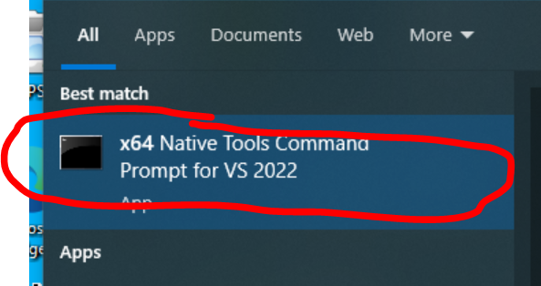

> 非官方中文译文 · 术语保留英文；代码、account、option、币种原样。
> 原文：https://beancount.github.io/docs/installing_beancount_v3/

# 安装 Beancount（C++ 版本）

[Martin Blais](mailto:blais@furius.ca) - 2020 年 7 月

[http://furius.ca/beancount/doc/v3-install](http://furius.ca/beancount/doc/v3-install)

*以下是在您的计算机上下载并运行 Beancount v3（开发中）的说明。对于 v2，请参阅此文档：[Beancount - 安装 (v2)](installing-beancount.md)*

<table><tbody><tr class="odd"><td><em><strong>本文档介绍的是 Beancount v3，这是一个实验性的开发中版本（截至 2020 年 7 月）；构建稳定版本（Beancount v2）的说明可在<a href="installing_beancount.md">另一份文档</a>中找到。</strong></em></td></tr></tbody></table>

## 设置 Python

运行程序仍然需要 Python 依赖项。

    pip install –r requirements/dev.txt

## 使用 Bazel 构建

*警告：这是一个实验性开发分支。不要期望一切都已完美打磨。*

### Bazel 依赖项

Beancount v3 使用 Bazel 构建系统，这在很大程度上将您与计算机上的本地安装和依赖项隔离开来。

需要安装的依赖项如下：

-   **Bazel 本身。** 请遵循 [https://bazel.build/](https://bazel.build/) 上的说明。

-   **C++ 编译器。** g++ 或 clang 均可。我使用的是 clang-11。

-   **Python 运行时**（版本 3.8 或更高）。请从您的发行版安装。

Bazel 会自行下载并编译其所需的所有库（甚至包括代码生成器，例如 Bison），并按照构建中指定的精确版本进行构建，因此您无需为此担心。

### 构建与测试

只需运行以下命令：

    bazel build //bin:all

目前还没有安装脚本，您必须从源代码运行。您可以使用以下命令运行单个程序（例如 bean-check）：

    bazel run //bin:bean_check -- /path/to/ledger.beancount

或者，如果您不介意自动重新构建修改后的代码，可以这样运行：

     ./bazel-bin/bin/bean_check /path/to/ledger.beancount

### 开发

您可以像这样运行所有单元测试：

    bazel test //...

由于 Bazel 对所有依赖项都有详细的记录，在修改代码后重新运行此命令只会重新测试受影响的 targets；这使得带有测试的迭代开发变得更加有趣。

另一个优势是，由于构建所依赖的所有库都是下载并构建的，虽然这在首次构建时可能较慢，但它允许我们使用非常新发布的依赖代码版本。

Targets 在其目录本地的 BUILD 文件中定义。所有构建规则都可以在 //third\_party 下找到。

### 数据摄取（Ingestion）

数据摄取代码涉及导入位于仓库外部的代码。Bazel 二进制文件是自包含的，如果未声明为依赖项，导入模块将会失败，因此运行 `//bin:bean_extract` target 可能无法正常工作。

这目前还不起作用（除非将您的导入配置构建为一个显式链接到 Beancount 的 py\_binary() target）。通过定义一个合适的 WORKSPACE 文件来从中获取规则，可以在不编写太多 Bazel 代码的情况下实现这一点。我还没有提供这方面的示例（待定）。

作为变通方法，您可以设置 PYTHONPATH 以从源代码位置导入，并预先创建一个指向解析器 .so 文件的符号链接。您可以像这样操作：

    make bazel-link

### 待定（TBD）

还有一些构建集成任务需要完成：

-   尚不支持 pytype。

-   pylint 也未集成到构建中。

## 使用 meson 进行开发安装 

***注意**：本节基于以下讨论进行了更新：[https://groups.google.com/g/beancount/c/7ppbyz\_5B5w](https://groups.google.com/g/beancount/c/7ppbyz_5B5w)*

Beancount v3 的 Bazel 构建会编译一些实验性的 C++ 代码，截至撰写本文时（2024 年 3 月 9 日），这些代码除了用于技术演示外，尚未用于其他任何用途。在“生产”环境中，v3 使用 meson-python 来构建扩展模块，并将其打包成 Python wheel。这就是 pip 在安装过程中所使用的机制。

本节描述的是用于开发 beancount v3 python 代码的安装流程，而不是用于实验 C++ 代码。

### 在 Linux 上

已在 Ubuntu 上使用 python3.12 和 python3.12-dev 进行测试

相关链接

[https://mesonbuild.com/meson-python/how-to-guides/editable-installs.html](https://mesonbuild.com/meson-python/how-to-guides/editable-installs.html#build-dependencies)

    git clone https://github.com/beancount/beancount.git

创建并激活虚拟环境

    python3.12 -m venv beancount/venv
    . beancount/venv/bin/activate
    cd beancount

安装所需的软件包。

    python -m pip install meson-python meson ninja

以可编辑模式安装 beancount，且不进行构建隔离

    python -m pip install --no-build-isolation --editable .

**注意：** 有一种 [观点](https://groups.google.com/g/beancount/c/7ppbyz_5B5w/m/YlHiKhynFAAJ) 认为不需要 --no-build-isolation 选项，但也有人提到，如果没有这个选项，[安装将无法正常工作](https://groups.google.com/g/beancount/c/7ppbyz_5B5w/m/nSxCzuutFAAJ)。此外，[文档](https://mesonbuild.com/meson-python/how-to-guides/editable-installs.html#editable-installs) 也建议需要此选项。这可能取决于 Linux 环境的类型

安装 pytest

    python -m pip install pytest

运行测试并确保一切正常：

    pytest --import-mode=importlib beancount/

### 在 Windows 上

已在 64 位 Windows 10 Pro 上测试

**先决条件**

安装 Microsoft Visual Studio（已在 v 2022 上测试）

**步骤**

    git clone https://github.com/beancount/beancount.git
    cd beancount

如果运行的是 x64 位 Windows，请启动 "x64 Native Tools Command Prompt for VS 20XX"。为此，请按下并释放 Windows 键，然后输入 x64

打开此提示符

转到 beancount 安装的目录

    C:\Program Files\Microsoft Visual Studio\2022\Community>cd C:\_code\t\beancount
    C:\_code\t\beancount>

激活虚拟环境

    C:\_code\t\beancount>venv\Scripts\Activate
    (venv) C:\_code\t\beancount>

安装所需的软件包

    (venv) C:\_code\t\beancount>py -m pip install meson-python meson ninja

以可编辑模式安装 beancount。与 Linux 不同，在 Windows 上 **`--no-build-isolation`** 一方面会抛出一些错误，另一方面似乎并不需要

    (venv) C:\_code\t\beancount> py -m pip install --editable .

安装 pytest

    (venv) C:\_code\t\beancount>py -m pip install pytest

运行测试

    (venv) C:\_code\t\beancount>pytest --import-mode=importlib beancount

注意：Windows 上的一些测试会失败，这是由于通用的 [可移植性问题](https://github.com/beancount/beancount/issues?q=is%3Aopen+is%3Aissue+label%3Aportability)

---

> **版权与许可**：原文 © Martin Blais / beancount/docs contributors，MIT License。中文翻译为非官方 derivative work，仅供个人学习；详见 [NOTICE.md](../NOTICE.md)。
