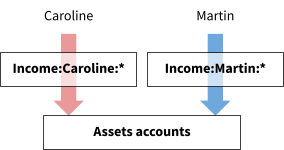
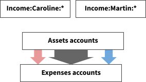
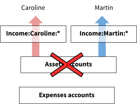
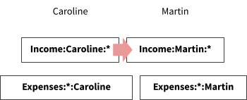
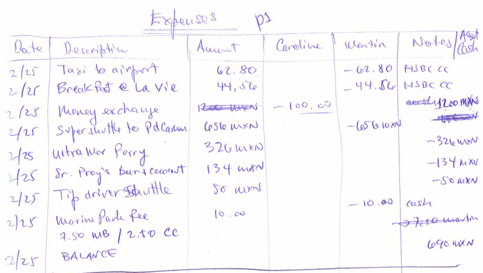
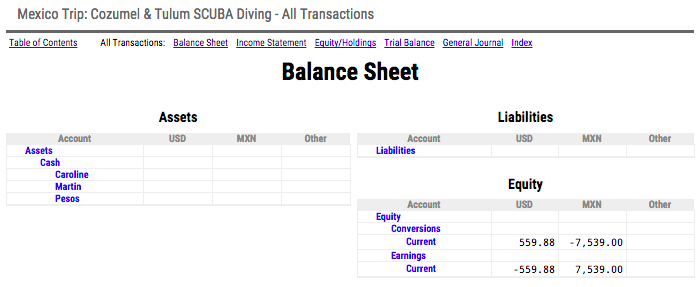
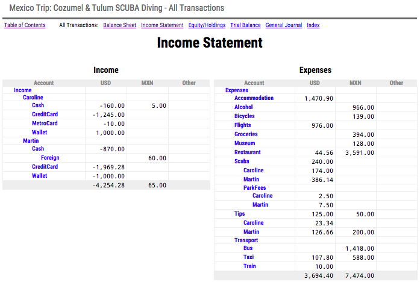
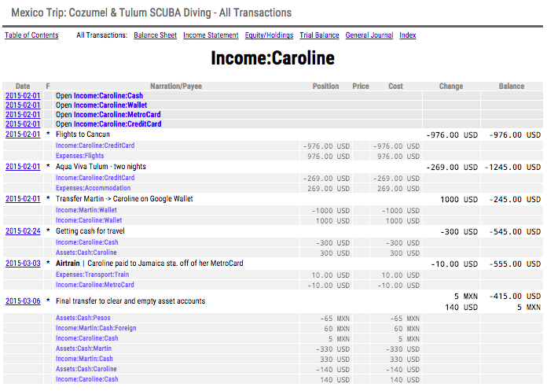

> 非官方中文译文 · 术语保留英文；代码、account、option、币种原样。
> 原文：https://beancount.github.io/docs/sharing_expenses_with_beancount/

# 在 Beancount 中分摊费用

[Martin Blais](mailto:blais@furius.ca)，2015 年 5 月

[http://furius.ca/beancount/doc/shared](http://furius.ca/beancount/doc/shared)

## 简介

本文介绍了一种在复杂的群体场景中精确且轻松地核算共享费用的方法。例如，与一群朋友一起旅行，每个人为不同的项目付款。我们展示了如何处理需要在群体中平均分摊的费用，以及应分配给特定个人的群体费用。

该方法使用复式记账系统。该方法的核心在于将费用的核算与其相关付款分离开来。这使得处理共享成本变得更加容易，因为使用此方法时，谁为某项费用付款并不重要：我们在最后核对每个人应支付的精确金额，并自动计算每个人的最终更正转账。

本文围绕一次简单的旅行展开，费用由两个人平均分担。然而，同样的方法可以推广到任何类型的项目，其中收入和费用需要在多个参与者之间共享，无论费用是否平均分摊。

## 一个旅行示例

马丁（作者）和卡罗琳（他的女朋友）于 2015 年 3 月访问了墨西哥。我们前往科苏梅尔岛进行了为期三天的 SCUBA 潜水之旅，随后前往图卢姆放松两天，并在 [天然井](http://en.wikipedia.org/wiki/Cenote) 中潜水。

我们的假设如下：

-   **混乱的支付**。我们的生活非常忙碌……我们俩都会在出发前和旅行期间进行支付，事先不会考虑谁该支付什么，尽管我们会仔细记录每一笔支付。我们各自只需支付安排此次旅行所需的任何准备费用。例如，卡罗琳提前选择并预订了航班，而我在出发前一周支付了度假村费用，并预订了租车以及当地潜水店的活动。

-   **共享资产和个人资产的使用**。我们俩都携带现金，并将在旅行期间分别从各自的钱包以及从兑换成本地货币（墨西哥比索，我将使用“MXN”符号）的共享现金池中进行支付，并在旅行前和旅行期间根据需要使用信用卡。

-   **多种货币**。我们的一些费用将以美元计价，另一些则以墨西哥比索计价。例如，航班费用以美元支付，当地餐饮和住宿以比索支付，但当地潜水店向我们收取的是美元。兑换金额将来自现金和信用卡两种来源。

-   **共享池中的个人费用**。虽然大部分费用需要平均分担，但有些费用仅适用于我们中的一人，我们希望明确地记录这些费用。例如，卡罗琳参加了一个 SCUBA 认证课程（[PADI 开放水域](http://www.padi.com/scuba-diving/padi-courses/course-catalog/open-water-diver/)），并将独自支付该费用；同样，她也不应该支付马丁昂贵的船潜费用。更复杂的是，潜水店在我们住宿结束时向我们开具了一张包含所有费用的联合账单。

## 关于分摊的说明

我认为有必要谈谈我们支出的“分摊”方面，因为这一主题曾在邮件列表的过往讨论中，涉及分摊示例时多次被提及。

**我们故意在吹毛求疵。** 为了完成本练习，我们以极其详细的方式记录每一分钱的支出。本文档的特定目的，是展示如何高效且简单地将一组记录完善的复杂 transaction 拆解，从而精确核算每位参与者的支出，而无需关心实际付款人是谁。我们并不是吝啬鬼。

**我们将假设已决定平均分担费用。** 我们彼此之间的“慷慨”并非本文档的相关主题。我们都是薪酬优渥的专业人士，你可以假设我们已同意将此次旅行的共同成本平均（50/50）分担。

我们在此展示的方法的一个特点是，关于如何分摊费用的决定可以*独立*于实际支付成本的行为。例如，我们最终可能决定我承担旅行的 ⅔，但这一决定可以精确做出，而不是以临时性的“哦，我记得我付了这个”的方式。这在较大群体中尤为有用，因为当费用未被准确跟踪时，通常*每个人*都会觉得自己比别人付得更多。群体中*感知*到的支出份额总和总是大于 100%……

## 方法概述

本节简要介绍该方法并配以图示。我们设置一组属于该项目的共同 Assets 账户，并将所有个人支出以及为旅行进行的转账记录为来自外部 Income 账户：

在旅行期间，我们使用共同的 Assets 账户进行支出。大多数支出由我们两人共同承担（最终需要分摊），但部分支出则单独归属于我们中的某一人：

旅行结束后，剩余的 Assets（例如我们步行回家时携带的现金）被分配回各自名下，以将 Assets 账户的余额清零，我们通过向 Income 账户进行反向 posting 来记录这一过程：

最后，共享的 Expenses 列表在两人之间进行拆分——使用一个插件来 fork 所有旨在作为共享支出的 posting——并使用最终金额在两人之间进行最后一次转账，从而确保我们各自支付了自己应承担的支出，双方账目两清：

请注意，每位参与者最终的支出余额可能不同，这是由于某些支出被单独归属，或者我们决定不均匀地分摊总额所致。

## 如何记录费用

为了记录这次旅行的所有费用，我们将创建一个全新的 Beancount 输入文件。尽管这些费用将来自每个人的个人账户，但将这次旅行视为一个特殊项目是有用的，就好像它是一个独立实体，例如一家仅存在于旅行期间的公司。我们为这次旅行编写的示例文件[可以在这里找到](https://raw.githubusercontent.com/beancount/beancount/v2/examples/sharing/cozumel2015.beancount)，应该有助于你跟随本文的内容。

### account 

输入文件中的 account 集合不必与你的个人 Beancount 文件中的 account 名称相匹配。我们将使用的 account 包括对应于 Martin 和 Caroline 个人 account 的 account，但使用通用名称（例如，使用 `Income:Martin:CreditCard` 而不是 `Liabilities:US:Chase`），并且 expense account 可能与我个人 Beancount 文件中的任何常规 expense 都不匹配——这并不重要。

作为一种约定，任何专门涉及某位旅行者的 account 都**在 account 名称中包含该人的名字**。例如，Caroline 的信用卡将被命名为“`Income:Caroline:CreditCard`”。这一点很重要，因为我们稍后将使用此方法来拆分贡献和 expense。

让我们来看看执行此操作所需的不同类型的 account。

#### 外部收入 account 

“项目”将以从任一旅行者个人 account 转账的形式接收收入。这些 account 被视为项目外部的 account，因此我们将它们定义为 Income account：

    ;; External accounts for Martin.
    2015-02-01 open Income:Martin:Cash
    2015-02-01 open Income:Martin:Cash:Foreign
    2015-02-01 open Income:Martin:Wallet
    2015-02-01 open Income:Martin:CreditCard

    ;; External accounts for Caroline.
    2015-02-01 open Income:Caroline:Cash
    2015-02-01 open Income:Caroline:Wallet
    2015-02-01 open Income:Caroline:MetroCard
    2015-02-01 open Income:Caroline:CreditCard

从这些 account 进行的 transaction 必须从你的个人 Beancount 文件中复制。显然，你必须小心包含所有与旅行相关的 transaction。我在个人文件中使用了 tag 来做到这一点。

#### 资产与负债 account 

将有一些在旅行期间处于活动状态并存在的 Asset account。这些临时 account 将在旅行结束时清零。一个例子是当地货币的小额现金池：

    2015-02-01 open Assets:Cash:Pesos
      description: "A shared account to contain our pocket of pesos"

我们在旅行时口袋里也携带了现金，因此我为此创建了两个单独的 account：

    2015-02-01 open Assets:Cash:Martin
      description: "Cash for the trip held by Martin"

    2015-02-01 open Assets:Cash:Caroline
      description: "Cash for the trip held by Caroline"

然而，请注意，尽管它们有各自的名称，但这些 account 被视为项目的一部分。只是方便起见，我们分别跟踪旅行期间各自持有的现金余额。

#### 费用 account 

我们将定义各种 account 来记录我们的 Expenses。例如，“`Expenses:Flights`”将包含与航班旅行相关的成本。为了方便起见，并且因为此文件中有许多类型的 expense，我们选择利用“auto-accounts”插件，让 Beancount 自动打开这些 account：

    plugin "beancount.ops.auto_accounts"

这些 account 中的绝大多数用于需要在我们之间分摊的共享 expense。例如，共享的 SCUBA 潜水 expense 将记录到“`Expenses:Scuba`”。

然而，对于仅由我们其中一人承担的 expense，我们只需在 account 名称中包含旅行者的名字。例如，Martin 的额外船潜成本将记录到“`Expenses:Scuba:Martin`” account。

### 示例 Transaction

让我们把注意力转向文件中存在的不同类型的 transaction。在本节中，我将带你浏览一些具有代表性的 transaction（我给这些 transaction 起的名字是任意的）。

#### 贡献 Transaction

对项目成本的贡献通常以从外部账户支付费用的形式进行。例如，Caroline 用她的信用卡支付机票看起来是这样的：

    2015-02-01 * "Flights to Cancun"
       Income:Caroline:CreditCard        -976.00 USD
       Expenses:Flights

Martin 支付去机场的出租车费看起来是这样的：

    2015-02-25 * "Taxi to airport" ^433f66ea0e4e
      Expenses:Transport:Taxi                   62.80 USD
      Income:Martin:CreditCard

#### 携带现金

我们都随身携带了一些现金，因为我们被告知在墨西哥使用信用卡可能很困难。在我个人的 Beancount 文件中，现金账户是“`Assets:Cash`”，但在这里它必须作为带有我名字的外部贡献进行 booking：

    ;; Initial cash on us.
    2015-02-24 * "Getting cash for travel"
      Income:Martin:Cash                        -1200 USD
      Assets:Cash:Martin                         1200 USD

Caroline 的现金类似：

    2015-02-24 * "Getting cash for travel"
      Income:Caroline:Cash                       -300 USD
      Assets:Cash:Caroline                        300 USD

再次注意，`Assets:Cash:Martin` 和 `Assets:Cash:Caroline` 账户被视为项目的一部分，在这种情况下，它只是指谁在携带它。（这些账户在结束时会被清除，所以我们的名字在其中并不重要。）

#### 转账

在旅行之前，我非常忙。看起来 Caroline 将负责大部分安排和预付款，因此我向她的 Google Wallet 进行了一笔转账，以帮她提前支付一些费用：

    2015-02-01 * "Transfer Martin -> Caroline on Google Wallet"
      Income:Martin:Wallet                      -1000 USD
      Income:Caroline:Wallet                     1000 USD

#### 现金兑换

获取当地货币是通过在机场兑换少量现金完成的（汇率非常差）：

    2015-02-25 * "Exchanged cash at XIC at CUN airport"
      Assets:Cash:Caroline                    -100.00 USD @ 12.00 MXN
      Assets:Cash:Pesos                          1200 MXN

“`Assets:Cash:Pesos`” 账户跟踪我们用于各种小额支出的当地货币公共池。

#### 以美元支付的现金费用

一些当地费用需要美元，在这个例子中，我从我的现金口袋中支付：

    2015-03-01 * "Motmot Diving" | "Deposit for cenote diving"
      Expenses:Scuba                            50.00 USD
      Assets:Cash:Martin

#### 以当地货币支付的现金费用

使用我们共享的比索储备支付现金看起来是这样的：

    2015-02-25 * "UltraMar Ferry across to Cozumel"
      Expenses:Transport:Bus                326 MXN
      Assets:Cash:Pesos

有时我们甚至不得不混合使用美元和比索支付。在这个例子中，我们的比索用完了，所以我们必须给他们美元和比索（Tulum 海滩部分的所有餐厅和酒店都接受美元）：

    2015-03-01 * "Hartwood" | "Dinner - ran out of pesos"
      Expenses:Restaurant                  1880 MXN
      Assets:Cash:Pesos                   -1400 MXN
      Assets:Cash:Martin                 -40.00 USD @ 12.00 MXN

我使用了餐厅提供的接受美元的不利汇率（当时的市场汇率是 14.5）。

#### 个人费用

这里是一个使用共享资金进行个人费用 booking 的例子。为了让我们能够进入珊瑚礁潜水，我们必须向岛屿支付每天 2.50 美元的“海洋公园”费用。这是一次短途旅行，我只在那里潜了三天，而 Caroline 的费用包含在她的课程中，除了有一天：

      2015-02-25 * "Marine Park (3 days Martin, 1 day Caroline)"
        Expenses:Scuba:ParkFees:Martin             7.50 USD
        Expenses:Scuba:ParkFees:Caroline           2.50 USD
        Assets:Cash:Martin

只需要将这些费用 booking 到带有我们名字的 expense 账户中，这些账户会在结束时被分离出来。

这里是一个更复杂的例子：Scuba Club Cozumel 的潜水店在我们住宿结束时向我们收取了一张单一账单，包括我们所有的租赁装备和额外潜水。我在这里所做的只是将明细账单转换为单个 transaction，并分别 booking 给彼此：

2015-03-01 * "Scuba Club Cozumel" | "Dive shop bill" ^69b409189b37
      Income:Martin:CreditCard           -381.64 USD
      Expenses:Scuba:Martin                        27 USD ;; Regulator w/ Gauge
      Expenses:Scuba:Caroline                       9 USD ;; Regulator w/ Gauge
      Expenses:Scuba:Martin                        27 USD ;; BCD
      Expenses:Scuba:Caroline                       9 USD ;; BCD
      Expenses:Scuba:Martin                         6 USD ;; Fins
      Expenses:Scuba:Martin                        24 USD ;; Wetsuit
      Expenses:Scuba:Caroline                       8 USD ;; Wetsuit
      Expenses:Scuba:Caroline                       9 USD ;; Dive computer
      Expenses:Scuba:Martin                         5 USD ;; U/W Light
      Expenses:Scuba:Caroline                      70 USD ;; Dive trip (2 tank)
      Expenses:Scuba:Martin                        45 USD ;; Wreck Dive w/ Lite
      Expenses:Scuba:Martin                        45 USD ;; Afternoon dive
      Expenses:Scuba:Caroline                      45 USD ;; Afternoon dive
      Expenses:Scuba:Martin                     28.64 USD ;; Taxes
      Expenses:Scuba:Caroline                   24.00 USD ;; Taxes

#### 最终余额

当然，你可以在旅行期间的任何时间使用 balance assertion。例如，在坎昆机场离开之前，我们知道接下来一段时间内不会再花费墨西哥比索，因此在 Caroline 决定把剩下的钱都花在机场商店里那些价格昂贵的巧克力上之后，我清点了一下我们剩下的钱：

    2015-03-04 balance Assets:Cash:Pesos               65 MXN

理想情况下，记账人应该在每天或每隔几天结束时的安静时刻执行此操作，这样更容易定位你可能忘记录入的某笔费用（毕竟我们在度假，在放松的心态下，我们难免会忘记记录这里或那里的一些事情）。

#### 清零资产账户

在旅行结束时，你应该通过将所有 Assets 和 Liabilities 账户的剩余资金转移给参与者（即转移到 Income 账户）来清零这些账户的最终余额。这应该使旅行期间的所有余额归零，并确保为旅行费用垫付的所有现金都已转移给旅行者。

顺便说一下，这笔钱由谁保管并不重要，因为最后我们会进行一笔单一的更正转账，以计算实现平均分担所需的余额。你可以将其转移给任何人；最终结果将是相同的。

我们的清零 transaction 如下所示：

    2015-03-06 * "Final transfer to clear internal balances to external ones"
      Assets:Cash:Pesos                               -65 MXN
      Income:Martin:Cash:Foreign                       60 MXN
      Income:Caroline:Cash                              5 MXN
      Assets:Cash:Martin                             -330 USD
      Income:Martin:Cash                              330 USD
      Assets:Cash:Caroline                           -140 USD
      Income:Caroline:Cash                            140 USD

    2015-03-07 balance Assets:Cash:Pesos                0 MXN
    2015-03-07 balance Assets:Cash:Pesos                0 USD
    2015-03-07 balance Assets:Cash:Martin               0 USD
    2015-03-07 balance Assets:Cash:Caroline             0 USD

我们有三张 20 比索的纸币，我保留了这些纸币以备未来旅行使用。Caroline 保留了 5 比索的硬币（忘记把它作为小费交出去了）。我们将旅行期间共同携带的相应现金金额转移了出去。

## 如何记录笔记

在这次旅行中，我没有携带笔记本电脑——毕竟这是假期。我喜欢断网。我也没有带笔记本。相反，我只是在每天结束时，在酒店的几张纸上做笔记。这个过程每晚大约需要 5-10 分钟，只需凭记忆回忆并写下内容即可。

这些笔记看起来是这样的：

我制作了一个纸质电子表格，每一行包含：

-   transaction 的 narration（一段描述，以便我稍后选择对应的 Expenses account）

-   谁支付的（资金来自哪个 Assets 或 Income account）

-   金额（以 USD 或 MXN 计）

旅行结束后，我坐在电脑前输入了[对应的 Beancount 文件](https://github.com/beancount/beancount/blob/master/examples/sharing/cozumel2015.beancount)。如果我在度假期间有电脑，我可能就会边玩边输入了。当然，由于一些错误，我不得不进行了一些调整。

底线是：如果你组织得当，这样做的开销是极小的。

## 核对费用

在行程文件上运行 bean-web：

    bean-web beancount/examples/sharing/cozumel2015.beancount

你可以在“All Transactions”视图中查看余额（点击“All Transactions”）。

Balance Sheet 应显示 Assets 账户的余额为空：

权益账户的余额应反映行程期间进行的货币转换总金额。你可以通过计算加权平均汇率来验证这一点：7539.00 / 559.88 ~= 13.465 USD/MXN（这个数值大致正确）。

### 审查贡献

Income Statement 应显示该项目所有 expenses 和 contributions 的摘要：

Income 账户的余额显示了每个人贡献的总金额。请注意，在创建 Income 账户时，我额外进行了一步，为每个支付来源创建了一些特定账户，例如 “Caroline’s Credit Card” 等。

从这个视图可以看出，我们为这次旅行总共贡献了 4254.28 USD（并且手中还剩下 65 MXN）。考虑到货币兑换，expenses 一侧应该匹配：3694.40 + 7474 / 13.465 ~= 4249 USD，这大致是正确的（微小的差异可以用不断变化的货币兑换来解释）。

如果你想查看 contribution payments 列表和最终余额，请点击某个旅行者的 root account，例如 “Income:Caroline”（点击 “Caroline”），这应该会带你进入该 root account 的 Journal：

此 Journal 包含其子账户中的所有 transactions。底部的最终值应显示这些账户的总余额，因此，也就是 Caroline 为这次旅行贡献的金额：415 USD，并保留了 5 MXN（硬币）。我们可以对 Martin 做同样的操作，找到最终余额 3839.28 USD 并保留了 60 MXN（纸币）。

你也可以使用 bean-query 来获得相同的金额：

    ~/p/.../examples/sharing$ bean-query cozumel2015.beancount 

    Input file: "Mexico Trip: Cozumel & Tulum SCUBA Diving"
    Ready with 105 directives (160 postings in 45 transactions).

    beancount> SELECT sum(position) WHERE account ~ '^Income:.*Caroline'

    sum_positio
    -----------
    -415.00 USD
       5    MXN

### 分摊费用

利润表（Income Statement）中的费用部分展示了费用的明细。请注意，某些费用 account 是通过其 account 名称明确地分别记录给每位成员的，例如 “`Expenses:Scuba:Martin`”。而其他 account，例如 “`Expenses:Groceries`”，则是打算进行分摊的。

我们将通过添加一个 plugin 来实现这一点，该 plugin 会转换所有 transaction，以*实际*分摊那些旨在共享的 posting，即那些不包含任何成员名称作为组成部分的 posting。例如，以下输入 transaction：

    2015-02-28 * "Scuba Club Cozumel" | "Room bill"
      Income:Martin:CreditCard         -1380.40 USD
      Expenses:Scuba:Martin              178.50 USD
      Expenses:Accommodation            1201.90 USD

将被该 plugin 转换为如下形式：

    2015-02-28 * "Scuba Club Cozumel" | "Room bill"
      Income:Martin:CreditCard         -1380.40 USD
      Expenses:Scuba:Martin              178.50 USD
      Expenses:Accommodation:Martin      600.95 USD
      Expenses:Accommodation:Caroline    600.95 USD

请注意：

-   只有 Expenses account 会被拆分为多个 posting。

-   按照惯例，包含成员名称的 account 被视为已经归属于该成员。为了实现这一点，必须向 plugin 提供成员的名称。

-   所有生成的 Income 和 Expenses account 都包含成员的名称。

该 plugin 的启用方式如下：

    plugin "beancount.plugins.split_expenses" "Martin Caroline"

在输入文件中取消注释该行并重新加载网页后，访问利润表页面应该会显示一个按人员拆分的长列表 Expenses account。现在，为了生成每个人发生的费用总额，我们需要计算所有包含成员名称的 Expenses account 的余额，例如像 “`Expenses:.*Martin`” 这样的 account。

目前，Web 工具不提供这种过滤功能[^1]，但我们可以使用 bean-query 工具来生成每个人的费用总额：

    beancount> SELECT sum(position) WHERE account ~ '^Expenses:.*Martin'

    sum_positio
    -----------
    2007.43 USD
    3837.0  MXN

    beancount> SELECT sum(position) WHERE account '^Expenses:.*Caroline'

    sum_positio
    -----------
    1686.97 USD
    3637.0  MXN

这表示“Martin 累计了 2007.43 USD 和 3837.0 MXN 的费用。”

你可以手动将其转换为美元金额：

    yuzu:~$ dc -e '2007.43 3837.0 13.465 / +p'
    2291.43 

或者，你可以使用 bean-query 最近引入的 “`CONVERT`” 函数来执行此操作：

    beancount> SELECT convert(sum(position), 'USD') WHERE account ~ '^Expenses:.*Martin'

         convert_sum_position_c_     
    ---------------------------------
    2288.528901098901098901098901 USD

    beancount> SELECT convert(sum(position), 'USD') WHERE account ~ '^Expenses:.*Caroline'

         convert_sum_position_c_     
    ---------------------------------
    1953.416886446886446886446886 USD

（2291.43 和 2288.53 之间的差异可归因于转换 transaction 中使用的汇率略有不同。）

类似地，你可以生成每个人支付的款项列表，例如：

    beancount> SELECT sum(position) WHERE account ~ '^Income:.*Caroline'

## 最终转账 

为了计算每位成员应付的总金额，过程类似：只需将该特定成员名下所有账户的余额相加：

    beancount> SELECT convert(sum(position), 'USD') WHERE account ~ 'Caroline'

         convert_sum_position_c_     
    ---------------------------------
    1538.783186813186813186813187 USD

    beancount> SELECT convert(sum(position), 'USD') WHERE account ~ 'Martin'

         convert_sum_position_c_      
    ----------------------------------
    -1546.355494505494505494505494 USD

请注意，这包括了该人员的 Income 和 Expenses 账户。这就像我们将两个独立的账本合并成了一个。（同样，微小的差异可归因于随时间变化的汇率差异。）

我们现在可以进行一笔最终转账，以结算我们的各项费用；我们已同意将其四舍五入为 1500 USD：

    2015-03-06 * "Final transfer from Caroline to Martin to pay for difference"
      Income:Caroline:Wallet                    -1500 USD
      Income:Martin:Wallet                       1500 USD

如果您在输入文件中取消注释此 transaction（位于文件末尾附近），您会发现修正后的余额：

    beancount> SELECT convert(sum(position), 'USD') WHERE account ~ 'Martin'

         convert_sum_position_c_     
    ---------------------------------
    -46.3554945054945054945054945 USD

    beancount> SELECT convert(sum(position), 'USD') WHERE account ~ 'Caroline'

        convert_sum_position_c_     
    --------------------------------
    38.7831868131868131868131868 USD

## 更新你的个人账本

太好了！现在你们已经就这次旅行完成了对账。但你仍然需要在你的个人账本中（如果你有的话）反映这些费用。在本节中，我将解释你应该如何在该文件中反映这些 transaction。

### 账户名称

首先，请注意，您个人账本中的账户无需与旅行账本文件中使用的账户名称一致。我从不将这些文件一起处理。（不尝试这样做的一个充分理由是，每次旅行都会包含其他人的账户名称，而我并不希望这些名称泄露到我的主账本文件中。）

### 使用标签

我喜欢使用一个标签来报告与整个行程相关的所有 transaction。在这个示例中，我使用了标签 `#trip-cozumel2015`。

### 记账贡献

你对该项目的贡献应记入一个临时持有账户。我将其命名为“`Assets:Travel:Pending`”。例如，来自行程文件的这笔 transaction：

    2015-02-25 * "Yellow Transfers" | "SuperShuttle to Playa del Carmen"
      Expenses:Transport:Bus                 656 MXN
      Income:Martin:CreditCard            -44.12 USD @ 14.86854 MXN

最终将被导入到我的个人文件中，并分类如下：

    2015-02-25 * "YELLOW TRANSFER MX  CO" #trip-cozumel2015
      Liabilities:US:BofA:CreditCard      -44.12 USD
      Assets:Travel:Pending                44.12 USD

你可以将其理解为向一个待处理现金池贡献资金，你最终将从中收到费用报销。

我为行程携带的现金也是如此：

    2015-02-24 * "Taking cash with me on the trip"
      Assets:Cash                             -1200.00 USD
      Assets:Travel:Pending                    1200.00 USD

请注意，与行程相关的**所有** transaction 都应记入该单一账户，包括账户间转账：

    2015-03-06 * "Final transfer from Mexico trip" #trip-cozumel2015
      Assets:Google:Wallet                       1500 USD
      Assets:Travel:Pending                      -1500 USD

## 更新你的个人账本

太好了！现在你们已经就这次旅行完成了对账。但你仍然需要在你的个人账本中（如果你有的话）反映这些费用。在本节中，我将解释你应该如何在该文件中反映这些 transaction。

### 账户名称

首先，请注意，您个人账本中的账户无需与旅行账本文件中使用的账户名称一致。我从不将这些文件一起处理。（不尝试这样做的一个充分理由是，每次旅行都会包含其他人的账户名称，而我并不希望这些名称泄露到我的主账本文件中。）

### 使用标签

我喜欢使用一个标签来报告与整个行程相关的所有 transaction。在这个示例中，我使用了标签 `#trip-cozumel2015`。

### 记账贡献

你对该项目的贡献应记入一个临时持有账户。我将其命名为“`Assets:Travel:Pending`”。例如，来自行程文件的这笔 transaction：

    2015-02-25 * "Yellow Transfers" | "SuperShuttle to Playa del Carmen"
      Expenses:Transport:Bus                 656 MXN
      Income:Martin:CreditCard            -44.12 USD @ 14.86854 MXN

最终将被导入到我的个人文件中，并分类如下：

    2015-02-25 * "YELLOW TRANSFER MX  CO" #trip-cozumel2015
      Liabilities:US:BofA:CreditCard      -44.12 USD
      Assets:Travel:Pending                44.12 USD

你可以将其理解为向一个待处理现金池贡献资金，你最终将从中收到费用报销。

我为行程携带的现金也是如此：

    2015-02-24 * "Taking cash with me on the trip"
      Assets:Cash                             -1200.00 USD
      Assets:Travel:Pending                    1200.00 USD

请注意，与行程相关的**所有** transaction 都应记入该单一账户，包括账户间转账：

    2015-03-06 * "Final transfer from Mexico trip" #trip-cozumel2015
      Assets:Google:Wallet                       1500 USD
      Assets:Travel:Pending                      -1500 USD

### 预订费用

旅行结束后，我们希望将待处理账户中的余额转换为一系列 Expenses。要获取属于你自己的费用列表，你可以执行如下查询：

    beancount> SELECT account, sum(position) WHERE account ~ '^Expenses:.*:Martin' 
               GROUP BY 1 ORDER BY 1

                account             sum_positio
    ------------------------------- -----------
    Expenses:Accommodation:Martin    735.45 USD
    Expenses:Alcohol:Martin          483    MXN
    Expenses:Bicycles:Martin          69.5  MXN
    Expenses:Flights:Martin          488.00 USD
    Expenses:Groceries:Martin        197.0  MXN
    Expenses:Museum:Martin            64    MXN
    Expenses:Restaurant:Martin        22.28 USD
                                    1795.5  MXN
    Expenses:Scuba:Martin            506.14 USD
    Expenses:Scuba:ParkFees:Martin     7.50 USD
    Expenses:Tips:Martin             225    MXN
                                     189.16 USD
    Expenses:Transport:Bus:Martin    709    MXN
    Expenses:Transport:Taxi:Martin    53.90 USD
                                     294    MXN
    Expenses:Transport:Train:Martin    5.00 USD

我想你可以编写脚本来处理这部分，从账户名称中移除成员姓名，并让脚本直接输出格式良好的 Transaction。但由于账户名称无法与个人账本文件中的条目一一对应，你仍然需要进行手动转换，因此我没有费心去自动化这一过程。此外，每次旅行后你只需要执行一次这样的操作，所以不值得花太多时间让这部分变得更简单[^2]。

以下是最终 transaction 的样子；我在输入文件中有一个包含以下内容的部分：

    2015-02-25 event "location" "Cozumel, Mexico"    ;; (1)
    pushtag #trip-mexico-cozumel-2015

    … 其他与旅行相关的 transactions… 

    2015-03-01 event "location" "Tulum, Mexico"      ;; (1)

2015-03-07 * "Final reconciliation - Booking pending expenses for trip"
      Expenses:Travel:Accommodation         735.45 USD
      Expenses:Food:Alcohol                  483.0 MXN
      Expenses:Sports:Velo                    69.5 MXN
      Expenses:Transportation:Flights       488.00 USD
      Expenses:Food:Grocery                  197.0 MXN
      Expenses:Fun:Museum                     64.0 MXN
      Expenses:Food:Restaurant               22.28 USD
      Expenses:Food:Restaurant              1795.5 MXN
      Expenses:Scuba:Dives                  506.14 USD
      Expenses:Scuba:Fees                     7.50 USD
      Expenses:Scuba:Tips                    225.0 MXN
      Expenses:Scuba:Tips                   189.16 USD
      Expenses:Transportation:Bus            709.0 MXN
      Expenses:Transportation:Taxi           53.90 USD
      Expenses:Transportation:Taxi           294.0 MXN
      Expenses:Transportation:Train           5.00 USD
      Assets:Cash:Foreign                     60.0 MXN                ;; (2)
      Assets:Cash                           330.00 USD                ;; (3)
      Assets:Travel:Pending               -2337.43 USD                ;; (4)
      Assets:Travel:Pending                -288.67 USD @@ 3897.0 MXN  ;; (5)

    2015-03-07 * "Writing off difference as gift to Caroline"     ;; (6)
      Assets:Travel:Pending                     -43.18 USD
      Expenses:Gifts

    2015-03-14 balance Assets:Travel:Pending     0 USD   ;; (7)
    2015-03-14 balance Assets:Travel:Pending     0 MXN

    poptag #trip-mexico-cozumel-2015

观察：

1.  我使用了 “event” directive 来追踪我的位置。我这样做是因为我最终需要它用于移民目的（顺便也为了好玩，追踪我在各地停留的天数）。

2.  我将我保留的多余现金转移到了我的“外币现金口袋”账户：`Assets:Cash:Foreign`

3.  我从旅行返回后，将随身携带的现金“移回”了原处。

4.  这一 posting 从 Pending 账户中移除了 USD 支出。

5.  该 posting 从 Pending 账户中移除了 MXN 支出。我手动计算了其金额（3897 / 13.5 ~= 288.67 USD），并使用全额作为汇率。

6.  我希望在旅行结束后完全清零 Pending 账户，因此我将我们商定不支付的超额部分（即不平衡金额与 1500.00 USD 之间的差额）作为礼物核销。

7.  最后，我断言 Pending 账户中 USD 和 MXN 均为零。

我通过运行 `bean-check` 或在 Emacs 中对不完整的 transaction 使用 `bean-doctor context` 找到了缺失的金额。

## 生成报告

如果你希望自动化地为旅行中的每位参与者生成 report，有一个脚本可以为前几节中提到的查询生成文本（以及最终的 CSV）report。你可以使用此脚本在旅行或项目结束后，甚至在过程中，为每位参与者提供 expenses 状态。

该脚本位于 `split_expenses` 插件本身中，调用方式如下：

    python3 -m beancount.plugins.split_expenses <beancount-filename> --text=<dir>

对于每个人，它将生成以下 report：

-   详细的 expenses 日志

-   详细的 contributions 日志

-   每个类别（account 类型）的 expenses 明细

最后，它还会为每个人生成最终 balance，你可以使用它来相互发送最终的结算转账。现在就在 Beancount 提供的其中一个[示例文件](https://raw.githubusercontent.com/beancount/beancount/v2/examples/sharing/)上试试吧。

## 其他示例

还有一个示例文件展示了如何在三个参与者之间分摊费用，见 [duxbury2015.beancount](https://raw.githubusercontent.com/beancount/beancount/v2/examples/sharing/duxbury2015.beancount)。未来将陆续引入更多示例文件。

## 结论

完成本文所述任务的方法不止一种。然而，我们介绍的方法可以很好地扩展到更大规模的参与者群体，能够处理在群体中为特定个人产生费用的情况，并且允许参与者之间进行非均等的分摊。这具有相当的通用性。

将其应用于更长期的持续项目也只需一小步。本文提出的想法为在简单场景下使用复式记账法提供了一个很好的用例。我希望通过研究这个用例，能帮助人们建立起使用复式记账法所需的直觉。

[^1]: 随着我们类 SQL 查询语言的成熟，bean-web 最终将允许用户从由表达式过滤出的一组 transaction 创建视图。这将在未来实现。

[^2]: 请注意，我们可以为 bean-query 工具实现一种特殊的 “beancount” 支持格式，以便以 Transaction 形式写出余额。我不确定这会有多实用，但这是一个值得在未来考虑的想法。

---

> **版权与许可**：原文 © Martin Blais / beancount/docs contributors，MIT License。中文翻译为非官方 derivative work，仅供个人学习；详见 [NOTICE.md](../NOTICE.md)。
